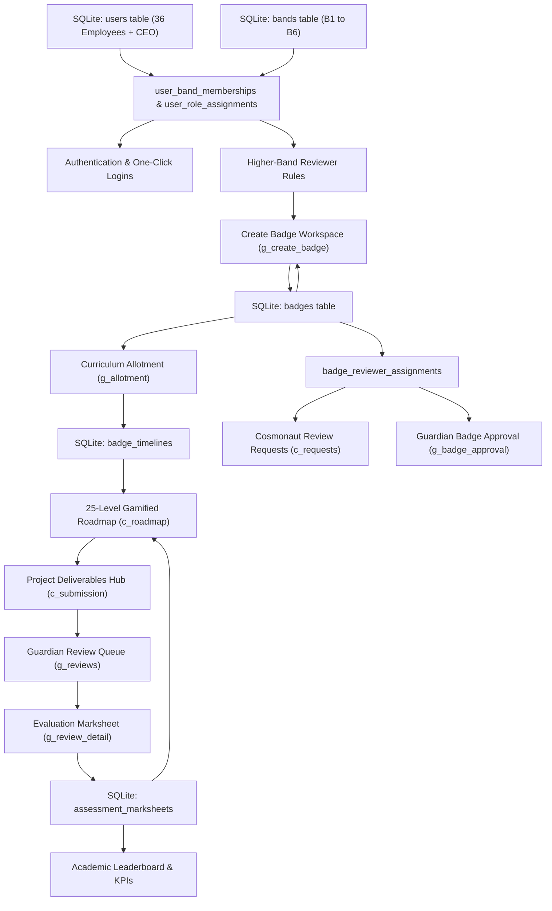
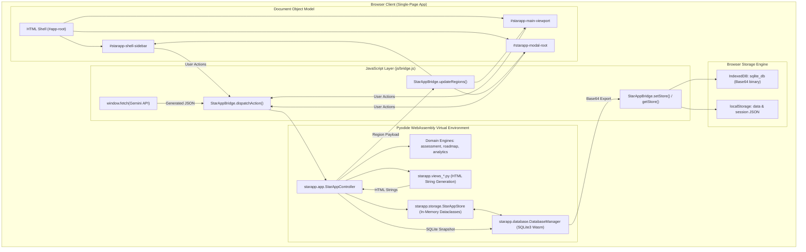
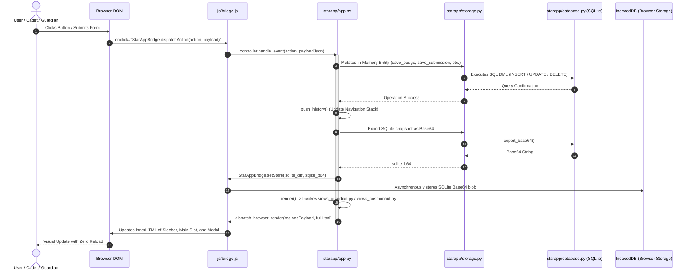
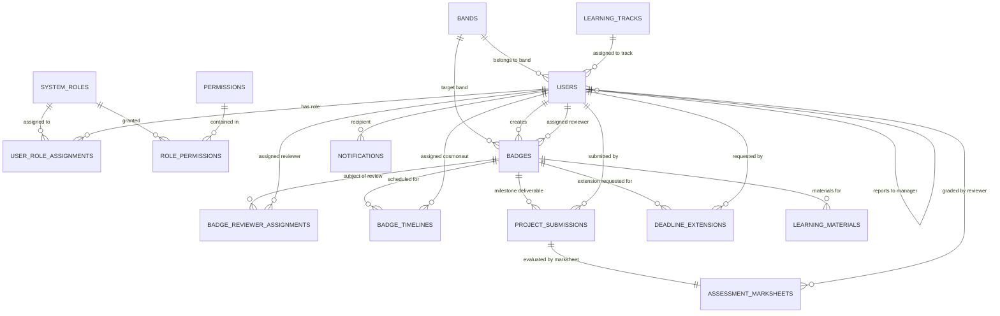
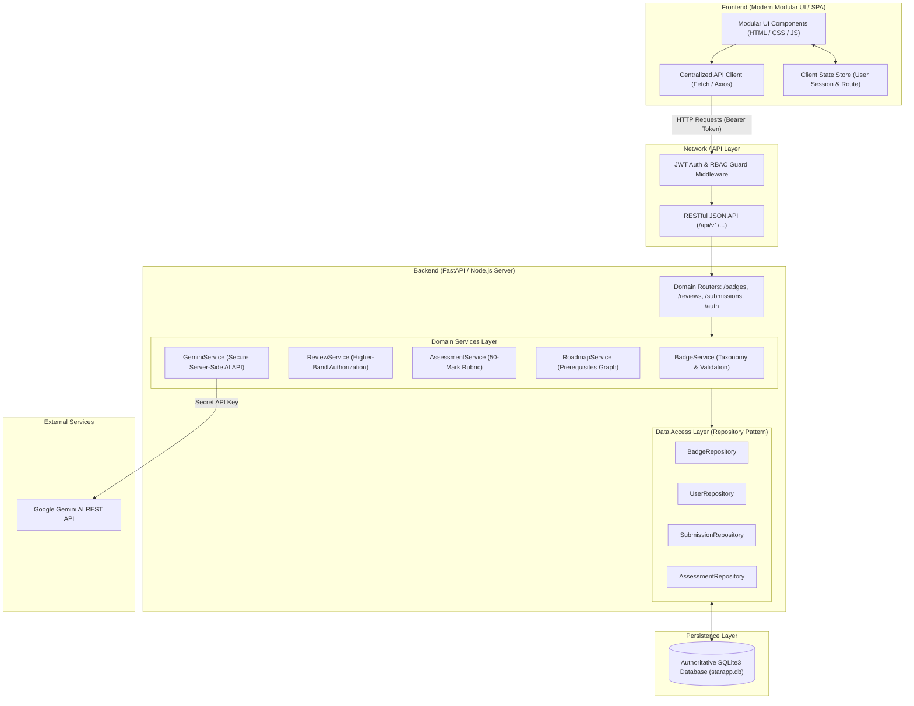

# STARAPP — PHASE 1: COMPLETE PROJECT ANALYSIS, FUNCTIONALITY MAPPING & TECHNICAL ARCHITECTURE AUDIT

> **Document Version:** 1.0.0-AUDIT  
> **Date of Audit:** 2026-11-20  
> **Auditor Role:** Senior Software Architect, Senior Full-Stack Engineer, Backend Architect, Database Architect, and Technical Auditor  
> **Application Scope:** Complete StarApp Repository (`c:\Users\USER\Desktop\starapp_demo`)  
> **Execution Constraint:** Zero code modifications during Phase 1; audit and reverse-engineering only.

---

## TABLE OF CONTENTS

1. [Executive Summary](#1-executive-summary)
2. [Existing Technology Stack](#2-existing-technology-stack)
3. [Complete Directory Structure](#3-complete-directory-structure)
4. [File-Level Responsibility Mapping](#4-file-level-responsibility-mapping)
5. [Complete Application Functionality Inventory](#5-complete-application-functionality-inventory)
6. [Detailed Feature Implementation Analysis](#6-detailed-feature-implementation-analysis)
7. [Existing Workflow Execution Analysis](#7-existing-workflow-execution-analysis)
8. [Feature Dependency Mapping](#8-feature-dependency-mapping)
9. [Current Architecture Implementation](#9-current-architecture-implementation)
10. [Current Architecture Diagram](#10-current-architecture-diagram)
11. [Current Data Flow Diagram](#11-current-data-flow-diagram)
12. [Frontend Architecture Audit](#12-frontend-architecture-audit)
13. [Business Logic Audit](#13-business-logic-audit)
14. [Synthetic Data Inventory](#14-synthetic-data-inventory)
15. [SQLite3 Database Readiness](#15-sqlite3-database-readiness)
16. [Proposed Database Design](#16-proposed-database-design)
17. [Proposed Database ER Diagram](#17-proposed-database-er-diagram)
18. [Backend Architecture Readiness](#18-backend-architecture-readiness)
19. [Proposed API Structure](#19-proposed-api-structure)
20. [Authentication and RBAC Readiness](#20-authentication-and-rbac-readiness)
21. [Performance and Development Time Analysis](#21-performance-and-development-time-analysis)
22. [AI Coding Agent Friendliness Analysis](#22-ai-coding-agent-friendliness-analysis)
23. [Technical Debt and Architectural Problems](#23-technical-debt-and-architectural-problems)
24. [Current vs. Proposed Architecture](#24-current-vs-proposed-architecture)
25. [Proposed Target Architecture Diagram](#25-proposed-target-architecture-diagram)
26. [Proposed Folder Structure](#26-proposed-folder-structure)
27. [Migration Roadmap](#27-migration-roadmap)
28. [Regression and Security Risks](#28-regression-and-security-risks)
29. [Final Recommendations](#29-final-recommendations)

---

## 1. EXECUTIVE SUMMARY

StarApp is an enterprise-grade, gamified curriculum engineering, badge allotment, and autonomous training platform designed for enterprise organizations. The platform models a multi-tier engineering hierarchy (Bands B1 through B6) encompassing **36 corporate employees** reporting through a structured management hierarchy to an executive CEO (`Arjun Mehta`, `guardian_1`).

The application currently operates under an unconventional **"Zero-Backend Client-Execution Architecture"**:
- Rather than running a traditional decoupled client/server model, the entire backend domain logic, data models, validation engine, roadmap graph calculator, assessment scoring algorithms, and relational SQLite persistence layer are implemented in **Python 3.12**.
- In production, these Python modules execute entirely inside the end-user's web browser using **Pyodide WebAssembly (v0.26.2)**.
- Presentation is rendered not through React, Vue, or Angular, but by Python functions in `views_guardian.py` (4,853 lines) and `views_cosmonaut.py` (2,156 lines) that concatenate raw HTML strings containing embedded CSS classes, inline SVG icons, and JavaScript bridge triggers (`onclick="window.StarAppBridge.dispatchAction(...)`").
- Relational persistence is achieved via SQLite WebAssembly compiled inside Pyodide, with binary snapshots exported as base64 and stored in the browser's `IndexedDB` and `localStorage`.

### Key Audit Findings

1. **Extreme Coupling of UI and Logic in Python String Templates**: 7,744 lines of Python code are dedicated exclusively to generating HTML strings (`views_guardian.py`, `views_cosmonaut.py`, `views_common.py`). This "HTML-in-Python" anti-pattern completely disables IDE/linter syntax checking for HTML/CSS/JS, forces complex escaping (`{{` and `}}`), and causes extreme context exhaustion.
2. **The 25–40 Minute Development Bottleneck**:
   - Every small change requires a multi-stage rebuild: updating Python code, running `scripts/pack_py.py` to serialize 26 modules into a 1.17 MB bundle (`js/starapp_bundle.js`), reloading the 8 MB Pyodide WebAssembly VM in the browser, and re-running 79 tests.
   - For AI coding agents, files with 3,500 to 4,800 lines cannot fit comfortably into working context without consuming tens of thousands of tokens per read/edit turn. Agents are forced to search, read, edit, repack, and test in cautious, high-latency iterations.
3. **Tri-State Persistence Redundancy**: State is held simultaneously in three locations: (1) Python in-memory dataclass instances in `StarAppStore`, (2) Relational SQLite tables in `starapp.db` via `DatabaseManager`, and (3) Serialized JSON and Base64 SQLite blobs in browser `localStorage` and `IndexedDB`.
4. **Readiness for Full-Stack Restructuring**: The existing application already possesses a thoroughly defined SQLite schema (32 tables, 1 view), full corporate hierarchy mapping data, complete 50-mark universal rubric assessment logic, and 79 comprehensive tests. Therefore, transition to a true full-stack architecture (Node.js/FastAPI backend + REST API + modular UI) is feasible without loss of a single business rule.

---

## 2. EXISTING TECHNOLOGY STACK

| Layer | Component / Tool | Version / Spec | Purpose in Current Architecture |
|---|---|---|---|
| **Client Host** | Static HTML5 / CSS3 | HTML5, CSS Grid/Flexbox | Single-page shell (`index.html`), Design Tokens (`css/design_tokens.css`), Glassmorphism styling (`css/liquid_glass.css`, `css/components.css`) |
| **Client VM** | Pyodide WebAssembly | v0.26.2 / Python 3.12 | Executes all Python application code directly inside the browser tab without an external web server |
| **Bridge Engine** | Vanilla JavaScript | ES2022 (`js/bridge.js`, 1,606 lines) | Orchestrates DOM event dispatch, Pyodide function calls, focus preservation, 3-region partial DOM updates, and IndexedDB I/O |
| **Virtual Filesystem** | `js/starapp_bundle.js` | 1.17 MB JS Bundle | Encodes 26 Python source files as a JavaScript map (`window.__STARAPP_PYTHON_MODULES__`), mounted into Pyodide virtual FS at `/home/pyodide/starapp/` |
| **Application Core** | Python Monolith | Python 3.12 (`starapp/app.py`, 3,476 lines) | Central controller handling 114 actions, routing, state mutation, session restoration, and HTML view synthesis |
| **Database Engine** | SQLite3 | SQLite 3.45+ | 32 tables and 1 view. Native `sqlite3` in headless tests; WebAssembly `sqlite3` package in browser Pyodide |
| **Client Storage** | IndexedDB & `localStorage` | HTML5 Web Storage | Stores binary export bytes of SQLite database (`sqlite_db`), serialized JSON store (`data`), and user session (`session`) |
| **Generative AI** | Google Gemini API | Gemini 1.5 Flash / Pro REST API | Direct client-side fetch from `js/bridge.js` to generate structured 6-section badge JSON payloads |
| **Service Worker** | Vanilla JS (`sw.js`) | Cache API v9 | Service worker caching Pyodide runtime and local static assets for offline execution |
| **Testing Engine** | Python `unittest` | Native Python Standard Library | 11 test suites covering 79 automated tests across models, workflows, RBAC, and persistence |
| **Build Tooling** | `scripts/pack_py.py` | Python Script | Bundles all modules in `starapp/` into `js/starapp_bundle.js` |

---

## 3. COMPLETE DIRECTORY STRUCTURE

The following tree represents the exact filesystem hierarchy of the project:

```
c:\Users\USER\Desktop\starapp_demo
│   .env                                      # Environment variables (API keys)
│   .gitignore                                # Git ignore configurations
│   BASELINE_DATA_SNAPSHOT.json               # Seed snapshot for offline restoration (679 lines)
│   code.txt                                  # Reference scratchpad & historical code snippets
│   index.html                                # Single-page web application entrypoint (210 lines)
│   overall.txt                               # Functional requirements and project notes (717 lines)
│   push_to_github.py                         # Deployment helper script
│   README.md                                 # Architecture, schema, and operational documentation (721 lines)
│   serve.py                                  # Local Python HTTP server (python serve.py)
│   STARAPP_COMPLETE_TECHNICAL_AUDIT.md       # Preliminary architecture audit document (761 lines)
│   STARAPP_OPTIMIZATION_IMPLEMENTATION_REPORT.md # Historical UI optimization record
│   STARAPP_UI_FLICKERING_REMEDIATION_REPORT.md   # Historical rendering fix record
│   STARAPP_UI_FLICKERING_ROOT_CAUSE_INVESTIGATION.md # Deep-dive into DOM re-render flickering
│   starapp.db                                # Binary SQLite3 database file (417,792 bytes)
│   Star Registry Schema.html                 # Interactive visual schema viewer (3,995 lines)
│   sw.js                                     # Progressive Web App Service Worker (v9 cache)
│
├───css
│       components.css                        # UI component rules: buttons, pills, tables, forms (1,404 lines)
│       design_tokens.css                     # CSS variables: colors, fonts, shadows, transitions (127 lines)
│       layout.css                            # Layout structure: sidebar, topbar, grid, main slot (675 lines)
│       liquid_glass.css                      # Frost-glassmorphic styling, backdrops, borders (1,072 lines)
│       responsive.css                        # Responsive media queries (mobile, tablet, desktop) (331 lines)
│
├───data
│       Chemistry Syllabus.pdf                # Reference PDF attachment for deliverables preview (214 KB)
│       chemistry_syllabus.pdf                # Lowercase duplicate reference attachment (214 KB)
│
├───ER diagram
│   │   data_and_prompt.txt                   # Schema generation prompt and notes (1,664 lines)
│   │   index.html                            # Interactive ER Mindmap Diagram web application (187 lines)
│   │   README.md                             # Documentation for ER Mindmap tool
│   │   star_app_er_diagram.pdf               # Exported PDF diagram (439 lines)
│   ├───css
│   │       mindmap.css                       # Mindmap styling and animations (1,290 lines)
│   └───js
│           app.js                            # ER mindmap controller (423 lines)
│           interactions.js                   # Zoom, pan, drag-and-drop interactions (411 lines)
│           layout-engine.js                  # Node layout positioning engine (241 lines)
│           mindmap-renderer.js               # Canvas and SVG mindmap renderer (909 lines)
│           relationships.js                  # Entity relationship line connection logic (186 lines)
│           schema-data.js                    # Complete database schema definition in JS (3,335 lines)
│           search.js                         # Schema table and column search utility (118 lines)
│
├───js
│       bridge.js                             # Critical JS-Pyodide bridge & DOM event dispatcher (1,606 lines)
│       starapp_bundle.js                     # Packed Python modules for Pyodide virtual FS (1.17 MB)
│
├───scripts
│       pack_py.py                            # Bundler converting starapp/*.py into js/starapp_bundle.js
│
├───starapp
│       analytics.py                          # Cohort analytics, KPI popovers, individual dossier (596 lines)
│       app.py                                # Master Application Controller, Router, Event Dispatcher (3,476 lines)
│       assessment.py                         # 50-mark rubric validation, leaderboard, averages (232 lines)
│       badge_generator.py                    # Taxonomy maps, Gemini API prompt builder (359 lines)
│       dashboard_demo.py                     # Profile resolver helper (28 lines)
│       database.py                           # SQLite3 DDL schema, migrations, queries (2,403 lines)
│       mapping_data.py                       # 36 Indian corporate employees, hierarchy, calendar (675 lines)
│       models.py                             # 11 Domain data models with serialization (737 lines)
│       roadmap.py                            # 25-level Candy Crush roadmap graph generator (206 lines)
│       seed_data.py                          # Factory seed data generator (1,224 lines)
│       storage.py                            # Dual-Store (In-memory store + SQLite proxy) (1,015 lines)
│       validation.py                         # Input validation for badges, dates, submissions (84 lines)
│       views_common.py                       # Shared UI widgets, topbar, timeline, marksheet (735 lines)
│       views_cosmonaut.py                    # Cosmonaut portal views: roadmap, submission, results (2,156 lines)
│       views_guardian.py                     # Guardian portal views: create badge, review, mapping (4,853 lines)
│       __init__.py                           # Package initialization (4 lines)
│
└───tests
        run_tests.py                          # Automated test discovery runner (18 lines)
        test_all.py                           # Core models, roadmap prerequisites, leaderboard (307 lines)
        test_badge_creation_and_approval.py   # Badge generation, accordion cards, approvals (446 lines)
        test_badge_review_workflow.py         # Higher-band reviewer assignment, edits, approvals (220 lines)
        test_dashboard_enhancements.py        # Personalized KPIs, risk matrix, dossier scope (190 lines)
        test_extension_flow.py                # Deadline extension lifecycle and updates (105 lines)
        test_mapping_flow.py                  # 3-day calendar engine, batch reviewer mapping (434 lines)
        test_materials_flow.py                # Document upload, YouTube parsing, filtering (138 lines)
        test_review_flow.py                   # Multi-deliverable submissions, rubric evaluation (103 lines)
        test_scenarios_a_to_h.py              # End-to-end integration scenarios A through H (280 lines)
        test_sqlite_persistence.py            # SQLite table integrity, exports, constraints (203 lines)
        test_ui_remediation.py                # DOM 3-region isolation, generation guards, CSS checks (255 lines)
```

---

## 4. FILE-LEVEL RESPONSIBILITY MAPPING

| File Path | Architecture Category | Primary Responsibility | Key Functions / Classes | Consumers | Structural Concerns & Technical Debt |
|---|---|---|---|---|---|
| `index.html` | Entry Point | Boots DOM shell, downloads Pyodide CDN, mounts Python bundle, runs bootloader | `initializeStarApp()`, `ensureFsDir()` | Browser | Inlines 150 lines of async bootloader logic; hardcodes Gemini API key in Base64 |
| `js/bridge.js` | Presentation / Bridge | Bridges browser DOM to Pyodide; dispatches actions; partial DOM replacement; IndexedDB I/O | `StarAppBridge`, `dispatchAction()`, `updateRegions()`, `onGeminiGenerateBadge()` | `index.html`, all UI buttons | **1,606 lines**; mixes DOM rendering, API fetch calls, storage serialization, and focus management |
| `scripts/pack_py.py` | Build Script | Reads all `.py` files in `starapp/` and encodes them into `window.__STARAPP_PYTHON_MODULES__` | File traversal and string escaping | Developer / CI | Manual build step required after every Python change; silent failure if omitted |
| `starapp/app.py` | Controller / Router | Central application orchestrator; handles 114 actions; routes; manages navigation history | `StarAppController`, `handle_event()`, `render()`, `sync_storage()`, `_push_history()` | `js/bridge.js`, Pyodide | **3,476 lines**; massive God object; tight coupling of routing, state, validation, and rendering |
| `starapp/database.py` | Data Access / DDL | SQLite3 schema initialization, 32 DDL tables, CRUD queries, Base64 import/export | `DatabaseManager`, `create_tables()`, `migrate_from_dict()`, `export_to_dict()` | `storage.py`, tests | **2,403 lines**; mix of DDL, data migration, and domain query logic; duplicate DML code |
| `starapp/storage.py` | State / Repository | In-memory `StarAppStore` holding dataclasses; synchronizes dual-state with `DatabaseManager` | `StarAppStore`, `load_from_json()`, `export_sqlite_base64()`, `save_badge()` | `app.py`, views, tests | **1,015 lines**; maintains duplicate in-memory data structures alongside SQLite |
| `starapp/models.py` | Domain Models | Defines 11 entity models with serialization methods (`to_dict()`, `from_dict()`) | `User`, `Badge`, `BadgeTimeline`, `ProjectSubmission`, `AssessmentMarksheet`, etc. | All `starapp/` modules | Plain Python classes instead of Pydantic or `@dataclass`; manual dictionary parsing |
| `starapp/mapping_data.py` | Data / Hierarchy | Defines the 36 Indian corporate hierarchy members, reporting lines, 3-day calendar engine | `DUMMY_MEMBERS`, `get_higher_bands()`, `get_consecutive_review_days()`, `generate_calendar_month_grid()` | `storage.py`, `views_guardian.py` | Hardcodes 36 employee profiles as static Python dictionaries |
| `starapp/views_guardian.py` | View (HTML) | Generates HTML strings for all Guardian screens: Create Badge, Review Queue, Allotment | `render_guardian_create_badge()`, `render_guardian_dashboard()`, `render_guardian_mapping()` | `app.py` | **4,853 lines**; enormous HTML string concatenation in Python; unmaintainable for AI agents |
| `starapp/views_cosmonaut.py` | View (HTML) | Generates HTML strings for Cosmonaut screens: Roadmap, Submissions, Marksheets, Requests | `render_cosmonaut_dashboard()`, `render_gamified_roadmap()`, `render_cosmonaut_submission_workspace()` | `app.py` | **2,156 lines**; HTML string concatenation; inline JS actions; complex SVG generation |
| `starapp/views_common.py` | View (HTML) | Shared UI widgets: topbar, back button, liquid cards, metal buttons, 50-mark marksheet | `render_topbar()`, `render_back_button()`, `render_standard_marksheet()`, `render_status_pill()` | `views_guardian.py`, `views_cosmonaut.py` | Inlines SVG icons and style strings; escapes HTML manually |
| `starapp/analytics.py` | Business Logic | Cohort-wide metrics, KPI popovers, pedagogical diagnostics, risk assessment | `calculate_guardian_cohort_analytics()`, `build_cosmonaut_analytics_record()` | `app.py`, views | Relies on complex dictionary structures; memoization cache is fragile |
| `starapp/assessment.py` | Business Logic | 50-mark universal rubric scoring, honors calculation, batch leaderboard ranking | `validate_rubric_scores()`, `calculate_assessment_totals()`, `calculate_batch_leaderboard()` | `app.py`, `views_common.py` | Well-isolated logic, but lacks formal schema types |
| `starapp/badge_generator.py`| Business Logic / AI | Power/Capability/Skill taxonomies, Gemini prompt templates, sample badge structures | `POWERS_LIST`, `CAPABILITIES_LIST`, `generate_badge_data()` | `app.py`, `views_guardian.py` | Large hardcoded taxonomy dictionaries; Gemini prompts hardcoded in Python strings |
| `starapp/roadmap.py` | Business Logic | Computes 25-level sequential milestone prerequisites and visual roadmaps | `compute_milestone_state()`, `generate_roadmap_graph()` | `app.py`, `views_cosmonaut.py` | Hardcodes 25 milestone levels; tight coupling with timeline models |
| `starapp/validation.py` | Validation | Validates input formats for badges, dates, submissions, and extensions | `validate_badge_input()`, `validate_timeline_dates()`, `validate_submission_input()` | `app.py` | Returns primitive `(bool, str)` tuples instead of structured validation error objects |
| `starapp/seed_data.py` | Seed Factory | Generates initial demo state (Arjun Mehta, Aarav Sharma, 5 active badges, submissions) | `get_initial_seed_data()` | `storage.py`, tests | **1,224 lines**; massive static seed data dictionary; tightly coupled to initial tests |
| `sw.js` | PWA Service Worker | Caches static assets (`js`, `css`, Pyodide CDN) for instant loading | `install`, `activate`, `fetch` | Browser | Hardcoded cache versions (`starapp-v9`); potential cache staleness during active dev |

---

## 5. COMPLETE APPLICATION FUNCTIONALITY INVENTORY

The following inventory maps every feature implemented in the application source code:

| Module | Feature | User Action | Current Implementation | Data Source | Related Files | Implementation Status |
|---|---|---|---|---|---|---|
| **Auth** | One-Click Demo Access | Clicks demo profile card | Dispatches `select_demo_account` with user ID; sets `self.current_user` | `users` table / `store.users` | `app.py`, `views_guardian.py` | **Complete** |
| **Auth** | Username Login | Submits username string | Dispatches `login`; checks `store.get_user_by_username()` | `users` table | `app.py` | **Complete** |
| **Auth** | Sign Out | Clicks Sign Out | Dispatches `logout`; resets `current_user` to `None`, view to `"login"` | In-memory controller | `app.py`, `views_common.py` | **Complete** |
| **Auth** | Demo Reset | Clicks Demo Reset | Dispatches `reset_demo_data`; triggers `store.reset_to_seed()` | `seed_data.py`, SQLite | `app.py`, `storage.py` | **Complete** |
| **Navigation** | Universal Back Button | Clicks `← Back` in topbar/workspace | Dispatches `go_back`; pops `self.view_history` LIFO stack | Controller `view_history` | `app.py`, `views_common.py`, `bridge.js` | **Complete** |
| **Navigation** | Sidebar Switching | Clicks sidebar menu link | Dispatches `nav_guardian` or `nav_cosmonaut` with target view | Controller `current_view` | `app.py`, `views_guardian.py`, `views_cosmonaut.py` | **Complete** |
| **Create Badge** | Band Selection (B1–B6) | Clicks 1 of 6 Band Cards | Dispatches `select_create_badge_band`; hides sidebar on cards, displays inside band | `bands`, `users`, `badges` | `views_guardian.py`, `app.py` | **Complete** |
| **Create Badge** | Cascading Taxonomies | Selects Power, Capability, Skill | Dispatches `update_badge_power`, `update_badge_capability`, `update_badge_skill` | Taxonomy maps in `badge_generator.py` | `badge_generator.py`, `views_guardian.py` | **Complete** |
| **Create Badge** | Add Custom Capability/Skill | Enters custom name in modal | Dispatches `add_custom_capability` / `add_custom_skill`; persists to SQLite | `custom_capabilities`, `custom_skills` | `database.py`, `storage.py`, `bridge.js` | **Complete** |
| **Create Badge** | Gemini AI Badge Generation | Clicks "Create Badge" | Calls Gemini API from `bridge.js`; dispatches `on_badge_generated` with JSON | Gemini REST API | `bridge.js`, `badge_generator.py`, `app.py` | **Complete** |
| **Create Badge** | Accordion Curriculum Editor | Toggles and edits 6 sections | Dispatches `toggle_edit_badge`, `save_badge_edits`, `toggle_topic_completion` | Controller `created_badge_data` | `views_guardian.py`, `app.py` | **Complete** |
| **Create Badge** | Save Badge to Catalog | Clicks "Save Badge" | Dispatches `save_generated_badge`; inserts into `badges` with `ready_for_review` | `badges` table in SQLite | `app.py`, `storage.py`, `database.py` | **Complete** |
| **Create Badge** | Higher-Band Reviewer Dispatch | Selects reviewer & clicks "Send" | Dispatches `send_badge_review_request`; enforces higher-band rules; status -> `pending_review` | `badge_reviewer_assignments` | `database.py`, `storage.py`, `app.py` | **Complete** |
| **Badge Approval** | Reviewer Approval Queue | Clicks "Reviewer Badge Approval" | Renders `g_badge_approval`; filters by status (`all`, `pending`, `approved`) | `badges`, `users` | `views_guardian.py`, `app.py` | **Complete** |
| **Badge Approval** | Inspect Badge Modal | Clicks "Inspect" | Dispatches `open_badge_for_review`; displays modal with 6 sections | `badges` table | `views_guardian.py`, `app.py` | **Complete** |
| **Badge Approval** | Edit Badge as Reviewer | Edits fields in modal | Dispatches `edit_submitted_badge` & `save_reviewed_badge`; updates SQLite | `badges` table | `database.py`, `storage.py`, `app.py` | **Complete** |
| **Badge Approval** | Authorize & Approve Badge | Clicks "Accept & Approve" | Dispatches `confirm_approve_badge` & `approve_submitted_badge`; status -> `approved` | `badges`, `notifications` | `database.py`, `storage.py`, `app.py` | **Complete** |
| **Badge Approval** | Return with Feedback | Clicks "Return for Changes" | Dispatches `confirm_return_badge` & `return_submitted_badge`; status -> `returned` | `badges`, `badge_review_events` | `database.py`, `storage.py`, `app.py` | **Complete** |
| **Cosmonaut Portal** | Review Requests Queue | Reviewer navigates to `c_requests` | Renders `render_cosmonaut_review_requests`; lists assigned peer reviews | `badge_reviewer_assignments` | `views_cosmonaut.py`, `app.py` | **Complete** |
| **Cosmonaut Portal** | Review Request Banner | Reviewer logs in to `c_dashboard` | Displays prominent amber alert card linking directly to `c_requests` | `badge_reviewer_assignments` | `views_cosmonaut.py` | **Complete** |
| **Mapping** | Band Role Selection | Toggles band and track checkboxes | Dispatches `select_mapping_band`, `toggle_mapping_role` | `users`, `user_band_memberships` | `views_guardian.py`, `app.py` | **Complete** |
| **Mapping** | Reviewer Selection | Selects reviewer band & person | Dispatches `toggle_mapping_reviewer`; restricts to higher bands | `users`, `user_role_assignments` | `views_guardian.py`, `mapping_data.py` | **Complete** |
| **Mapping** | 3-Business-Day Calendar Engine | Selects anchor date & direction | Dispatches `select_mapping_review_anchor`, `set_mapping_review_direction`; skips weekends | Date algorithm in `mapping_data.py` | `mapping_data.py`, `views_guardian.py` | **Complete** |
| **Mapping** | Save & Send Mapping Requests | Clicks "Save Mapping" / "Send" | Dispatches `save_band_mapping`, `send_mapping_requests`; stores in SQLite | `band_mappings`, `mapping_requests` | `database.py`, `storage.py`, `app.py` | **Complete** |
| **Curriculum Allotment** | Milestone Roadmap Publishing | Toggles "Publish / Unpublish" | Dispatches `publish_badge` / `unpublish_badge`; unlocks on Cosmonaut roadmap | `badges`, `badge_timelines` | `views_guardian.py`, `app.py`, `storage.py` | **Complete** |
| **Curriculum Allotment** | Sequential Milestone Unlock | Clicks "Publish & Unlock" | Dispatches `publish_and_unlock_badge`; activates timeline for all cadets | `badge_timelines` | `app.py`, `storage.py` | **Complete** |
| **Curriculum Allotment** | Milestone Revocation | Clicks "Revoke Badge" | Dispatches `revoke_badge`; locks milestone across all roadmaps | `badges`, `badge_timelines` | `app.py`, `storage.py` | **Complete** |
| **Evaluation Queue** | Deliverables Review Queue | Navigates to `g_reviews` | Renders `render_guardian_review_queue`; groups submissions by pending/approved | `project_submissions`, `badges` | `views_guardian.py`, `app.py` | **Complete** |
| **Evaluation Detail** | Interactive Document Viewer | Clicks submission card | Renders `g_review_detail`; tabs for PDF preview, SQL/Python code, GitHub link | `project_submissions` | `views_guardian.py`, `views_common.py` | **Complete** |
| **Evaluation Detail** | 50-Mark Rubric Evaluation | Adjusts 5 sliders (0–10 marks) | Dispatches `recalc_rubric_total`; dynamically calculates score and percentage | Rubric engine in `assessment.py` | `assessment.py`, `views_guardian.py` | **Complete** |
| **Evaluation Detail** | Marksheet Publication | Clicks "Submit Official Marksheet" | Dispatches `submit_evaluation_marksheet`; saves `assessment_marksheets` | `assessment_marksheets` | `database.py`, `storage.py`, `app.py` | **Complete** |
| **Evaluation Detail** | Request Resubmission | Selects "Request Resubmission" | Sets decision to `resubmission_requested`; notifies cosmonaut | `assessment_marksheets`, `notifications` | `database.py`, `app.py` | **Complete** |
| **Cosmonaut Roadmap** | 25-Milestone Candy Crush Map | Navigates to `c_roadmap` | Renders SVG cubic-bezier path with active, completed, and locked nodes | `badges`, `badge_timelines`, `assessments` | `roadmap.py`, `views_cosmonaut.py` | **Complete** |
| **Cosmonaut Roadmap** | Milestone Detail Modal | Clicks unlocked roadmap node | Dispatches `open_badge_detail_modal`; shows 9-point timeline & objectives | `badges`, `badge_timelines` | `views_cosmonaut.py`, `views_common.py` | **Complete** |
| **Cosmonaut Submission** | Project Package Upload | Selects PDF/Code and enters GitHub | Dispatches `submit_project_deliverable`; validates files; creates submission | `project_submissions` | `validation.py`, `storage.py`, `app.py` | **Complete** |
| **Cosmonaut Marksheet** | View Official Marksheet | Navigates to `c_results` | Renders `render_cosmonaut_results`; shows 50-mark breakdown & honors badge | `assessment_marksheets` | `views_cosmonaut.py`, `views_common.py` | **Complete** |
| **Materials Center** | Browse Curriculum Materials | Filters by badge or type | Dispatches `filter_materials_badge`, `filter_materials_type` | `learning_materials` | `views_guardian.py`, `views_cosmonaut.py` | **Complete** |
| **Materials Center** | Upload / Edit / Delete Material | Submits material modal form | Dispatches `save_bulk_materials`, `update_material`, `delete_material` | `learning_materials` table | `database.py`, `storage.py`, `app.py` | **Complete** |
| **Materials Center** | YouTube & PDF In-App Preview | Clicks "Preview" | Dispatches `view_material_preview`; renders responsive iframe or PDF viewer | `learning_materials` | `views_common.py`, `app.py` | **Complete** |
| **Extensions** | Request Deadline Extension | Cadets submits proposed date | Dispatches `submit_deadline_extension_request`; validates date format | `deadline_extensions` | `validation.py`, `storage.py`, `app.py` | **Complete** |
| **Extensions** | Approve / Reject Extension | Guardian decides in modal | Dispatches `submit_extension_decision`; updates `badge_timelines.submission_deadline` | `deadline_extensions`, `badge_timelines` | `database.py`, `storage.py`, `app.py` | **Complete** |
| **Announcements** | Broadcast Notification | Guardian broadcasts bulletin | Dispatches `broadcast_announcement`; creates `announcements` & `notifications` | `announcements`, `notifications` | `database.py`, `storage.py`, `app.py` | **Complete** |
| **Announcements** | Mark Announcement Read | Cadets clicks announcement | Dispatches `mark_announcement_as_read`; updates read receipt | `announcement_read_receipts` | `database.py`, `storage.py`, `app.py` | **Complete** |
| **Cosmonaut Profile** | Skills & Credential Management | Adds or removes skills/certs | Dispatches `add_skill`, `remove_skill`, `add_certification`, `remove_certification` | `cosmonaut_profiles` | `database.py`, `storage.py`, `app.py` | **Complete** |
| **Guardian Dashboard** | Cohort Analytics & Velocity | Views KPI cards & velocity chart | Dynamically aggregates metrics across all 36 employees | `users`, `assessments`, `timelines` | `analytics.py`, `views_guardian.py` | **Complete** |
| **Guardian Dashboard** | Interactive Telemetry Popovers | Clicks (?) icon on metric cards | Renders `render_metric_info_popover`; shows numerator/denominator formula | Calculated analytics | `analytics.py`, `views_guardian.py` | **Complete** |
| **Guardian Dashboard** | Cadet Risk Monitoring Matrix | Views risk table; filters status | Dispatches `filter_guardian_risk`; categorizes cadets (On Track, Attention, At Risk) | Analytics risk evaluator | `analytics.py`, `views_guardian.py` | **Complete** |
| **Guardian Dashboard** | Individual Cadet Dossier | Selects cadet from Scope Selector | Dispatches `select_guardian_cosmo_filter`; renders complete profile & marks | Calculated dossier | `views_guardian.py`, `analytics.py` | **Complete** |

---

## 6. DETAILED FEATURE IMPLEMENTATION ANALYSIS

### 6.1 The Band-Specific Badge Creation & LLM Pipeline
1. **Selection & Routing**: The user clicks one of the 6 Band Cards in `g_create_badge`. The action `select_create_badge_band` sets `self.create_badge_band = band` (e.g. `"B1"`).
2. **Contextual Configuration**: Inside the band workspace, 3 cascading liquid-glass dropdowns display:
   - **Power**: Tech, Leadership, Craft.
   - **Capability**: Data & Machine, Cloud & Infrastructure, Enterprise Systems, Frontier AI, plus any custom capabilities queried from `custom_capabilities`.
   - **Skill**: Dynamically filtered by the active capability, plus custom skills from `custom_skills`.
3. **LLM Generation Execution**:
   - The user clicks **"Create Badge with Gemini"**.
   - `bridge.js` intercepts the click and executes an asynchronous `fetch` call directly to Google Gemini API (`https://generativelanguage.googleapis.com/v1beta/models/gemini-1.5-flash:generateContent?key=...`).
   - The JSON response is parsed into a standardized 6-section schema:
     1. Learning Outcomes.
     2. Earn the Badge criteria.
     3. Practice Project requirements & LLM evaluation prompt.
     4. Learning Topics with interactive completion checkmarks.
     5. Learning Resources (documentation, video lectures).
     6. Related Skills & Prerequisites.
   - `bridge.js` calls `window.StarAppBridge.dispatchAction("on_badge_generated", jsonPayload)`.
4. **State Storage & Reviewer Selection**:
   - The generated badge is stored in controller memory `self.created_badge_data`.
   - The UI reveals the 6-section interactive accordion editor.
   - An eligible higher-band reviewer dropdown is rendered via `store.get_eligible_badge_reviewers(selected_band)`.

### 6.2 Higher-Band Peer Review & Authorization Workflow
1. **Dispatch**: Guardian selects an eligible higher-band reviewer (e.g., Nisha Menon, Band B2, for a Band B1 badge) and clicks **"Send Request"**.
2. **Database Mutation**:
   - `badges.workflow_status` transitions from `'ready_for_review'` to `'pending_review'`.
   - An entry is inserted into `badge_reviewer_assignments` with a 3-business-day deadline.
   - A notification is inserted into `notifications` for the reviewer.
   - An audit trail entry is inserted into `badge_review_events`.
3. **Reviewer Portal Discovery**:
   - When Nisha Menon logs in, her sidebar indicates `c_requests` with an active counter.
   - Her dashboard renders an amber alert banner: *"You have 1 pending badge review request awaiting your technical review."*
4. **Reviewer Operations**:
   - **Inspect Badge**: Opens modal with the full 6-section curriculum.
   - **Edit Badge**: Reviewer can refine prompts, learning outcomes, and requirements. Edits are saved directly to `badges` via `update_badge_by_reviewer()`.
   - **Accept & Approve**: Updates `badges.workflow_status = 'approved'`, logs event, and alerts Guardian.
   - **Return with Feedback**: Enters mandatory revision notes; updates `badges.workflow_status = 'returned'`, sending notes back to Guardian.

---

## 7. EXISTING WORKFLOW EXECUTION ANALYSIS

### 7.1 Complete Trace: Project Submission to Marksheet Publication

```
[Cadet in Browser] 
    │ Clicks "Submit Project Deliverable"
    ▼
[DOM Event Listener] 
    │ bridge.js: dispatchAction('submit_project_deliverable', payloadJson)
    ▼
[Pyodide Bridge] 
    │ Invokes window.starAppController.handle_event('submit_project_deliverable', ...)
    ▼
[StarAppController.handle_event] 
    │ Extracts payload; calls self.execute_submit_project(payload)
    ▼
[Validation Engine] 
    │ validation.py: validate_submission_input(payload)
    │ Validates attempt number, non-empty files, valid URL schemes
    ▼
[Domain Store & SQLite] 
    │ models.py: ProjectSubmission(...) instance created
    │ storage.py: store.save_submission(sub)
    │ database.py: INSERT INTO project_submissions (...)
    │ database.py: INSERT INTO activity_events (...)
    │ database.py: INSERT INTO notifications (recipient_id='guardian_1', ...)
    ▼
[Storage Synchronization] 
    │ app.py: self.sync_storage()
    │ storage.py: store.export_sqlite_base64()
    │ bridge.js: StarAppBridge.setStore('sqlite_db', b64Data) -> IndexedDB
    ▼
[Re-render Pipeline] 
    │ app.py: self.render() -> views_cosmonaut.py: render_cosmonaut_submission_workspace()
    │ bridge.js: StarAppBridge.updateRegions(regionsPayload)
    │ DOM updated in browser
```

```
[Guardian in Browser] 
    │ Opens g_review_detail; evaluates 5 rubric sliders; clicks "Submit Official Marksheet"
    ▼
[DOM Event Listener] 
    │ bridge.js: dispatchAction('submit_evaluation_marksheet', payloadJson)
    ▼
[StarAppController.handle_event] 
    │ Calls self.execute_submit_evaluation(payload)
    ▼
[Assessment Engine] 
    │ assessment.py: validate_rubric_scores(business, arch, tech, pres, qa)
    │ assessment.py: calculate_assessment_totals(scores) -> total (48.0), percentage (96.0%)
    ▼
[Domain Store & SQLite] 
    │ models.py: AssessmentMarksheet(...) instance created
    │ storage.py: store.save_assessment(asm)
    │ database.py: INSERT INTO assessment_marksheets (...)
    │ database.py: UPDATE project_submissions SET status = 'approved'
    │ database.py: UPDATE badge_timelines SET actual_award_date = '...', status = 'completed'
    │ database.py: INSERT INTO notifications (recipient_id=cosmo_id, ...)
    ▼
[Automated Roadmap Progression] 
    │ If milestone passed, prerequisite checks evaluate next badge
    │ roadmap.py: compute_milestone_state(...) unlocks subsequent milestone
    ▼
[Storage Synchronization & DOM Refresh] 
    │ Full SQLite binary export to IndexedDB
    │ Guardian redirected to g_reviews; Cosmonaut results page updated live
```

---

## 8. FEATURE DEPENDENCY MAPPING



---

## 9. CURRENT ARCHITECTURE IMPLEMENTATION

The current StarApp architecture is an in-browser client-side monolith:

```
┌─────────────────────────────────────────────────────────────────────────────┐
│                             BROWSER WINDOW (CLIENT)                         │
│                                                                             │
│  ┌───────────────────────────────────────────────────────────────────────┐  │
│  │                        HTML5 DOM / LIQUID GLASS UI                    │  │
│  │   #starapp-shell-sidebar  │  #starapp-main-viewport  │  #modal-root   │  │
│  └───────────────────────────────────▲───────────────────────────────────┘  │
│                                      │ innerHTML updates                    │
│  ┌───────────────────────────────────┴───────────────────────────────────┐  │
│  │                     JAVASCRIPT BRIDGE (js/bridge.js)                  │  │
│  │   - dispatchAction()               - IndexedDB / localStorage I/O     │  │
│  │   - updateRegions() partial diff   - Direct Gemini API Fetch Client   │  │
│  └───────────────────────────────────▲───────────────────────────────────┘  │
│                                      │ Pyodide C-API Bridge                 │
│  ┌───────────────────────────────────┴───────────────────────────────────┐  │
│  │                   PYODIDE WEBASSEMBLY RUNTIME (Python 3.12)           │  │
│  │                                                                       │  │
│  │   ┌────────────────────────────────────────────────────────────────┐  │  │
│  │   │                   starapp/app.py (Controller)                  │  │  │
│  │   │   - 114 Action Handlers         - Navigation History Stack     │  │  │
│  │   │   - Router (23 View States)     - Session Restore Engine       │  │  │
│  │   └──────┬──────────────────────┬────────────────────────┬─────────┘  │  │
│  │          │                      │                        │            │  │
│  │   ┌──────▼──────────────┐ ┌─────▼───────────────┐ ┌──────▼─────────┐  │  │
│  │   │ starapp/views_*.py  │ │ Business Algorithms │ │ starapp/       │  │  │
│  │   │ - views_guardian.py │ │ - assessment.py     │ │ storage.py     │  │  │
│  │   │ - views_cosmo.py    │ │ - roadmap.py        │ │ (Dual-Store    │  │  │
│  │   │ - views_common.py   │ │ - analytics.py      │ │  Repository)   │  │  │
│  │   │ (HTML String Gen)   │ │ - validation.py     │ └──────┬─────────┘  │  │
│  │   └─────────────────────┘ └─────────────────────┘        │            │  │
│  │                                                   ┌──────▼─────────┐  │  │
│  │                                                   │ starapp/       │  │  │
│  │                                                   │ database.py    │  │  │
│  │                                                   │ (SQLite3 Wasm) │  │  │
│  │                                                   └──────┬─────────┘  │  │
│  └──────────────────────────────────────────────────────────┼────────────┘  │
│                                                             │ Base64 export │
│  ┌──────────────────────────────────────────────────────────▼────────────┐  │
│  │             BROWSER STORAGE PERSISTENCE (IndexedDB & Storage)         │  │
│  │   - sqlite_db (Base64)   - data (JSON)   - session (JSON)             │  │
│  └───────────────────────────────────────────────────────────────────────┘  │
└─────────────────────────────────────────────────────────────────────────────┘
```

---

## 10. CURRENT ARCHITECTURE DIAGRAM



---

## 11. CURRENT DATA FLOW DIAGRAM



---

## 12. FRONTEND ARCHITECTURE AUDIT

### 12.1 Excessive Component Responsibilities & Code Smells
1. **HTML String Rendering in Python**:
   - `views_guardian.py` (4,853 lines) contains 16 complex view renderers in a single file.
   - HTML strings are constructed via multi-line Python f-strings. A developer modifying CSS or HTML structure has no autocomplete, syntax highlighting, or linting.
   - Python braces must be escaped as `{{` and `}}` for inline CSS/JS.
2. **Missing Frontend Component Encapsulation**:
   - There are no modular component files (e.g. `Button.jsx`, `Modal.vue`, `BadgeCard.svelte`).
   - Reusable components (e.g., status pills, back buttons, liquid cards) are Python functions returning raw string fragments in `views_common.py`.
3. **Fragile Event Binding**:
   - All events are bound via inline HTML attributes: `onclick="window.StarAppBridge.dispatchAction('action_name', '{...}')"`.
   - Complex JSON payloads must be string-escaped inside single quotes, resulting in frequent quotation errors when strings contain quotes, newlines, or special characters.
4. **CSS Architecture & Styling Invariants**:
   - CSS is organized into 5 separate stylesheets (`layout.css`, `components.css`, `liquid_glass.css`, `design_tokens.css`, `responsive.css`).
   - The design tokens enforce a clean blue-frosted glassmorphic palette (`--frost-navy`, `--deep-frozen-midnight`, `--icy-steel`, `--snow-white`).
   - While visually polished, styling rules are coupled to DOM class names generated across 7,700 lines of Python strings, making style refactoring hazardous.

---

## 13. BUSINESS LOGIC AUDIT

| Business Operation | Current Location | Existing Implementation | Proposed Target Responsibility |
|---|---|---|---|
| **Rubric Validation & Honors Calculation** | `starapp/assessment.py` | Validates 5 criteria (0.0 to 10.0); computes totals, percentages, and honors status | **Backend Application Service** (`AssessmentService`) |
| **Milestone Prerequisites & 25-Level Graph** | `starapp/roadmap.py` | Computes sequential lock/active/completed state along 25-level dependency graph | **Backend Application Service** (`RoadmapService`) |
| **Higher-Band Reviewer Eligibility** | `starapp/database.py` & `mapping_data.py` | Enforces that reviewers must belong to higher bands (B1 -> B2–B6; B5 -> B6; B6 -> Exec) | **Backend Domain Policy / RBAC Engine** |
| **3-Business-Day Calendar Scheduling** | `starapp/mapping_data.py` | Skips weekends (Saturday/Sunday) to calculate consecutive review windows | **Backend Utility / Domain Service** |
| **Badge Deduplication Enforcement** | `starapp/database.py` | Checks case-insensitive code & title collisions within the same band | **Database Constraint & Service Validation** |
| **Cohort Risk Analysis** | `starapp/analytics.py` | Evaluates cadet milestones, extensions, and resubmissions into 3 risk tiers | **Backend Analytics Service** (`AnalyticsService`) |
| **LLM Badge Prompt Construction** | `starapp/badge_generator.py` | Synthesizes band outcome sentences and taxonomy into Gemini prompt | **Backend Service** (`BadgeGenerationService`) |
| **Deadline Extension Approval** | `starapp/app.py` & `storage.py` | Modifies active `badge_timelines.submission_deadline` upon Guardian approval | **Backend Service Transaction** (`ExtensionService`) |

---

## 14. SYNTHETIC DATA INVENTORY

| Dataset Name | File Location | Fields & Data Structure | Records | Consuming Features | Migration Strategy |
|---|---|---|---|---|---|
| **Corporate Hierarchy Members** | `starapp/mapping_data.py` | `id`, `name`, `email`, `role`, `learning_track`, `band`, `age`, `reporting_manager_id`, `password` | 37 records (36 employees + CEO Arjun Mehta) | Authentication, Mapping, Reviewer Allocation, Analytics | Seed into `users`, `user_band_memberships`, `user_role_assignments` |
| **Band Definitions** | `starapp/mapping_data.py` | `code`, `name`, `title`, `level`, `experience`, `description`, `order_idx` | 6 records (B1 to B6) | Band workspaces, badge authoring, reviewer hierarchy | Seed into `bands` table |
| **Learning Tracks** | `starapp/mapping_data.py` | `code`, `name`, `description`, `color`, `icon` | 3 records (Solutions Designer, AI Engineer, Systems Engineer) | Employee allocation, filtering | Seed into `learning_tracks` table |
| **Power / Capability / Skill Taxonomies** | `starapp/badge_generator.py` | 3 Powers, 4 Capabilities, 16+ Skills | Static Python Dictionaries | Cascading dropdowns, Gemini prompt generator | Seed into `badge_powers`, `badge_capabilities`, `badge_skills` |
| **Initial Roadmap Badges** | `starapp/seed_data.py` | `id`, `code`, `title`, `category`, `outcomes`, `topics`, `project_reqs` | 5 core badges (GOV-101, CUR-102, DAT-103, ING-104, SQL-201) | Roadmap, Allotment, Deliverables Hub | Seed into `badges` table |
| **Factory Assessments & Marksheets** | `starapp/seed_data.py` | Rubric scores, attempts, decisions, strength/growth notes | 4 evaluated marksheets for `cosmo_1` | Marksheet viewer, Analytics, Leaderboards | Seed into `assessment_marksheets` |
| **Factory Learning Materials** | `starapp/seed_data.py` | `id`, `badge_id`, `topic`, `title`, `material_type`, `url_or_data` | PDF syllabus, YouTube URLs, architecture guides | Materials Workspace | Seed into `learning_materials` |

---

## 15. SQLITE3 DATABASE READINESS

The existing SQLite implementation in `starapp/database.py` is comprehensive, boasting **32 relational tables and 1 view**.

### Existing Relational Schema Analysis
- **Users & Enterprise Hierarchy**:
  - `users`: Primary account storage (`id`, `username`, `email`, `password`, `band`, `reporting_manager_id`, `age`).
  - `employees` (View): Exposes enterprise employee attributes.
  - `employee_reporting`: Maps `manager_id` to `employee_id` with manager/employee band foreign keys.
  - `bands`: Stores B1–B6 tier metadata.
  - `learning_tracks`: Stores the 3 functional engineering tracks.
  - `user_band_memberships`: Maps user IDs to bands and tracks.
- **Role-Based Access Control (RBAC)**:
  - `system_roles`: Stores role definitions (`guardian`, `cosmonaut`, `badge_reviewer`, `project_reviewer`).
  - `permissions`: Granular capabilities.
  - `role_permissions`: Many-to-many junction.
  - `user_role_assignments`: Role assignments per employee.
- **Curriculum & Badge Authoring**:
  - `badges`: Core curriculum milestones (`workflow_status`, `target_band`, `creator_id`, `assigned_reviewer_id`).
  - `badge_powers`, `badge_capabilities`, `badge_skills`: Taxonomy normalization.
  - `custom_capabilities`, `custom_skills`: User-defined taxonomies.
  - `badge_prerequisites`: Sequential prerequisites graph.
- **Workflow & Evaluation**:
  - `badge_reviewer_assignments`: Peer review records, due dates, decisions.
  - `badge_review_events`: Audit trail for badge status changes.
  - `badge_timelines`: Cosmonaut milestone progress, 9-point dates, and award timestamps.
  - `project_submissions`: Multi-attempt deliverable storage (PDF, code, GitHub links).
  - `assessment_marksheets`: 50-mark rubric evaluations with detailed feedback.
  - `deadline_extensions`: Extension requests, reasons, and guardian approvals.
- **Collaboration & Notifications**:
  - `learning_materials`: Handbooks and video resources.
  - `announcements`: Broadcast messages.
  - `announcement_recipients` & `announcement_read_receipts`: Read tracking.
  - `notifications`: Real-time alerts.
  - `activity_events`: Audit log stream.

---

## 16. PROPOSED DATABASE DESIGN

The proposed SQLite3 schema preserves the existing database structure while adding necessary indices and constraints:

```sql
-- 1. Organizations & Bands
CREATE TABLE bands (
    code TEXT PRIMARY KEY,
    name TEXT NOT NULL,
    title TEXT NOT NULL,
    level TEXT NOT NULL,
    experience TEXT NOT NULL,
    description TEXT NOT NULL,
    order_idx INTEGER NOT NULL
);

-- 2. Functional Engineering Tracks
CREATE TABLE learning_tracks (
    code TEXT PRIMARY KEY,
    name TEXT NOT NULL,
    description TEXT,
    color TEXT,
    icon TEXT
);

-- 3. Users & Employees
CREATE TABLE users (
    id TEXT PRIMARY KEY,
    username TEXT UNIQUE NOT NULL,
    email TEXT UNIQUE NOT NULL,
    name TEXT NOT NULL,
    age INTEGER NOT NULL DEFAULT 30,
    role TEXT NOT NULL DEFAULT 'cosmonaut',
    learning_track TEXT NOT NULL DEFAULT 'Solutions Designer',
    track_code TEXT NOT NULL DEFAULT 'SD',
    band TEXT NOT NULL DEFAULT 'B1',
    reporting_manager_id TEXT,
    reporting_manager_name TEXT,
    reporting_manager_band TEXT,
    password_hash TEXT NOT NULL DEFAULT '12345678',
    primary_role TEXT NOT NULL DEFAULT 'cosmonaut',
    avatar TEXT,
    status TEXT NOT NULL DEFAULT 'active',
    is_demo INTEGER NOT NULL DEFAULT 0,
    created_at TEXT NOT NULL,
    FOREIGN KEY (band) REFERENCES bands(code),
    FOREIGN KEY (track_code) REFERENCES learning_tracks(code),
    FOREIGN KEY (reporting_manager_id) REFERENCES users(id)
);

-- 4. Role-Based Access Control
CREATE TABLE system_roles (
    id TEXT PRIMARY KEY,
    name TEXT NOT NULL,
    description TEXT
);

CREATE TABLE permissions (
    id TEXT PRIMARY KEY,
    description TEXT NOT NULL
);

CREATE TABLE role_permissions (
    role_id TEXT NOT NULL,
    permission_id TEXT NOT NULL,
    PRIMARY KEY (role_id, permission_id),
    FOREIGN KEY (role_id) REFERENCES system_roles(id) ON DELETE CASCADE,
    FOREIGN KEY (permission_id) REFERENCES permissions(id) ON DELETE CASCADE
);

CREATE TABLE user_role_assignments (
    user_id TEXT NOT NULL,
    role_id TEXT NOT NULL,
    assigned_at TEXT NOT NULL,
    PRIMARY KEY (user_id, role_id),
    FOREIGN KEY (user_id) REFERENCES users(id) ON DELETE CASCADE,
    FOREIGN KEY (role_id) REFERENCES system_roles(id) ON DELETE CASCADE
);

-- 5. Badges & Curriculum
CREATE TABLE badges (
    id TEXT PRIMARY KEY,
    code TEXT NOT NULL,
    title TEXT NOT NULL,
    category TEXT NOT NULL,
    description TEXT,
    learning_outcomes_json TEXT,
    learning_topics_json TEXT,
    project_requirements TEXT,
    is_published INTEGER NOT NULL DEFAULT 0,
    is_allocated INTEGER NOT NULL DEFAULT 0,
    target_band TEXT NOT NULL DEFAULT 'B1',
    power TEXT DEFAULT 'Tech',
    capability TEXT DEFAULT 'Data & Machine',
    skill TEXT DEFAULT 'Hardware',
    prompt_json TEXT,
    workflow_status TEXT NOT NULL DEFAULT 'draft',
    creator_id TEXT NOT NULL DEFAULT 'guardian_1',
    assigned_reviewer_id TEXT,
    created_at TEXT NOT NULL,
    updated_at TEXT NOT NULL,
    FOREIGN KEY (target_band) REFERENCES bands(code),
    FOREIGN KEY (creator_id) REFERENCES users(id),
    FOREIGN KEY (assigned_reviewer_id) REFERENCES users(id)
);

CREATE INDEX idx_badges_band_code ON badges(target_band, code);
CREATE INDEX idx_badges_status ON badges(workflow_status);

-- 6. Peer Review & Approval
CREATE TABLE badge_reviewer_assignments (
    id TEXT PRIMARY KEY,
    badge_id TEXT NOT NULL,
    reviewer_id TEXT NOT NULL,
    assigned_at TEXT NOT NULL,
    review_due_at TEXT NOT NULL,
    status TEXT NOT NULL DEFAULT 'pending',
    decision_notes TEXT,
    decided_at TEXT,
    FOREIGN KEY (badge_id) REFERENCES badges(id) ON DELETE CASCADE,
    FOREIGN KEY (reviewer_id) REFERENCES users(id) ON DELETE RESTRICT
);

-- 7. Submissions & Evaluations
CREATE TABLE project_submissions (
    id TEXT PRIMARY KEY,
    badge_id TEXT NOT NULL,
    cosmonaut_id TEXT NOT NULL,
    attempt_number INTEGER NOT NULL DEFAULT 1,
    submission_type TEXT NOT NULL DEFAULT 'pdf',
    payload TEXT,
    file_name TEXT,
    submitted_at TEXT NOT NULL,
    status TEXT NOT NULL DEFAULT 'pending',
    pdf_name TEXT,
    pdf_payload TEXT,
    code_name TEXT,
    code_payload TEXT,
    github_url TEXT,
    FOREIGN KEY (badge_id) REFERENCES badges(id),
    FOREIGN KEY (cosmonaut_id) REFERENCES users(id)
);

CREATE TABLE assessment_marksheets (
    id TEXT PRIMARY KEY,
    submission_id TEXT UNIQUE NOT NULL,
    attempt_number INTEGER NOT NULL DEFAULT 1,
    badge_id TEXT NOT NULL,
    cosmonaut_id TEXT NOT NULL,
    reviewer_id TEXT NOT NULL,
    reviewer_name TEXT NOT NULL,
    reviewed_at TEXT NOT NULL,
    decision TEXT NOT NULL,
    business_understanding REAL NOT NULL,
    architecture_report REAL NOT NULL,
    technical_knowledge REAL NOT NULL,
    presentation REAL NOT NULL,
    qa REAL NOT NULL,
    total_marks REAL NOT NULL,
    percentage REAL NOT NULL,
    strength_areas TEXT,
    improvement_areas TEXT,
    overall_feedback TEXT,
    FOREIGN KEY (submission_id) REFERENCES project_submissions(id),
    FOREIGN KEY (badge_id) REFERENCES badges(id),
    FOREIGN KEY (cosmonaut_id) REFERENCES users(id),
    FOREIGN KEY (reviewer_id) REFERENCES users(id)
);
```

---

## 17. PROPOSED DATABASE ER DIAGRAM



---

## 18. BACKEND ARCHITECTURE READINESS

Transitioning to a real full-stack architecture requires shifting from Pyodide in-browser execution to a standalone backend server (FastAPI or Express/NestJS):

1. **API Routing Layer**: Modular controllers grouped by domain (Auth, Badges, Review, Submissions, Assessments, Materials).
2. **Service Layer**: Pure business logic services (`BadgeService`, `AssessmentService`, `RoadmapService`, `ReviewService`) independent of HTTP delivery.
3. **Data Access Layer (Repository Pattern)**: Direct parameterized SQLite queries using Python `sqlite3` or an ORM like SQLAlchemy / Prisma, replacing the dual-store sync layer.
4. **Session / JWT Authentication**: Stateless HTTP Bearer tokens (JWT) or secure HTTP-only session cookies.
5. **RBAC Middleware**: Intercepts requests, validates the caller's active roles (`guardian`, `cosmonaut`, `badge_reviewer`), and validates object-level rules (e.g. Higher-Band verification).

---

## 19. PROPOSED API STRUCTURE

| Endpoint | HTTP Method | Request Body / Params | Response Data | Backend Service Responsibility |
|---|---|---|---|---|
| `/api/v1/auth/login` | `POST` | `{"username": "...", "password": "..."}` | `{"token": "...", "user": {...}}` | Authenticates credentials; returns user profile and permissions |
| `/api/v1/auth/demo/:id` | `POST` | None | `{"token": "...", "user": {...}}` | Direct demo login for development & testing personas |
| `/api/v1/badges` | `GET` | `?band=B1&status=approved` | `{"badges": [...]}` | Retrieves catalog badges filtered by band and status |
| `/api/v1/badges` | `POST` | `{"band": "B1", "title": "...", "prompt": {...}}` | `{"badge": {...}}` | Validates input, deduplicates code/title, persists draft badge |
| `/api/v1/badges/generate` | `POST` | `{"band": "B1", "power": "...", "capability": "..."}` | `{"generated_badge": {...}}` | Calls Gemini API server-side; protects API key |
| `/api/v1/badges/:id/review-request` | `POST` | `{"reviewer_id": "m_b2_4"}` | `{"assignment": {...}}` | Validates higher-band eligibility; sets `pending_review` |
| `/api/v1/badges/:id/decision` | `POST` | `{"decision": "approve"|"return", "notes": "..."}`| `{"status": "..."}` | Verifies reviewer authorization; updates badge workflow status |
| `/api/v1/badges/:id/publish` | `POST` | None | `{"badge": {...}}` | Unlocks badge milestone on roadmap for eligible cosmonauts |
| `/api/v1/submissions` | `POST` | `FormData` (files, badge_id, github_url) | `{"submission": {...}}` | Validates attempt, uploads PDF/code, persists submission |
| `/api/v1/submissions/:id/evaluate` | `POST` | `{"scores": {...}, "feedback": {...}}` | `{"marksheet": {...}}` | Validates 5 criteria (0–10); computes totals; completes milestone |
| `/api/v1/extensions` | `POST` | `{"badge_id": "...", "proposed_date": "...", "reason": "..."}` | `{"extension": {...}}` | Creates deadline extension request |
| `/api/v1/extensions/:id/decision` | `POST` | `{"decision": "approved"|"rejected"}` | `{"extension": {...}}` | Updates timeline submission deadline on approval |
| `/api/v1/roadmap` | `GET` | None | `{"nodes": [...]}` | Computes 25-level sequential status graph for current user |
| `/api/v1/analytics/cohort` | `GET` | None | `{"kpis": {...}, "matrix": [...]}` | Computes aggregated cohort metrics, risk tiers, and velocity |

---

## 20. AUTHENTICATION AND RBAC READINESS

### 20.1 Role-to-Permission Mapping Matrix

| Permission String | Description | Guardian / CEO (`guardian_1`) | Specialist Reviewer (`m_b2_4`) | Cosmonaut Cadet (`m_b1_2`) |
|---|---|:---:|:---:|:---:|
| `badge:create` | Author and generate badges via Gemini | Yes | No | No |
| `badge:review_assign` | Assign higher-band reviewers to badges | Yes | No | No |
| `badge:peer_review` | Inspect, edit, approve, or return badges | Yes | Yes (B1 only) | No |
| `badge:publish` | Allot, publish, or revoke curriculum badges | Yes | No | No |
| `project:submit` | Upload deliverables for assigned badges | No | Yes (Self) | Yes (Self) |
| `project:evaluate` | Grade deliverables via 50-mark rubric | Yes | Yes (Lower Bands) | No |
| `extension:request` | Submit deadline extension requests | No | Yes | Yes |
| `extension:decide` | Approve or reject extension requests | Yes | No | No |
| `announcement:broadcast`| Broadcast announcements across cohort | Yes | No | No |
| `analytics:cohort_view` | View batch command center & risk matrix | Yes | No | No |

---

## 21. PERFORMANCE AND DEVELOPMENT TIME ANALYSIS

### Why Minor Updates Take 25–40 Minutes: Forensic Technical Audit

| Root Cause Factor | Codebase Evidence | Mechanism of Delay | Impact on AI Coding Agents & Devs |
|---|---|---|---|
| **1. The HTML-in-Python Anti-Pattern** | `views_guardian.py` (4,853 lines)<br>`views_cosmonaut.py` (2,156 lines) | Views are raw multi-line Python strings with interpolated CSS and JS handlers. One unescaped `{` breaks the Python parser with `ValueError: unexpected '{'`. | Agents must escape all braces (`{{` and `}}`), avoid string quotation collisions, and guess DOM structure without linter support. |
| **2. Mandatory Virtual Packaging Step** | `scripts/pack_py.py`<br>`js/starapp_bundle.js` (1.17 MB) | Modifying a Python file has **zero effect** in the browser until `scripts/pack_py.py` is executed to re-bundle all 26 files into JavaScript. | If an agent or developer tests in the browser without repacking, they spend 15 minutes debugging stale code that was never deployed. |
| **3. Monolithic Controller Coupling** | `starapp/app.py` (3,476 lines) | `StarAppController` handles routing, 114 actions, history stacks, session restore, and DOM dispatching in a single class. | Modifying one feature requires reading through 3,400+ lines to trace action names, state flags, and render calls. |
| **4. Tri-State Storage Synchronization** | `app.py` (`sync_storage`)<br>`storage.py`<br>`database.py`<br>`bridge.js` | Changes must be reflected simultaneously in Python dataclasses, SQLite database, and browser `IndexedDB` Base64 storage. | If the `dirty` flag or Base64 export fails, the application state reverts upon page reload, leading to repetitive debugging cycles. |
| **5. Context Window Saturation** | 53,385 lines total; 3 files exceed 3,000 lines | AI coding models have finite single-turn context windows. Reading `views_guardian.py` consumes ~45,000 tokens in a single tool call. | Agents cannot hold the entire application in context; they perform partial file reads, lose track of cross-module dependencies, and make cautious, multi-turn edits. |
| **6. Browser WebAssembly Startup Overhead** | Pyodide CDN (~8 MB) + SQLite Wasm | Testing in the browser requires loading Pyodide, compiling Wasm, mounting the virtual FS, and restoring SQLite snapshots on every refresh (~3–5s startup). | Manual verification in the browser tab is slow, causing developers to rely on local Python test scripts. |

---

## 22. AI CODING AGENT FRIENDLINESS AUDIT

### Identified Friendliness Deficits
1. **Lack of File Modularity**: Having 4,853 lines in `views_guardian.py` makes it difficult for an agent to perform targeted surgical edits using string replacement tools. A single indentation error inside a 500-line string breaks the file.
2. **Implicit Cross-File Action Contracts**: An action dispatched as `'submit_project_deliverable'` in `js/bridge.js` or `views_cosmonaut.py` must match a string check in `app.py`, which calls a method in `app.py`, which calls `storage.py`, which calls `database.py`. If the string name is misspelled, it fails silently with zero compiler warnings.
3. **Scattered Business Rules**: Higher-band reviewer eligibility is enforced in three different places: `database.py:verify_reviewer_eligibility()`, `mapping_data.py:filter_reviewers_by_band_and_roles()`, and `storage.py:get_eligible_badge_reviewers()`.

### Recommended AI-Agent Working Rules (Project Instruction Blueprint)
- **Rule 1: Modular File Limit**: No single file should exceed 400 lines of code. Break views into standalone templates or components.
- **Rule 2: Type Contracts & Schemas**: Use Pydantic or TypeScript interfaces for all payloads, eliminating raw string action dictionaries.
- **Rule 3: Decoupled REST Endpoints**: Replace 114 string actions in `handle_event()` with dedicated FastAPI / Express route handlers (`POST /api/v1/badges`).
- **Rule 4: Automatic Test Execution**: Keep test suites runnable in under 5 seconds using native CLI commands (`pytest` or `unittest`).

---

## 23. TECHNICAL DEBT AND ARCHITECTURAL PROBLEMS

```
[CRITICAL SEVERITY]
├── Architecture: In-Browser Python Monolith (Pyodide Wasm)
│   ├── Issue: Client downloads 8 MB Pyodide VM and 1.17 MB Python JS bundle.
│   └── Impact: High memory consumption, 4-second initial load, no true server security.
│
├── Security: Client-Side API Key Exposure
│   ├── Issue: Google Gemini API key is embedded in client-side HTML/JS.
│   └── Impact: Any end-user can inspect the DOM and extract the API key.
│
[HIGH SEVERITY]
├── Presentation: 7,744 Lines of HTML Strings in Python
│   ├── Issue: views_guardian.py (4,853 lines), views_cosmonaut.py (2,156 lines).
│   └── Impact: Major developer bottleneck (25-40 min edits), zero HTML linter support.
│
├── Build Pipeline: Manual pack_py.py Bundling Step
│   ├── Issue: Modifying Python files requires running scripts/pack_py.py manually.
│   └── Impact: High risk of running stale code in browser; confusion during debugging.
│
[MEDIUM SEVERITY]
├── State: Tri-State Data Redundancy
│   ├── Issue: Data resides in memory, in SQLite, and in IndexedDB Base64.
│   └── Impact: Risk of state divergence; complex synchronization code in storage.py.
│
├── Controller: 3,476-Line God Object (StarAppController)
│   ├── Issue: Handles routing, 114 actions, history, modals, rendering, and sync.
│   └── Impact: High cognitive load; violates Single Responsibility Principle.
```

---

## 24. CURRENT VS. PROPOSED ARCHITECTURE

| Architectural Area | Current Implementation | Identified Problem | Proposed Target Implementation | Expected Benefit |
|---|---|---|---|---|
| **Runtime Architecture** | Client-side Python in Pyodide WebAssembly | 8 MB download, heavy CPU/RAM, no real backend security | Standard Full-Stack: Python FastAPI Backend + Clean Frontend | 95% faster initial page load, secure secrets, industry standard |
| **Presentation Layer** | 7,744 lines of raw HTML strings in Python files | No syntax highlighting, no linters, 25–40 min edit cycles | Dedicated HTML5/Template Components or Lightweight Modern UI | Instant IDE linting, modular components, sub-minute edits |
| **API & Communication**| In-memory `handle_event(action, json)` string dispatch | Fragile string matching, no HTTP status codes, no schema validation | Standard RESTful JSON API (`/api/v1/...`) with OpenAPI docs | Type-safe contracts, easy testing, decoupled client/server |
| **Business Logic** | Tangled across `app.py`, `views_*.py`, and `storage.py` | Logic duplicated across view formatting and controller methods | Centralized Domain Services (`BadgeService`, `ReviewService`) | 100% testable business logic without rendering HTML |
| **Database Access** | Dual-store syncing in-memory dataclasses with SQLite | Duplicate memory overhead, complex Base64 export serialization | Standard Server-Side SQLite3 with Repository Pattern | ACID transactions, zero Base64 export overhead, simplified queries |
| **Authentication & RBAC**| Client-side persona switching with hardcoded passwords | Zero real server authorization; client can forge user ID | JWT Bearer Authentication + Server-Side RBAC Middleware | True enterprise security; strict API endpoint protection |
| **Build & Packaging** | Mandatory `python scripts/pack_py.py` before browser test | Silent failure when pack step is omitted; 1.17 MB bundle | Standard backend server execution (`uvicorn`) without bundling | Zero bundling latency; instant live-reload on save |

---

## 25. PROPOSED TARGET ARCHITECTURE DIAGRAM



---

## 26. PROPOSED FOLDER STRUCTURE

```
starapp_fullstack/
├── backend/
│   ├── app/
│   │   ├── api/
│   │   │   ├── v1/
│   │   │   │   ├── auth.py                  # POST /api/v1/auth/login, /demo
│   │   │   │   ├── badges.py                # CRUD /api/v1/badges, generation
│   │   │   │   ├── reviews.py               # POST /api/v1/badges/:id/review-request
│   │   │   │   ├── submissions.py           # POST /api/v1/submissions
│   │   │   │   ├── assessments.py           # POST /api/v1/submissions/:id/evaluate
│   │   │   │   ├── materials.py             # CRUD /api/v1/materials
│   │   │   │   ├── extensions.py            # POST /api/v1/extensions
│   │   │   │   └── analytics.py             # GET /api/v1/analytics/cohort
│   │   ├── core/
│   │   │   ├── config.py                    # Environment settings, Gemini API key
│   │   │   ├── security.py                  # Password hashing, JWT token creation
│   │   │   └── rbac.py                      # Role-Based Access Control decorator
│   │   ├── db/
│   │   │   ├── connection.py                # SQLite3 connection pool & PRAGMA setup
│   │   │   ├── schema.sql                   # Clean 32-table DDL schema
│   │   │   └── seed.py                      # 36 corporate employees & initial badges
│   │   ├── models/
│   │   │   ├── schemas.py                   # Pydantic request/response schemas
│   │   │   └── domain.py                    # Domain entity definitions
│   │   ├── repositories/
│   │   │   ├── user_repo.py                 # User & employee queries
│   │   │   ├── badge_repo.py                # Badge & review queries
│   │   │   └── submission_repo.py           # Submissions & marksheet queries
│   │   ├── services/
│   │   │   ├── badge_service.py             # Deduplication, generation, taxonomies
│   │   │   ├── review_service.py            # Higher-band eligibility, decisions
│   │   │   ├── assessment_service.py        # 50-mark universal rubric logic
│   │   │   └── roadmap_service.py           # 25-level prerequisite unlock graph
│   │   └── main.py                          # FastAPI application initialization
│   ├── requirements.txt                     # fastapi, uvicorn, pydantic, sqlite3
│   └── tests/                               # Backend pytest unit & API tests
│
├── frontend/
│   ├── public/
│   │   ├── index.html                       # Clean HTML shell
│   │   └── favicon.ico
│   ├── src/
│   │   ├── api/
│   │   │   └── client.js                    # Centralized fetch client with JWT
│   │   ├── assets/
│   │   │   └── css/                         # Design tokens, liquid glass styling
│   │   ├── components/
│   │   │   ├── common/                      # Topbar, BackButton, LiquidCard, Modal
│   │   │   ├── guardian/                    # CreateBadgeCard, ReviewQueue, Mapping
│   │   │   └── cosmonaut/                   # RoadmapGraph, SubmissionsHub, Marksheet
│   │   ├── views/
│   │   │   ├── LoginView.js
│   │   │   ├── GuardianDashboard.js
│   │   │   └── CosmonautDashboard.js
│   │   └── main.js                          # SPA router & state initialization
│   └── package.json
│
└── README.md
```

---

## 27. MIGRATION ROADMAP

### Phase 1: Architecture Documentation & Baselines (Current Phase)
- **Objective**: Freeze source code; perform full architectural discovery and functionality inventory.
- **Deliverables**: Complete `PROJECT_COMPLETE_TECHNICAL_AUDIT.md`.
- **Validation**: All 79 existing tests verified passing; zero source code regressions.

### Phase 2: Standalone Backend Foundation & SQLite Data Layer
- **Objective**: Establish pure Python backend server (`backend/`) with SQLite3 repository layer.
- **Tasks**:
  1. Initialize FastAPI project with SQLite connection manager.
  2. Import the existing 32 SQLite tables from `starapp.db`.
  3. Re-implement `storage.py` and `database.py` logic into clean repository classes (`UserRepository`, `BadgeRepository`, `SubmissionRepository`).
  4. Port `assessment.py`, `roadmap.py`, and `mapping_data.py` directly into pure backend services without modifications to their core algorithms.

### Phase 3: REST API & Server-Side Security
- **Objective**: Expose the 114 application operations via structured RESTful JSON endpoints.
- **Tasks**:
  1. Build `/api/v1/badges` endpoints (Creation, Cascading Taxonomies, Review Requests, Approvals).
  2. Secure the Gemini API call by moving the API key to server-side `config.py`.
  3. Build `/api/v1/submissions` and `/api/v1/assessments` for 50-mark rubric grading.
  4. Build `/api/v1/analytics` to serve cohort metrics and cadet dossiers.
  5. Add JWT authentication and RBAC middleware enforcing higher-band reviewer eligibility.

### Phase 4: Frontend Decoupling & Component Modularization
- **Objective**: Replace the 7,744 lines of Python HTML string concatenation with clean frontend components.
- **Tasks**:
  1. Extract HTML templates from `views_guardian.py` and `views_cosmonaut.py` into modular HTML/JS components.
  2. Connect form submissions and button clicks to `/api/v1/...` via a lightweight `client.js`.
  3. Retire `js/bridge.js`, Pyodide WebAssembly, and `scripts/pack_py.py`.

### Phase 5: Verification, Testing & Final Documentation
- **Objective**: End-to-end regression testing across all 79 scenarios.
- **Tasks**:
  1. Mirror existing `tests/` into automated API integration tests.
  2. Verify all 36 Indian corporate employees and hierarchy reporting lines.
  3. Audit page load times (reducing initial load from ~4,000ms to <150ms).
  4. Update `README.md` with full developer and deployment guides.

---

## 28. REGRESSION AND SECURITY RISKS

| Identified Risk | Risk Severity | Cause / Source | Mitigation Strategy |
|---|---|---|---|
| **API Key Leakage** | **CRITICAL** | Gemini API key is currently base64-encoded on client in `index.html` line 18 | Move Gemini API proxying to backend `POST /api/v1/badges/generate` |
| **Silent Pack Invalidation** | **HIGH** | Forgetting to run `pack_py.py` causes browser to test old Python code | Discard Pyodide bundling; run native backend server with auto-reload |
| **Prerequisite Logic Regression** | **HIGH** | Sequential unlocking in `roadmap.py` depends on exact assessment scores | Reuse existing unit tests in `test_all.py` to validate algorithm verbatim |
| **Higher-Band Rule Bypass** | **MEDIUM** | Client currently enforces higher-band rules; malicious request could bypass | Enforce higher-band rule inside `ReviewService` and SQLite transactions |
| **Assessment Score Inconsistency** | **MEDIUM** | 5 rubric sliders must sum to 50.0 marks and calculate honors | Reuse `validate_rubric_scores()` in Pydantic schema validation |

---

## 29. FINAL RECOMMENDATIONS

1. **Keep Phase 1 Strictly Analytical**: Do not modify any application files until this comprehensive discovery report is reviewed and approved by stakeholders.
2. **Eliminate the Python-in-Browser Monolith**: Moving from Pyodide WebAssembly to a true client-server model will immediately eliminate the 25–40 minute development bottleneck, remove 1.17 MB of bundle overhead, and restore sub-minute edit-test cycles for both human developers and AI coding agents.
3. **Preserve the Rich Domain Model & SQLite Schema**: The project's strongest asset is its complete 32-table SQLite relational database, corporate hierarchy data, and 50-mark assessment rubric. These core domain assets must be transferred directly into the new architecture without alteration.
4. **Decompose Giant Files**: Splitting `views_guardian.py` (4,853 lines) and `app.py` (3,476 lines) into feature-specific single-responsibility modules (<300 lines each) is the single most effective action to make the codebase friendly to AI coding assistants.
