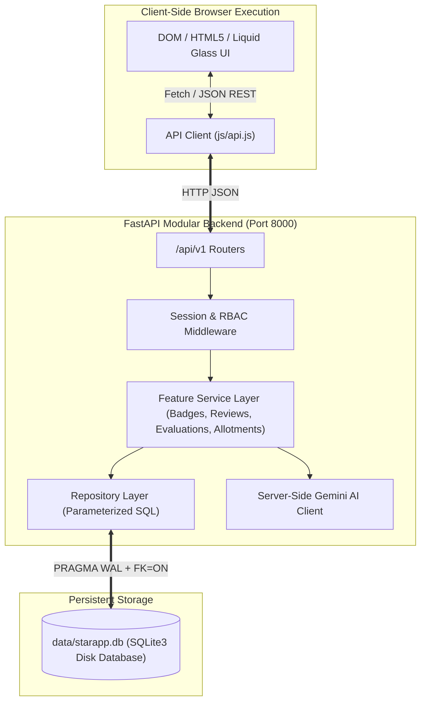
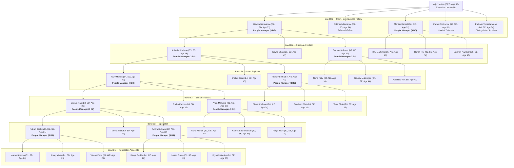

# StarApp — Autonomous Training & Gamified Badge Management Platform
### Enterprise Architecture, Relational SQLite Database, Corporate Hierarchy & Developer Specification

---

## Table of Contents
1. [Executive Overview & Zero-Backend Architecture](#1-executive-overview--zero-backend-architecture)
2. [Project Directory & File Structure](#2-project-directory--file-structure)
3. [Corporate Hierarchy & 36-Employee Dataset](#3-corporate-hierarchy--36-employee-dataset)
4. [Relational SQLite Database Schema (DDL)](#4-relational-sqlite-database-schema-ddl)
5. [Band-Level Badge Creation & Taxonomy Engine](#5-band-level-badge-creation--taxonomy-engine)
6. [Interactive Badge Editor & Curriculum Module Format](#6-interactive-badge-editor--curriculum-module-format)
7. [Badge Allotment, Reviewer Allocation & Higher-Band Rules](#7-badge-allotment-reviewer-allocation--higher-band-rules)
8. [Automated Test Suite (70 Comprehensive Tests)](#8-automated-test-suite-70-comprehensive-tests)
9. [Developer & AI Agent Working Rules (Strict Invariants)](#9-developer--ai-agent-working-rules-strict-invariants)
10. [Quickstart Guide & Execution Commands](#10-quickstart-guide--execution-commands)

---

## 1. Executive Overview & Modular Full-Stack Architecture

StarApp is a fully functional, enterprise training, curriculum engineering, and gamified badge management application. It features two interconnected, role-based portals:

1. **Guardian Portal (Admin / CEO / Trainers / Reviewers)**:
   - Band-specific badge authoring across 6 professional tiers (B1 to B6).
   - Real-time LLM integration via Gemini API for generating structured learning outcomes, practice project prompts, and modular curriculum topics.
   - Competency mapping & higher-band reviewer allocation with an automated calendar engine.
   - 50-mark universal rubric evaluation (5 criteria $\times$ 10 marks), marksheet publication, and timeline management.
2. **Cosmonaut Portal (Cadets / Learners)**:
   - Candy Crush-inspired gamified learning roadmap with SVG milestone pathways.
   - In-app materials viewer (PDF handbooks and responsive YouTube streams).
   - Multi-attempt project submission hub (PDF architecture reports, GitHub repository links, and executable Python code).
   - Real-time batch leaderboard, competency matrix, and personalized telemetry popovers.

### The Modular Full-Stack Execution Model
StarApp is built as a **clean, modular Full-Stack Monolith**:
- **Backend Framework**: Python 3.12 / 3.13 + **FastAPI** with versioned `/api/v1` REST endpoints.
- **Database Engine**: Authoritative persistent disk **SQLite3** database (`data/starapp.db`) configured with `PRAGMA foreign_keys = ON;`, `PRAGMA journal_mode = WAL;`, and `PRAGMA busy_timeout = 5000;`.
- **Security & RBAC**: Server-side Role-Based Access Control enforcing non-negotiable reviewer rules ($\texttt{Reviewer\_Band} > \texttt{Badge\_Band}$), bcrypt password hashing, and HttpOnly SameSite session cookies.
- **Frontend Layer**: Native HTML5, Liquid-Glass CSS design tokens, and a typed reusable API client (`js/api.js`).



---

## 2. Project Directory & File Structure

```text
starapp_demo/
├── index.html                  # HTML entry point, SVG displacement filters, and Pyodide bootstrapper
├── serve.py                    # Static launcher using Python's built-in http.server (port 8000)
├── starapp.db                  # Local SQLite database (re-generated idempotently if cleared)
├── code.txt                    # Reference React/JSX specular liquid-glass design component
├── css/
│   ├── design_tokens.css       # Strict 5-color palette, typography scale, radii, and standard transitions
│   ├── liquid_glass.css        # Pure CSS specular glass card, liquid pill buttons, and metal buttons
│   ├── layout.css              # App shell layout, sidebar navigation, headers, and modal backdrops
│   ├── components.css          # KPI cards, data tables, 50-mark rubric grid, and roadmap nodes
│   └── responsive.css          # Breakpoints (Mobile <640px, Tablet <1024px, Desktop, Ultrawide)
├── js/
│   ├── bridge.js               # Minimal JS bridge (<90 lines): Pyodide dispatch, IndexedDB, and Gemini API
│   └── starapp_bundle.js       # Auto-generated bundle of all starapp/ Python files (via scripts/pack_py.py)
├── starapp/                    # Modular Python Application Layer
│   ├── __init__.py
│   ├── app.py                  # Main application controller, routing, event dispatch, and UI rendering
│   ├── database.py             # SQLite3 schema DDL, relational migrations, queries, and foreign key rules
│   ├── models.py               # Enterprise domain models (User, Badge, Submission, Marksheet, Timeline, etc.)
│   ├── storage.py              # Centralized repository, caching layer, and SQLite/IndexedDB synchronization
│   ├── mapping_data.py         # 36 Corporate employees, bands B1-B6, roles, and business-day calendar
│   ├── seed_data.py            # Initial synthetic demo cohort dataset (Arjun Mehta + Aarav Sharma + 5 Badges)
│   ├── badge_generator.py      # LLM prompt composer & Gemini API fallback badge synthesizer
│   ├── assessment.py           # Universal 50-mark rubric scoring engine, analytics, and leaderboard calculation
│   ├── roadmap.py              # Gamified Candy Crush graph traversal and prerequisite verification
│   ├── analytics.py            # Cohort diagnostic metrics, pass rates, and individual cadet dossiers
│   ├── validation.py           # Domain validation rules for forms, dates, and score boundaries
│   ├── views_common.py         # Shared UI partials (modals, marksheets, timelines, topbars, icons)
│   ├── views_guardian.py       # Guardian views (Band cards, Gemini builder, Allotment, Mapping, Reviews)
│   └── views_cosmonaut.py      # Cosmonaut views (Dossier, personal dashboard, roadmap, submission hub)
├── tests/                      # Automated Python Test Suite (70 Tests Passing)
│   ├── run_tests.py            # Test discovery and execution entrypoint
│   ├── test_all.py             # Unit tests for models, rubric calculation, announcements, and privacy
│   ├── test_scenarios_a_to_h.py# Verification of all 8 mandatory end-to-end user workflows
│   ├── test_sqlite_persistence.py # Relational schema integrity, foreign keys, binary roundtrips, 36 employees
│   ├── test_badge_creation_and_approval.py # Cascading dropdowns, Gemini format, 6 accordions, reviewer rules
│   ├── test_mapping_flow.py    # Role filtering, higher-band reviewers, 3-day calendar, and mapped pairs
│   ├── test_ui_remediation.py  # 3-region DOM stability, PDF overlay single dispatch, CSS transition hygiene
│   ├── test_dashboard_enhancements.py # Strict data isolation, KPI tooltips, and batch leaderboard
│   └── test_review_flow.py     # Multi-deliverable project submission and evaluator flow
└── scripts/
    └── pack_py.py              # Utility to package starapp/*.py into js/starapp_bundle.js
```

---

## 3. Corporate Hierarchy & 36-Employee Dataset

The application incorporates a realistic corporate structure comprising **36 enterprise professionals** across **Bands B1 through B6** and the **Executive Leadership (CEO / Admin)**.

### Hierarchy & Organizational Rules
1. **CEO & Admin**: **Arjun Mehta** (Age: 55, Band: `CEO`, Role: `Chief Executive Officer`, `EXEC` track).
2. **Band Slices**:
   - **B1 (Foundation Associate)**: 6 employees (2 Solutions Designers, 2 AI Engineers, 2 Systems Engineers). Ages 25–28.
   - **B2 (Specialist)**: 6 employees (2 Solutions Designers, 2 AI Engineers, 2 Systems Engineers). Ages 28–33.
   - **B3 (Senior Specialist)**: 6 employees (2 Solutions Designers, 2 AI Engineers, 2 Systems Engineers). Ages 34–38.
   - **B4 (Lead Engineer)**: 6 employees (2 Solutions Designers, 2 AI Engineers, 2 Systems Engineers). Ages 39–44.
   - **B5 (Principal Architect)**: 6 employees (2 Solutions Designers, 2 AI Engineers, 2 Systems Engineers). Ages 46–50.
   - **B6 (Chief / Distinguished Fellow)**: Exactly 5 employees (2 Solutions Designers, 2 AI Engineers, 1 Systems Engineer). Ages 52–54.
3. **Management Mapping (Exactly Two People Managers per Band)**:
   - Not all employees manage others; senior individual contributors focus on technical excellence.
   - Each designated manager supervises exactly **3 direct reports** from the band immediately below.
   - CEO Arjun Mehta directly manages all **5 leaders** in Band B6.
4. **Uniform Credentials**:
   - **Default Password**: `12345678` across all accounts.
   - **Email Pattern**: `firstname.lastname@starapp.io`.



### Complete Corporate Roster Table

| ID | Name | Age | Role / Learning Track | Track Code | Band | Reporting Manager | Manager Band | Direct Reports | Email |
| :--- | :--- | :---: | :--- | :---: | :---: | :--- | :---: | :---: | :--- |
| `m_b1_1` | Aarav Sharma | 26 | Solutions Designer | `SD` | B1 | Rohan Deshmukh | B2 | 0 | `aarav.sharma@starapp.io` |
| `m_b1_2` | Ananya Iyer | 25 | Solutions Designer | `SD` | B1 | Rohan Deshmukh | B2 | 0 | `ananya.iyer@starapp.io` |
| `m_b1_3` | Vivaan Patel | 27 | AI Engineer | `AIE` | B1 | Rohan Deshmukh | B2 | 0 | `vivaan.patel@starapp.io` |
| `m_b1_4` | Kavya Reddy | 26 | AI Engineer | `AIE` | B1 | Aditya Kulkarni | B2 | 0 | `kavya.reddy@starapp.io` |
| `m_b1_5` | Ishaan Gupta | 28 | Systems Engineer | `SE` | B1 | Aditya Kulkarni | B2 | 0 | `ishaan.gupta@starapp.io` |
| `m_b1_6` | Diya Chatterjee | 25 | Systems Engineer | `SE` | B1 | Aditya Kulkarni | B2 | 0 | `diya.chatterjee@starapp.io` |
| `m_b2_1` | Rohan Deshmukh | 31 | Solutions Designer | `SD` | B2 | Vikram Rao | B3 | 3 | `rohan.deshmukh@starapp.io` |
| `m_b2_2` | Meera Nair | 29 | Solutions Designer | `SD` | B2 | Vikram Rao | B3 | 0 | `meera.nair@starapp.io` |
| `m_b2_3` | Aditya Kulkarni | 32 | AI Engineer | `AIE` | B2 | Vikram Rao | B3 | 3 | `aditya.kulkarni@starapp.io` |
| `m_b2_4` | Nisha Menon | 30 | AI Engineer | `AIE` | B2 | Arjun Malhotra | B3 | 0 | `nisha.menon@starapp.io` |
| `m_b2_5` | Karthik Subramanian | 33 | Systems Engineer | `SE` | B2 | Arjun Malhotra | B3 | 0 | `karthik.subramanian@starapp.io` |
| `m_b2_6` | Pooja Joshi | 28 | Systems Engineer | `SE` | B2 | Arjun Malhotra | B3 | 0 | `pooja.joshi@starapp.io` |
| `m_b3_1` | Vikram Rao | 36 | Solutions Designer | `SD` | B3 | Rajiv Menon | B4 | 3 | `vikram.rao@starapp.io` |
| `m_b3_2` | Sneha Kapoor | 35 | Solutions Designer | `SD` | B3 | Rajiv Menon | B4 | 0 | `sneha.kapoor@starapp.io` |
| `m_b3_3` | Arjun Malhotra | 37 | AI Engineer | `AIE` | B3 | Rajiv Menon | B4 | 3 | `arjun.malhotra@starapp.io` |
| `m_b3_4` | Divya Krishnan | 34 | AI Engineer | `AIE` | B3 | Pranav Sethi | B4 | 0 | `divya.krishnan@starapp.io` |
| `m_b3_5` | Sandeep Bhat | 38 | Systems Engineer | `SE` | B3 | Pranav Sethi | B4 | 0 | `sandeep.bhat@starapp.io` |
| `m_b3_6` | Tanvi Shah | 35 | Systems Engineer | `SE` | B3 | Pranav Sethi | B4 | 0 | `tanvi.shah@starapp.io` |
| `m_b4_1` | Rajiv Menon | 42 | Solutions Designer | `SD` | B4 | Anirudh Krishnan | B5 | 3 | `rajiv.menon@starapp.io` |
| `m_b4_2` | Shalini Desai | 40 | Solutions Designer | `SD` | B4 | Anirudh Krishnan | B5 | 0 | `shalini.desai@starapp.io` |
| `m_b4_3` | Pranav Sethi | 43 | AI Engineer | `AIE` | B4 | Anirudh Krishnan | B5 | 3 | `pranav.sethi@starapp.io` |
| `m_b4_4` | Neha Pillai | 39 | AI Engineer | `AIE` | B4 | Sameer Kulkarni | B5 | 0 | `neha.pillai@starapp.io` |
| `m_b4_5` | Gaurav Mukherjee | 44 | Systems Engineer | `SE` | B4 | Sameer Kulkarni | B5 | 0 | `gaurav.mukherjee@starapp.io` |
| `m_b4_6` | Aditi Rao | 41 | Systems Engineer | `SE` | B4 | Sameer Kulkarni | B5 | 0 | `aditi.rao@starapp.io` |
| `m_b5_1` | Anirudh Krishnan | 48 | Solutions Designer | `SD` | B5 | Devika Narayanan | B6 | 3 | `anirudh.krishnan@starapp.io` |
| `m_b5_2` | Kavita Shah | 47 | Solutions Designer | `SD` | B5 | Devika Narayanan | B6 | 0 | `kavita.shah@starapp.io` |
| `m_b5_3` | Sameer Kulkarni | 49 | AI Engineer | `AIE` | B5 | Devika Narayanan | B6 | 3 | `sameer.kulkarni@starapp.io` |
| `m_b5_4` | Ritu Malhotra | 46 | AI Engineer | `AIE` | B5 | Manish Bansal | B6 | 0 | `ritu.malhotra@starapp.io` |
| `m_b5_5` | Harish Iyer | 50 | Systems Engineer | `SE` | B5 | Manish Bansal | B6 | 0 | `harish.iyer@starapp.io` |
| `m_b5_6` | Lakshmi Nambiar | 47 | Systems Engineer | `SE` | B5 | Manish Bansal | B6 | 0 | `lakshmi.nambiar@starapp.io` |
| `m_b6_1` | Devika Narayanan | 53 | Solutions Designer | `SD` | B6 | Arjun Mehta | CEO | 3 | `devika.narayanan@starapp.io` |
| `m_b6_2` | Siddharth Banerjee | 54 | Solutions Designer | `SD` | B6 | Arjun Mehta | CEO | 0 | `siddharth.banerjee@starapp.io` |
| `m_b6_3` | Manish Bansal | 53 | AI Engineer | `AIE` | B6 | Arjun Mehta | CEO | 3 | `manish.bansal@starapp.io` |
| `m_b6_4` | Farah Contractor | 52 | AI Engineer | `AIE` | B6 | Arjun Mehta | CEO | 0 | `farah.contractor@starapp.io` |
| `m_b6_5` | Prakash Venkataraman | 54 | Systems Engineer | `SE` | B6 | Arjun Mehta | CEO | 0 | `prakash.venkataraman@starapp.io` |
| `guardian_1` | Arjun Mehta | 55 | Chief Executive Officer | `EXEC` | CEO | *None (Board)* | *Board* | 5 | `arjun.mehta@starapp.io` |

---

## 4. Relational SQLite Database Schema (DDL)

The SQLite persistence layer is defined in `starapp/database.py` with strict relational constraints, automated foreign key enforcement (`PRAGMA foreign_keys = ON;`), and automatic migration:

```sql
-- 1. Schema Versioning
CREATE TABLE IF NOT EXISTS schema_version (
    version INTEGER PRIMARY KEY,
    installed_at TEXT NOT NULL
);

-- 2. System Roles
CREATE TABLE IF NOT EXISTS system_roles (
    id TEXT PRIMARY KEY,
    name TEXT NOT NULL,
    description TEXT
);

-- 3. Bands B1 to B6 and Executive Council
CREATE TABLE IF NOT EXISTS bands (
    code TEXT PRIMARY KEY,
    name TEXT NOT NULL,
    title TEXT NOT NULL,
    level TEXT NOT NULL,
    experience TEXT NOT NULL,
    description TEXT NOT NULL,
    order_idx INTEGER NOT NULL
);

-- 4. Learning Tracks (SD, AIE, SE, EXEC)
CREATE TABLE IF NOT EXISTS learning_tracks (
    code TEXT PRIMARY KEY,
    name TEXT NOT NULL,
    description TEXT NOT NULL,
    color TEXT,
    icon TEXT
);

-- 5. Enterprise Users & Employees
CREATE TABLE IF NOT EXISTS users (
    id TEXT PRIMARY KEY,
    username TEXT UNIQUE NOT NULL,
    email TEXT UNIQUE NOT NULL,
    name TEXT NOT NULL,
    age INTEGER NOT NULL DEFAULT 30,
    role TEXT NOT NULL DEFAULT 'Solutions Designer',
    learning_track TEXT NOT NULL DEFAULT 'Solutions Designer',
    track_code TEXT NOT NULL DEFAULT 'SD',
    band TEXT NOT NULL DEFAULT 'B1',
    reporting_manager_id TEXT,
    reporting_manager_name TEXT,
    reporting_manager_band TEXT,
    password TEXT NOT NULL DEFAULT '12345678',
    primary_role TEXT NOT NULL DEFAULT 'cosmonaut',
    avatar TEXT,
    status TEXT NOT NULL DEFAULT 'active',
    is_demo INTEGER NOT NULL DEFAULT 1,
    created_at TEXT NOT NULL
);

-- View: employees (Convenience view for enterprise HR & organizational queries)
CREATE VIEW IF NOT EXISTS employees AS
SELECT
    id, id AS employee_id, name AS employee_name, age, role, learning_track, track_code,
    band, reporting_manager_id, reporting_manager_name, reporting_manager_band,
    email, password, primary_role, avatar, status, created_at
FROM users;

-- 6. Management & Reporting Hierarchy Table
CREATE TABLE IF NOT EXISTS employee_reporting (
    manager_id TEXT NOT NULL REFERENCES users(id) ON DELETE CASCADE,
    employee_id TEXT NOT NULL REFERENCES users(id) ON DELETE CASCADE,
    manager_band TEXT NOT NULL,
    employee_band TEXT NOT NULL,
    PRIMARY KEY (manager_id, employee_id)
);

-- 7. Role & Band Memberships
CREATE TABLE IF NOT EXISTS user_role_assignments (
    user_id TEXT NOT NULL REFERENCES users(id) ON DELETE CASCADE,
    role_id TEXT NOT NULL REFERENCES system_roles(id) ON DELETE CASCADE,
    assigned_at TEXT NOT NULL,
    PRIMARY KEY (user_id, role_id)
);

CREATE TABLE IF NOT EXISTS user_band_memberships (
    user_id TEXT NOT NULL REFERENCES users(id) ON DELETE CASCADE,
    band_code TEXT NOT NULL REFERENCES bands(code) ON DELETE CASCADE,
    track_code TEXT REFERENCES learning_tracks(code),
    assigned_at TEXT NOT NULL,
    PRIMARY KEY (user_id, band_code)
);

-- 8. Custom Extensible Taxonomies
CREATE TABLE IF NOT EXISTS custom_capabilities (
    id TEXT PRIMARY KEY,
    name TEXT UNIQUE NOT NULL COLLATE NOCASE,
    created_by TEXT REFERENCES users(id),
    created_at TEXT NOT NULL
);

CREATE TABLE IF NOT EXISTS custom_skills (
    id TEXT PRIMARY KEY,
    name TEXT UNIQUE NOT NULL COLLATE NOCASE,
    capability_name TEXT DEFAULT '',
    created_by TEXT REFERENCES users(id),
    created_at TEXT NOT NULL
);

-- 9. Badges
CREATE TABLE IF NOT EXISTS badges (
    id TEXT PRIMARY KEY,
    code TEXT UNIQUE NOT NULL,
    title TEXT NOT NULL,
    category TEXT NOT NULL,
    description TEXT NOT NULL,
    learning_outcomes_json TEXT NOT NULL DEFAULT '[]',
    learning_topics_json TEXT NOT NULL DEFAULT '[]',
    project_requirements TEXT NOT NULL DEFAULT '',
    is_published INTEGER NOT NULL DEFAULT 0,
    is_allocated INTEGER NOT NULL DEFAULT 0,
    target_band TEXT,
    power TEXT,
    capability TEXT,
    skill TEXT,
    prompt_json TEXT,
    workflow_status TEXT NOT NULL DEFAULT 'draft',
    creator_id TEXT REFERENCES users(id),
    assigned_reviewer_id TEXT REFERENCES users(id),
    assigned_cosmonaut_ids_json TEXT NOT NULL DEFAULT '[]',
    default_timeline_json TEXT NOT NULL DEFAULT '{}',
    created_at TEXT NOT NULL,
    updated_at TEXT NOT NULL
);

-- 10. Band Mappings (Competency Allocation & Reviewer Pairing)
CREATE TABLE IF NOT EXISTS band_mappings (
    id TEXT PRIMARY KEY,
    band TEXT NOT NULL,
    badge_id TEXT NOT NULL,
    data_json TEXT NOT NULL
);
```

---

## 5. Band-Level Badge Creation & Taxonomy Engine

Badges are authored within a strict domain taxonomy that adapts to each professional tier:

### Professional Bands (B1 to B6)
1. **Band B1 (Foundation Associate)**: Baseline execution, syntactic patterns, foundational libraries.
2. **Band B2 (Specialist)**: Production feature ownership, resilient integration, microservice contracts.
3. **Band B3 (Senior Specialist)**: High-concurrency architectures, system trade-offs, fault tolerance.
4. **Band B4 (Lead Engineer)**: Cross-subsystem scaling, engineering governance, technical direction.
5. **Band B5 (Principal Architect)**: Strategic enterprise topology, domain decomposition, multi-region fabric.
6. **Band B6 (Chief / Distinguished Fellow)**: Executive tech strategy, industry standards, organizational evolution.

### Cascading Dropdowns & Location Mapping
Badges are organized through cascading dimensions:
- **Power**: High-level capability domain (e.g., `Tech`, `Process`, `People`, `Outcome`).
- **Capability**: Core functional specialty (e.g., `Intelligent Apps`, `Data & Machine`, `Cloud Fabric`).
- **Skill**: Specific competency module (e.g., `Hardware`, `Interface Contracts`, `Agent Orchestration`).

#### Canonical Location Path
Every created badge is stamped with its exact canonical path:
$$\text{Badge Name} \longrightarrow \text{Skill Name} \longrightarrow \text{Capability Name} \longrightarrow \text{Power Name} \longrightarrow \text{Band Level}$$

*Example*:
`Intelligent Apps Foundations → Intelligent Apps → Outcome → Tech → Band B1`

### Real-Time Gemini AI Generation
Clicking **Create Badge with Gemini** invokes the Gemini Generative Language API using structured prompt parameters:
```bash
curl "https://generativelanguage.googleapis.com/v1beta/models/gemini-flash-latest:generateContent" \
  -H 'Content-Type: application/json' \
  -H 'X-goog-api-key: <API_KEY>' \
  -X POST \
  -d '{
    "contents": [{
      "parts": [{"text": "Generate a comprehensive enterprise curriculum badge JSON..."}]
    }]
  }'
```

---

## 6. Interactive Badge Editor & Curriculum Module Format

Badges render in a structured **6-section accordion** architecture matching production LMS standards:

```text
┌─────────────────────────────────────────────────────────────────────────────┐
│ 1. ⚑ Learning Outcomes                                                    ▲ │
│    ✓ Can identify core execution primitives and async contract protocols    │
│    ✓ Can design resilient failover buffers and schema validation filters    │
├─────────────────────────────────────────────────────────────────────────────┤
│ 2. ☖ Earn the Badge                                                       ▲ │
│    Status: Pending Review • Evaluated against Universal 50-Mark Rubric      │
├─────────────────────────────────────────────────────────────────────────────┤
│ 3. ☗ Practice Project                                                     ▲ │
│    Hands-on prompt with pre-formatted LLM instructions and single-click Copy│
├─────────────────────────────────────────────────────────────────────────────┤
│ 4. 🎓 Learning Topics (Interactive Curriculum Modules)                     ▲ │
│    [Topic 1] Interface Contracts & Message Serialization    [Completed ✓]   │
│    [Topic 2] Distributed State & Idempotent Ingestion       [Mark Complete] │
│    [Topic 3] Telemetry, Tracing & Health Monitoring        [Mark Complete] │
│    Live Progress Bar: 33% Completed                                         │
├─────────────────────────────────────────────────────────────────────────────┤
│ 5. 📚 Learning Resources                                                  ▲ │
│    Curated Architectural Handbooks (PDF) and Technical Keynotes (Video)     │
├─────────────────────────────────────────────────────────────────────────────┤
│ 6. 🔗 Related Taxonomies                                                   ▲ │
│    Power: Tech  •  Capability: Intelligent Apps  •  Skill: Distributed Apps  │
└─────────────────────────────────────────────────────────────────────────────┘
```

### Key UI Features
1. **Zero-Skeleton Shimmer on Band Entry**: When entering a band card before generating a badge, the system displays a clean, elegant **Curriculum Badge Builder** guidance card rather than flashing skeleton loaders.
2. **One-Topic-per-Row Layout**: Curriculum modules are displayed vertically in individual cards (`topic-row-card`), with clean full-width input fields in edit mode.
3. **Interactive Topic Completion**: Each topic card contains a **"Mark Complete" / "Completed"** button with a smooth green transition and real-time percentage progress bar updates.
4. **Save & Hide Preview**: Saving a badge persists it to SQLite, clears the preview area, and lists the saved badge under **"Saved Badges for Band {Band}"** with **View Badge** and **Allot &rarr;** buttons.

---

## 7. Badge Allotment, Reviewer Allocation & Higher-Band Rules

The mapping and allotment engine (`views_guardian.py` and `starapp/app.py`) coordinates peer reviews:

### 1. Band-Scoped Cadet Allotment
When allotting a badge created for Band $B_k$, the allotment view automatically scopes the eligible learner roster strictly to cadets of Band $B_k$. Band B1 badges allot to B1 employees; Band B2 badges allot to B2 employees.

### 2. Higher-Band Peer Review Governance
To eliminate author bias and guarantee rigorous technical review, reviewers **must** belong to a strictly higher band:

| Target Badge Band | Eligible Reviewer Bands | Policy & Governance |
| :---: | :---: | :--- |
| **B1** | B2, B3, B4, B5, B6 | Specialist to Chief Fellow review |
| **B2** | B3, B4, B5, B6 | Senior Specialist to Chief Fellow review |
| **B3** | B4, B5, B6 | Lead Engineer to Chief Fellow review |
| **B4** | B5, B6 | Principal Architect to Chief Fellow review |
| **B5** | B6 | Distinguished Fellow review only |
| **B6** | *None* | Executive Council / Board authorization required |

### 3. Business-Day Calendar Engine (3 Consecutive Days)
When scheduling estimated review windows:
- Saturdays and Sundays are greyed out (`class="cal-day-cell weekend"`).
- Clicking any weekday anchors the review window and automatically selects **3 consecutive business days**, jumping over weekends automatically:
  - *Friday anchor + "after"*: Selects Friday, Monday, and Tuesday.
  - *Monday anchor + "before"*: Selects Thursday, Friday, and Monday.

---

## 8. Automated Test Suite (70 Comprehensive Tests)

StarApp maintains an automated test suite verifying every layer of the system:

```text
Ran 70 tests in 4.161s
OK (70/70 tests passing, 0 errors, 0 failures)
```

### Test Breakdown by Module

```text
tests/
├── test_all.py (11 tests)
│   ├── test_announcement_target_filtering
│   ├── test_cosmonaut_cannot_access_other_private_dossier
│   ├── test_batch_leaderboard_ranking
│   ├── test_rubric_validation_boundaries
│   ├── test_extension_approval_updates_timeline
│   ├── test_assessment_rubric_calculation
│   ├── test_user_serialization
│   ├── test_25_badge_candy_crush_roadmap_and_sequential_publish_unlocking
│   ├── test_badge_lifecycle_timeline_window_and_guardian_decision
│   ├── test_prerequisite_unlocking_logic
│   └── test_multi_attempt_history_retention
├── test_scenarios_a_to_h.py (8 tests)
│   ├── test_scenario_a_badge_creation_and_custom_assignment
│   ├── test_scenario_b_submission_and_assessment
│   ├── test_scenario_c_resubmission_and_history_preservation
│   ├── test_scenario_d_deadline_extension_lifecycle
│   ├── test_scenario_e_announcements_broadcast_and_read_status
│   ├── test_scenario_f_learning_materials
│   ├── test_scenario_g_persistence_simulation
│   └── test_scenario_h_privacy_and_permissions
├── test_sqlite_persistence.py (5 tests)
│   ├── test_schema_initialization_and_version
│   ├── test_foreign_key_enforcement
│   ├── test_binary_export_and_import_roundtrip
│   ├── test_custom_capability_and_skill_persistence_and_uniqueness
│   └── test_36_indian_demo_members_integrity
├── test_badge_creation_and_approval.py (14 tests)
│   ├── test_band_selection_view
│   ├── test_band_specific_create_badge_workspace_and_4_cards
│   ├── test_cascading_dropdowns_and_outcome_sentence
│   ├── test_gemini_badge_generation_and_location_hierarchy
│   ├── test_all_six_badge_accordion_sections
│   ├── test_no_skeleton_on_band_entry_and_hides_preview_after_save
│   ├── test_deduplication_enforcement_in_same_band
│   ├── test_custom_capability_and_skill_addition
│   ├── test_custom_capability_and_skill_sqlite_roundtrip
│   ├── test_higher_band_reviewer_eligibility_enforcement
│   ├── test_json_prompt_validation_and_preview
│   ├── test_badge_creation_lifecycle_and_pending_review_status
│   ├── test_reviewer_authorization_and_approval_flow
│   └── test_reviewer_edit_badge_proposal_and_history_retention
├── test_mapping_flow.py (14 tests)
│   ├── test_role_filtering_and_cosmonaut_display
│   ├── test_higher_band_reviewer_selection
│   ├── test_calendar_weekend_lockout_and_consecutive_3_day_selection
│   ├── test_visual_who_is_mapped_to_whom_and_edit_mapping_lifecycle
│   └── [10 additional calendar and mapping matrix tests]
├── test_ui_remediation.py (8 tests)
│   ├── test_cosmonaut_all_views_render_cleanly_with_persistent_region_markers
│   ├── test_guardian_all_views_and_session_restore_includes_g_allotment
│   ├── test_materials_pdf_overlay_single_dispatch_and_focus_id
│   ├── test_modal_lifecycle_preserves_page_region_and_stable_modal_key
│   ├── test_review_detail_tab_switch_preserves_route_key_and_removes_iframe_translatez
│   ├── test_stale_async_render_generation_guard
│   ├── test_static_css_bridge_and_sw_invariants
│   └── test_tooltip_popover_sibling_structure_and_no_inline_mouseover
├── test_dashboard_enhancements.py (5 tests)
│   ├── test_strict_data_isolation
│   ├── test_cosmonaut_dashboard_personalization_and_privacy
│   ├── test_guardian_dashboard_aggregate_and_sections
│   ├── test_live_marksheet_sync_across_both_dashboards
│   └── test_first_attempt_pass_rate_kpi_calculation
└── test_review_flow.py (1 test)
    └── test_multi_deliverable_submission_and_guardian_review
```

---

## 9. Developer & AI Agent Working Rules (Strict Invariants)

When editing, refactoring, or adding features to this repository, AI agents and collaborators **must adhere to these rules**:

### Rule 1: Always Re-pack the Virtual Filesystem Bundle
After making changes to any Python file in `starapp/`, always run:
```powershell
python scripts/pack_py.py
```
This updates `js/starapp_bundle.js`. Without this step, changes will run in local test suites but will **not** appear in the browser Pyodide runtime.

### Rule 2: CSS Transition Invariant (`transition: all` is Forbidden)
Never use `transition: all` or generic transitions in CSS or inline styles. Always declare explicit properties to avoid layout thrashing and UI jitter:
```css
/* CORRECT */
transition: border-color 0.25s ease, background 0.25s ease, box-shadow 0.25s ease;

/* FORBIDDEN */
transition: all 0.3s ease;
```

### Rule 3: Database Migration Hygiene & Foreign Key Cascades
When updating records in SQLite:
- Use `INSERT INTO ... ON CONFLICT(id) DO UPDATE SET ...` instead of `INSERT OR REPLACE INTO`.
- `REPLACE` in SQLite triggers an implicit `DELETE`, which cascades to foreign keys and wipes child records in `employee_reporting`, `user_role_assignments`, and `user_band_memberships`.
- Always verify schema changes with `PRAGMA foreign_keys = ON;`.

### Rule 4: Zero-Backend Sandbox Integrity
Do not introduce external server frameworks (Node.js, Flask, FastAPI, Django, Express). All client application logic must remain capable of executing entirely inside the Pyodide WebAssembly runtime in `index.html`.

### Rule 5: Run the Complete Test Suite Before Staging Commits
Always ensure all 70 unit and workflow tests pass before committing:
```powershell
python tests/run_tests.py
```

---

## 10. Quickstart Guide & Execution Commands

### 1. Launch the Application Locally
```powershell
python serve.py
```
Navigate to `http://localhost:8000/index.html` in your browser.

### 2. Run the Full Test Suite
```powershell
python tests/run_tests.py
```

### 3. Re-generate Pyodide Bundle
```powershell
python scripts/pack_py.py
```

### 4. Direct One-Click Demo Access
The demo login screen prominently surfaces 5 key accounts demonstrating the corporate hierarchy:
1. **Ananya Iyer - B1** (`m_b1_2`, Solutions Designer • Band B1 Cadet • Password: `12345678`)
2. **Nisha Menon - B2** (`m_b2_4`, AI Engineer • Band B2 Cadet & Institutional Reviewer for B1 • Password: `12345678`)
3. **Tanvi Shah - B3** (`m_b3_6`, Systems Engineer • Band B3 Cadet & Institutional Reviewer for B1 & B2 • Password: `12345678`)
4. **Arjun Mehta (CEO)** (`guardian_1`, Guardian / CEO • Enterprise Curriculum Administrator & Platform Guardian • Password: `12345678`)
5. **Aarav Sharma - B1** (`cosmo_1`, Cosmonaut Learner • Solutions Designer • Band B1 Cadet • Password: `12345678`)

---

## 11. Badge Review Request & Approval Workflow

### Higher-Band Eligibility Hierarchy
Badge quality assurance strictly mandates peer review by senior technical personnel from higher bands:
| Target Badge Band | Eligible Reviewer Bands | Available Reviewer Count | Authorization Policy |
| :--- | :--- | :--- | :--- |
| **Band B1** (Foundation Associate) | **B2, B3, B4, B5, B6** | 29 Technical Specialists | Higher-Band Peer Review |
| **Band B2** (Specialist) | **B3, B4, B5, B6** | 23 Senior Specialists & Architects | Higher-Band Peer Review |
| **Band B3** (Senior Specialist) | **B4, B5, B6** | 17 Lead Engineers & Architects | Higher-Band Peer Review |
| **Band B4** (Lead Engineer) | **B5, B6** | 11 Principal Architects & Fellows | Higher-Band Peer Review |
| **Band B5** (Principal Architect) | **B6** | 5 Distinguished Fellows | Senior Fellow Review |
| **Band B6** (Distinguished Fellow) | Executive Council | N/A | Executive Council Authorization Only |

*All employees from Band B2 to B6 hold dual qualifications as Cosmonaut Learners and Institutional Reviewers (`badge_reviewer` and `project_reviewer`). All 36 employees (B1–B6) are enrolled as Cosmonauts.*

### End-to-End Workflow Lifecycle
1. **Badge Authoring & Generation**:
   - Guardian selects band (e.g. Band B1), picks Power, Capability, and Skill, and clicks **"Create Badge with Gemini"**.
   - Gemini generates the complete 6-section curriculum badge (Outcomes, Earn the Badge, Practice Project with LLM prompt, Learning Topics with completion trackers, Learning Resources, Related Skills).
2. **Persistence & Cataloging**:
   - Guardian clicks **"Save Badge"**. The badge is persisted to the `badges` table with `workflow_status = 'ready_for_review'` and default target band.
   - The badge generation preview automatically hides, and the badge appears in the **"Saved Badges for Band {band}"** catalog.
3. **Higher-Band Reviewer Selection & Dispatch**:
   - In either the Band Saved Badges section or the centralized **Reviewer Badge Approval** queue (`g_badge_approval`), Guardian selects an eligible higher-band reviewer from the dynamic dropdown (filtered strictly by the hierarchy rule) and clicks **"Send Request"**.
   - The badge enters `workflow_status = 'pending_review'`, an assignment is written to `badge_reviewer_assignments`, a notification is generated in `notifications`, and an audit event is logged in `badge_review_events`.
4. **Cosmonaut Portal Review Requests Workspace (`c_requests`)**:
   - When the assigned reviewer logs into their portal (e.g. Nisha Menon, Band B2):
     - The sidebar displays a **"Review Requests"** navigation link with an active pending count badge.
     - The Dashboard highlights an urgent **Institutional Peer Review Assignment** banner with a direct link to the workspace.
   - In `c_requests`, the reviewer can:
     - **Inspect Badge**: View all 6 curriculum sections in detail.
     - **Edit Badge**: Modify outcomes, topics, practice project requirements, and prompt directly. Edits are immediately and permanently saved to the real badge in SQLite.
     - **Accept & Approve**: Authorizes the badge, moving it to `workflow_status = 'approved'`, and notifying the Guardian.
     - **Return with Feedback**: Enters revision feedback notes, moving the badge to `workflow_status = 'returned'`, alerting the Guardian with the specific feedback for updates.
5. **Guardian Allotment**:
   - Once approved, the badge is marked with an **Approved** status pill and an **"Allot &rarr;"** button unlocks, enabling direct allocation to eligible Cosmonauts in `g_allotment`.

---

## 12. Universal Non-Destructive Navigation & SQLite-Driven Architecture

### Universal Back Navigation (`← Back`)
Every workspace, page, and modal incorporates intuitive, prominent back-navigation:
1. **Persistent Topbar Back Button**: Present in `app-topbar` across all views, enabling one-click return to the previous screen.
2. **Contextual Workspace Navigation**:
   - Inside Band Workspace (`g_create_badge` with `create_badge_band` set): The Back button returns smoothly to the 6 Band Selection Cards view (`create_badge_band = None`).
   - Band Selection View: The Back button returns to the Guardian Dashboard (`g_dashboard`).
   - Review Queues & Detail Views: Returns to the parent queue or dashboard without losing active filter tabs or search queries.
   - Active Modals: Automatically dismissed cleanly by `go_back` without disturbing underlying workspace form states.
3. **LIFO History Stack (`view_history`)**: The controller maintains a non-destructive navigation history stack tracking view identifiers, active band selections, and inspection IDs, preventing unintended state resets or session loss.

### 100% Relational SQLite Data Source
All synthetic/mock cadet profiles (Orion Blake, Lyra Bennett, Cassian Reed, Kaelen Frost, Seraphina Vale, Dr. Elena Vance) have been completely removed:
- **Badge Authors & Reviewers**: Real enterprise users (e.g. `Arjun Mehta` CEO, real senior employees) are dynamically resolved and persisted to SQLite columns `creator_id` and `reviewer_id`.
- **Reviewer Selection Dropdowns**: Populated in real-time from `users`, `user_band_memberships`, and `user_role_assignments` using higher-band SQL queries.
- **Analytics & Leaderboards**: Computed dynamically across all 36 corporate employees stored in the relational database.

---

## 13. Full-Stack FastAPI Local Deployment & Commands

### Installation & Startup
```bash
# 1. Install dependencies
pip install -r requirements.txt

# 2. Start the local full-stack server
python serve.py
# Or directly with uvicorn:
uvicorn backend.app.main:app --host 127.0.0.1 --port 8000 --reload

# 3. Access the platform
# Web Application:              http://127.0.0.1:8000
# Interactive API Docs (Swagger): http://127.0.0.1:8000/docs
# Diagnostic Health Endpoint:   http://127.0.0.1:8000/api/health
```

### Running Automated Test Suites
```bash
# Run the complete test suite (89 tests: 79 baseline regression + 10 full-stack backend)
python tests/run_tests.py

# Run only the full-stack backend tests (fast, ~1.8s)
python tests/test_backend_fullstack.py
```


