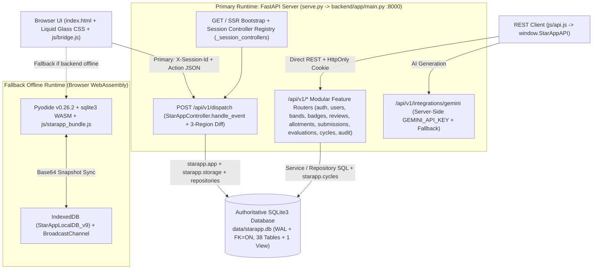

# StarApp — Complete Technical Architecture, Workflow, Database & Feature Reference (`Report.md`)

> **Scope of Analysis:** This document provides an A-to-Z technical reference derived directly from the active codebase (`serve.py`, `index.html`, `backend/`, `starapp/`, `css/`, `js/`, `scripts/`, `tests/`), `README.md`, `requirements.txt`, `.env.example`, and the authoritative SQLite database (`data/starapp.db`).

---

## Table of Contents
1. [Executive Summary](#1-executive-summary)
2. [Tech Stack, Libraries & Tools Used](#2-tech-stack-libraries--tools-used)
3. [Active Project Structure & File Responsibilities](#3-active-project-structure--file-responsibilities)
4. [How It Is Made — Hybrid Dual-Runtime Architecture](#4-how-it-is-made--hybrid-dual-runtime-architecture)
5. [How It Works Internally (Request, State, Rendering & Security Flow)](#5-how-it-works-internally-request-state-rendering--security-flow)
6. [Complete End-to-End Business Workflow](#6-complete-end-to-end-business-workflow)
7. [Complete Feature Catalog (By Role & Portal)](#7-complete-feature-catalog-by-role--portal)
8. [Authoritative Database Deep-Dive (`data/starapp.db`)](#8-authoritative-database-deep-dive-datastarappdb)
9. [AI Integration & Deterministic Curriculum Engine](#9-ai-integration--deterministic-curriculum-engine)
10. [Testing, Automation & Build Utilities](#10-testing-automation--build-utilities)
11. [Configuration & How to Run](#11-configuration--how-to-run)

---

## 1. Executive Summary

**StarApp** is an enterprise engineering competency, curriculum authoring, peer-review, and 6-month cycle performance appraisal platform. It manages multi-band technical progression (`B1` through `B6` + `CEO`), higher-band peer validation (`Reviewer_Band > Badge_Band`), structured project execution, universal 50-mark rubric grading, and dual-role compensation appraisal (evaluating every employee both as a **Cosmonaut / Learner** and as a **Reviewer / Mentor**).

Unlike a traditional SPA tied to one runtime, StarApp uses a **server-first FastAPI + SQLite3 architecture with a Pyodide WebAssembly browser fallback**, where both modes share the same Python domain engine (`starapp/`):
- **Primary Mode (Full-Stack Server):** Python **FastAPI** + **Uvicorn** serves SSR-bootstrapped HTML (`index.html`), processes stateful UI actions via `POST /api/v1/dispatch`, exposes modular `/api/v1/*` REST APIs, proxies Google Gemini AI calls server-side, and persists all data to **`data/starapp.db`**.
- **Fallback Mode (Offline/Static WASM):** When `/api/v1/dispatch` is unreachable, `index.html` dynamically loads **Pyodide v0.26.2** + WASM `sqlite3`, mounts all 28 packed Python files and a Base64 snapshot of `data/starapp.db` from `js/starapp_bundle.js` into an Emscripten virtual filesystem, and executes `starapp.app.controller` in-browser with IndexedDB / `localStorage` persistence and cross-tab `BroadcastChannel` sync.

---

## 2. Tech Stack, Libraries & Tools Used

| Layer | Technology / Library | Purpose & Implementation Details |
| :--- | :--- | :--- |
| **Backend Web Framework** | **FastAPI** (`>=0.115.0`), **Pydantic** (`>=2.8.0`), **python-multipart** (`>=0.0.9`) | Modular REST API (`/api/v1/*`), OpenAPI docs (`/docs`, `/redoc`), lifespan DB migrations, action dispatcher (`POST /api/v1/dispatch`), static asset mounting. |
| **ASGI Server** | **Uvicorn** (`uvicorn[standard]>=0.30.0`) | Runs `backend.app.main:app` with hot reload on `127.0.0.1:8000` (with stdlib `http.server` fallback in `serve.py`). |
| **Database Engine** | **SQLite3** (Python stdlib `sqlite3`) | Persistent disk DB at `data/starapp.db` configured with `PRAGMA foreign_keys = ON`, `journal_mode = WAL`, `synchronous = NORMAL`, `busy_timeout = 5000`. |
| **Authentication & Hashing** | **bcrypt** (`>=4.2.0`), `secrets`, `hashlib`, HttpOnly Cookies | Password hashing (`bcrypt` rounds=12 with legacy plaintext check for demo accounts), 32-byte URL-safe session tokens stored in `user_sessions`, `starapp_session` HttpOnly SameSite cookies, Bearer token support, and `sessionStorage` tab isolation. |
| **Configuration** | **python-dotenv** (`>=1.0.0`), `.env` | Loads `HOST`, `PORT`, `DEBUG`, `SECRET_KEY`, `SESSION_EXPIRE_HOURS`, `DATABASE_URL`, and server-side `GEMINI_API_KEY`. |
| **Generative AI** | **Google Gemini REST API** (`gemini-1.5-flash:generateContent`) via `urllib.request` | Server-side curriculum badge JSON synthesis (`/api/v1/integrations/gemini/generate-badge`), reviewer project brief generation (`/generate-project`), mentor chat (`/mentor-chat`), plus deterministic fallback in `starapp/badge_generator.py`. |
| **Frontend Markup & UI** | **HTML5 + Vanilla CSS3 Design System** (5 modular stylesheets, 7,178 CSS lines total) | Server/controller-rendered HTML templates styled via 5 strict palette tokens (`design_tokens.css`), frosted glassmorphism (`liquid_glass.css`), app shell (`layout.css`), KPI/rubric/roadmap widgets (`components.css`), and breakpoints (`responsive.css`). Zero CSS framework dependencies; inline SVG vector icons (`ICON_SVGS`). |
| **Frontend Logic & Sync** | **Vanilla ES6 JavaScript** (`js/api.js`, `js/bridge.js`) | Typed REST client (`window.StarAppAPI`), incremental **3-region DOM patcher** (`updateRegions`), focus/scroll preservation, cross-tab `BroadcastChannel("starapp_cross_window_sync")`, IndexedDB (`StarAppLocalDB_v9`), custom interactive 6-month cycle calendar widget, and `FileReader` Base64/text deliverable uploads. |
| **Offline / Client Python Runtime** | **Pyodide v0.26.2** (WebAssembly, CDN) + **Service Worker** (`sw.js`) | Fallback browser Python VM running `starapp/` + WASM `sqlite3`; `sw.js` caches static assets (`starapp-runtime-cache-v42`) and Pyodide runtime (`starapp-pyodide-v0.26.2`) in standalone static mode (auto-unregistered when `FASTAPI_ACTIVE = true`). |
| **Testing & Tooling** | **`unittest`**, **`httpx`** (`>=0.28.0`), Starlette `TestClient` | 27 test modules under `tests/` (`137` discovered test cases in `tests/run_tests.py`) plus E2E verification, bundle packing, and DB reset/seeding utilities in `scripts/`. |

---

## 3. Active Project Structure & File Responsibilities

### Root Entrypoints & Config
- [`serve.py`](serve.py) — Local production launcher starting `uvicorn` (`backend.app.main:app` on `127.0.0.1:8000` with reload), falling back to `http.server` if Uvicorn is unavailable.
- [`index.html`](index.html) — Main HTML shell linking CSS (`v=85`), `js/api.js`, `js/bridge.js`, SSR-injected initial login screen (`STARAPP_INITIAL_ROOT_START/END`), FastAPI `/api/v1/dispatch` boot flow, and Pyodide v0.26.2 offline fallback loader.
- [`sw.js`](sw.js) — Service Worker (`starapp-runtime-cache-v42`, `starapp-pyodide-v0.26.2`); caches CDN Pyodide binaries cache-first and local static assets network-first for standalone mode.
- [`requirements.txt`](requirements.txt), [`.env.example`](.env.example), [`.gitignore`](.gitignore), [`README.md`](README.md).

### FastAPI Backend Package (`backend/app/`)
- [`backend/app/main.py`](backend/app/main.py) — FastAPI v2.0.0 app: lifespan DB migration & integrity checks, CORS & asset-version cache middleware, hot-reload watcher (`_reload_starapp_if_changed`) for `starapp/*.py`, per-tab isolated `StarAppController` registry (`_session_controllers`), `POST /api/v1/dispatch`, `GET /api/health`, SSR `/` & `/index.html`, `/css`, `/js`, `/sw.js`, `/favicon.ico`, and router registration under `/api/v1`.
- **Core (`backend/app/core/`)**:
  - `config.py` — Resolves paths (`BASE_DIR`, `DATABASE_PATH` defaulting to `data/starapp.db`), parses `.env`, and sets `STARAPP_DB_PATH` + `GEMINI_API_KEY`.
  - `security.py` — `bcrypt` password hashing/verification (with legacy plaintext demo fallback), URL-safe session tokens, SHA-256 helper.
  - `permissions.py` — Enforces **Rule 1** (`verify_reviewer_eligibility`: `Reviewer_Band > Badge_Band`) and **Rule 2** (`validate_50_mark_rubric`: 5 integer criteria `0..10`, total `/50`).
  - `dependencies.py` — DB connection injection (`get_db`), session resolution (`Cookie` -> `Bearer` -> `X-User-Id`/`demo_user_id` -> active `StarAppController` user), and role guards (`require_guardian`, `require_reviewer`, `require_cosmonaut`).
  - `exceptions.py` — Structured `StarAppException`, `UnauthorizedException`, `ForbiddenException`, and JSON exception handler.
- **Database Infrastructure (`backend/app/database/`)**:
  - `connection.py` — Thread-safe `sqlite3` connections (`Row` factory, `WAL`, `foreign_keys = ON`, `busy_timeout = 5000`), context manager transactions, and `check_database_integrity()`.
  - `migrations.py` — Creates/migrates `user_sessions`, `reviewer_project_prompts`, `performance_cycles`, `cycle_enrollments`, `cycle_performance_appraisals`; adds `cycle_id` columns/indexes across 14 cycle-scoped tables; seeds default `admin` and `cycle_1` backfill; enrolls active users.
- **Modular Feature APIs (`backend/app/features/` & `integrations/`)** — Each feature splits cleanly into `router.py`, `schemas.py`, `service.py`, and `repository.py` (with `cycles` and `audit` delegating directly to `starapp.cycles` / SQLite):
  - `auth`, `users`, `bands`, `badges`, `reviews`, `allotments`, `submissions`, `evaluations`, `cycles`, `audit`, and `integrations/gemini`.

### Python Domain Engine & View Layer (`starapp/`)
*28 Python files (all packed into `js/starapp_bundle.js` for Pyodide compatibility):*
- [`starapp/app.py`](starapp/app.py) — `StarAppController`: orchestrates state, navigation history stack (`view_history`), Global Cycle Context filtering (`selected_cycle_id` + read-only guard on closed cycles), 137 action handlers (`_handle_event_impl`), workspace rendering (`_render_workspace_scoped`), and 25 modal templates (`render_active_modal`).
- [`starapp/models.py`](starapp/models.py) — 15 domain models (`User`, `CosmonautProfile`, `Badge`, `BadgeTimeline`, `ProjectSubmission`, `AssessmentMarksheet`, `LearningMaterial`, `DeadlineExtension`, `Announcement`, `ActivityEvent`, `Notification`, `ReviewerProjectPrompt`, `PerformanceCycle`, `CycleEnrollment`, `CyclePerformanceAppraisal`), `DEFAULT_HIKE_POLICY`, and `add_six_months_iso()`.
- [`starapp/database.py`](starapp/database.py) — Core `DatabaseManager` (`SCHEMA_VERSION = 12`, full relational `DDL_SCHEMA`, FK cascades, dict import/export roundtrips, eligibility & approval transactional methods).
- [`starapp/storage.py`](starapp/storage.py) — `DataStore` singleton (`store`): unifies in-memory cache, normalized `starapp/repositories/*` classes, `sqlite3` persistence, thread/async `ContextVar` `cycle_scope(cycle_id)`, and binary/JSON snapshots.
- **Repositories (`starapp/repositories/`)**: `BaseRepository`, `UserRepository`, `BadgeRepository`, `TimelineRepository`, `AssessmentRepository`, `MappingRepository`, `MaterialRepository`, `ExtensionRepository`, `AnnouncementRepository`.
- **Business Engines**:
  - `cycles.py` — 6-month cycle creation (`create_new_six_month_cycle`), global cycle activation (`activate_cycle`), dual-role metric aggregation (`compute_cycle_candidate_performance`), appraisal persistence (`calculate_and_save_cycle_appraisals`), and lock/finalization (`finalize_and_close_cycle`).
  - `badge_generator.py` — Taxonomy constants (`POWERS_LIST`, `CAPABILITIES_LIST`, `CAPABILITY_SKILLS_MAP`, `BAND_DEFAULT_OUTCOME_SENTENCES`, `SKILL_TOPIC_PRESETS`), LLM prompt builders, deterministic badge & reviewer project generators.
  - `mapping_data.py` — Band definitions (`B1`–`B6`), 3 roles (`Solutions Designer`, `AI Engineer`, `Systems Engineer`), 35 corporate matrix employees + CEO (`Arjun Mehta`), higher-band filtering, and business-day calendar engine (weekend exclusion, 3-consecutive-working-day calculation).
  - `roadmap.py` — Candy Crush 25-milestone serpentine coordinate layout (`generate_roadmap_graph`) and prerequisite unlocking (`compute_milestone_state`).
  - `assessment.py` — Universal 5-criterion 50-mark rubric definitions (`RUBRIC_CRITERIA`), validation, score summaries, memoized batch leaderboard, and cohort aggregates.
  - `analytics.py` & `dashboard_demo.py` — Cohort diagnostics, first-attempt pass rates, risk status classification (`On Track`, `Needs Attention`, `At Risk`), individual dossiers, and `(i)` KPI formula popovers.
  - `validation.py` — Input, timeline ordering, deliverable, extension date, and announcement validators.
  - `seed_data.py` & `previous_cycle_seed.py` — Initial baseline seed (`guardian_1`, `cosmo_1`, Band `B1` initial badges) plus full synthetic `cycle_0` (`C0-2026`, `Jan–Jun 2026`) seeder covering Bands `B1`–`B6`, extensions, retakes, materials, announcements, and finalized appraisals.
- **Server-Side HTML View Renderers**:
  - `views_common.py` (16 helpers) — SVG icon library, liquid-glass cards/buttons, taxonomy tree disclosures, status pills, 50-mark marksheets, 9-point timelines, global cycle context bar, learning materials reader.
  - `views_guardian.py` (36 functions) — Guardian 4-pillar shell, 6-month cycles console + calendar creator, Band badge studio, badge approval queue, mapping matrix & business-day calendar modal, allotment catalog, submission inspection & final grading workspace, extensions, announcements, activity stream, dashboard/dossiers.
  - `views_cosmonaut.py` (28 functions) — Cosmonaut & Dual-Role Reviewer views: Global Cycle selector, Past Cycles & Performance scorecard, dashboard, Candy Crush roadmap, Badges showcase + dedicated Badge Detail Page, deliverable submission modal, reviewer badge review requests/schedule, reviewer project creator, cadet assessment grading split-screen, profile, extensions, marksheets.

### Presentation & Client Layer (`css/` & `js/`)
- **CSS (`css/`)**: `design_tokens.css` (5-color frost palette + typography/radii/transitions), `liquid_glass.css` (specular frosted containers, liquid pills, 3D metal buttons), `layout.css` (shell, collapsible sidebar, topbar, modals), `components.css` (KPI cards, 50-mark rubric UI, roadmap nodes, cycle widgets, calendar), `responsive.css` (breakpoints down to `<420px` + `prefers-reduced-motion`).
- **JS (`js/`)**: `api.js` (`StarAppAPI`), `bridge.js` (`StarAppBridge`), `starapp_bundle.js` (generated bundle for Pyodide mode).

### Data & Automation (`data/`, `scripts/`, `tests/`)
- `data/starapp.db` — Authoritative disk SQLite database (`765,952 B`). *(Note: `data/Chemistry Syllabus.pdf` serves as default sample PDF fallback in `views_common.py`; root `starapp.db` [31 objects, legacy pre-cycle schema] and `data/starapp_backup*.db` are legacy/backup artifacts not used by `config.py`.)*
- `scripts/`: `pack_py.py`, `clear_data.py`, `clear_badges.py`, `seed_previous_cycle.py`, `verify_e2e_workflow.py`.
- `tests/`: `run_tests.py` + 27 automated test modules.

---

## 4. How It Is Made — Hybrid Dual-Runtime Architecture

StarApp decouples domain logic and HTML rendering from transport so that the **same `starapp/` Python core** drives three interfaces:



### Design Principles Built Into the Codebase
1. **Incremental 3-Region DOM Patching:** Instead of replacing `#app-root` on every click, `StarAppController.render()` emits structured regions (`sidebarHtml`, `topbarHtml`, `flashHtml`, `mainContentHtml`, `modalHtml`, `portalKey`, `routeKey`, `modalKey`, `generation`). `StarAppBridge.updateRegions()` skips unchanged regions, updates sidebar active highlights in place, preserves `.review-right-column` form inputs when switching left-pane document viewer tabs (`pdf` / `code` / `github`), restores focus/scroll on same-route updates, and drops stale cross-tab async renders via `appliedGeneration`.
2. **Hot-Reloadable Controller Without Dropping Tabs:** In `backend/app/main.py`, `_reload_starapp_if_changed()` monitors file modification timestamps under `starapp/`, snapshots `_SESSION_ATTRS` across every active browser tab session controller, reloads changed modules cleanly in dependency order, and restores each tab's active view, filters, and user state.
3. **Non-Destructive FK & Conflict Hygiene:** Repository writes use `INSERT INTO ... ON CONFLICT(...) DO UPDATE SET ...` rather than `INSERT OR REPLACE` so foreign-key `ON DELETE CASCADE` children (`user_role_assignments`, `user_band_memberships`, `employee_reporting`, `badge_timelines`) are never accidentally wiped.

---

## 5. How It Works Internally (Request, State, Rendering & Security Flow)

1. **Boot & Authentication Sequence:**
   - `GET /` builds `index.html` with cache-busted asset query strings, injects `FASTAPI_ACTIVE = true` & `SSR_LOGIN = true`, and server-renders the Login Screen directly into `#app-root`.
   - When logging in via `login` (`email` + `password`, hashed via `bcrypt` or demo plaintext check in `store.authenticate_user`) or `select_demo_account`, the controller resolves the user's roles from `users` + `user_role_assignments`.
   - **Guardian / Admin users** land on **`g_cycles`** (`Choose Cycle`, showing the 4-pillar sidebar: `Choose Cycle`, `Learning`, `Earning`, `Contribution`).
   - **Cosmonaut / Dual-Role Reviewer users** land on **`c_choose_cycle`** (`Choose Cycle`, with `Choose Cycle` plus reviewer tabs [if Band `B2`–`B6` / `badge_reviewer`] and personal learning workspaces).
   - Window session isolation uses `sessionStorage.starapp_window_session_id` (`X-Session-Id` header) mapped to an isolated `StarAppController` instance in `_session_controllers`, allowing simultaneous Guardian, Reviewer, and Cadet browser tabs against the shared `data/starapp.db`.

2. **Global Cycle Context & Historical Immutability:**
   - Every controller stores `selected_cycle_id` (defaulting to the single active cycle `cycle_1`).
   - Selecting any cycle (`select_cycle`) sets the global filter across **both portals**, entering `store.cycle_scope(effective_cid)` (`contextvars.ContextVar`) on every event and render so badges, mappings, timelines, prompts, submissions, assessments, extensions, materials, announcements, notifications, and activity logs are strictly partitioned by `cycle_id`.
   - If the selected cycle has `status == "closed"` (such as `cycle_0`), `StarAppController.handle_event()` blocks all mutating actions except `_CYCLE_READONLY_SAFE_ACTIONS` (navigation, modals, filter switches, inspections, and cycle creation/activation), enforcing read-only archival integrity.

3. **RBAC & Architectural Invariants:**
   - **`Reviewer_Band > Badge_Band` (`permissions.py` & `database.py`):** Band `B1` is reviewed by `B2–B6`, `B2` by `B3–B6`, `B3` by `B4–B6`, `B4` by `B5–B6`, `B5` by `B6` only, and **`B6` cannot be peer-reviewed** (handled directly by Guardian / Executive Council).
   - **Direct Access Authorization Guards (`views_guardian.py` / `app.py` / backend services):** Cadets (`c_*`) are blocked from `g_*` Guardian views and from inspecting other cadets' private dossiers, submissions, or marksheets. Reviewers can only evaluate submissions and project prompts tied to their assigned `badge_id`/`cosmonaut_id` pairs.
   - **Dual-Role Competency Model (`B2`–`B6`):** Employees in `B2`–`B6` simultaneously carry `cosmonaut`, `badge_reviewer`, and `project_reviewer` roles — they earn badges in their own band while reviewing badges and grading project submissions in lower bands.

4. **Calendar & Business-Day Scheduling (`mapping_data.py` & `bridge.js`):**
   - Badge/project review scheduling disables Saturdays and Sundays and selects 3 consecutive business days (`after` or `before` anchor, skipping weekends) or custom range mode.
   - 6-Month Cycle creation features a custom Liquid-Glass calendar picker in `bridge.js` (`cycleCalPickDate`, `_addSixMonthsMinusOne`) calculating inclusive 6-month bounds (`add_six_months_iso`).

---

## 6. Complete End-to-End Business Workflow

StarApp executes a **12-Stage Continuous 6-Month Cycle Workflow**:

```mermaid
flowchart LR
    S1["1. Activate / Launch\n6-Month Cycle"] --> S2["2. Author Badge\n(Gemini AI / Manual\nBand B1-B6)"]
    S2 --> S3["3. Peer Review &\nBadge Approval\n(Reviewer_Band > Badge_Band)"]
    S3 --> S4["4. Mapping Request\n& Reviewer Acceptance"]
    S4 --> S5["5. Cadet Equal Partition\n& 9-Point Timeline"]
    S5 --> S6["6. Publish Badge\nto Allotment & Roadmap"]
    S6 --> S7["7. Reviewer Creates &\nReleases Project Spec"]
    S7 --> S8["8. Cadet Learns &\nSubmits Deliverables\n(.py + .pdf + GitHub)"]
    S8 --> S9["9. Deadline Extension\n(Optional Request/Decision)"]
    S9 --> S10["10. Reviewer 50-Mark\nEvaluation (5x10)"]
    S10 --> S11["11. Guardian Final Award\n(>=35/50 Approve vs Retake)"]
    S11 --> S12["12. Cycle Close, Dual-Role\nAppraisal & Hike Rollover"]
```



### Detailed Stage-by-Stage Progression
1. **Cycle Launch (`g_cycles`):** Guardian picks start/end dates on the cycle calendar (`create_six_month_cycle` or `activate_cycle`), enrolling all cohort users in `cycle_enrollments` and making that cycle globally active for all users.
2. **Badge Authoring (`g_create_badge` / `g_learning`):** Guardian picks Band (`B1`–`B6`) -> Power -> Capability -> Skill (or adds custom Capabilities/Skills), writes/uses the Band Outcome Sentence, generates the 6-section curriculum badge via Gemini AI (or deterministic engine), optionally edits modules/prompts, and submits it to an eligible higher-band reviewer (`workflow_status = 'pending_review'`). *(For `B6`, badges bypass peer review via Guardian Executive Council flow.)*
3. **Badge Review & Authorization (`c_requests`):** Assigned higher-band reviewer inspects the 6 accordion sections in their Cosmonaut portal under `Review Requests`, optionally edits outcomes/topics/prompts (`update_badge_by_reviewer`), and either **Approves** (`workflow_status = 'approved'`) or **Returns** with feedback (`workflow_status = 'returned'`).
4. **Mapping Invitations (`g_mapping` & `c_requests`):** Guardian selects Band, Approved Badge, Role filter (`SD`, `AIE`, `SE`), eligible Cosmonauts, Higher-Band Reviewers, and Business-Day Review Window -> dispatches invitations (`send_mapping_requests`). Invited reviewers accept (`accept_mapping_request`) or decline (`reject_mapping_request`) in `c_requests`.
5. **Equal Cadet Partitioning (`execute_cosmonaut_mapping` / `save_band_mapping`):** Guardian saves or executes automated equal distribution across accepted reviewers, persisting `band_mappings` and `badge_timelines` (`status = 'active'`) with 9 lifecycle milestone dates and `review_window_json`.
6. **Badge Allotment & Publication (`g_allotment`):** Guardian configures per-badge/per-cadet timelines (`save_allotment_timeline`) and clicks **Publish** (`publish_badge` / `publish_and_unlock_badge`), unlocking the milestone on cadets' Badges page & 25-node Candy Crush roadmap and notifying mapped cadets & reviewers.
7. **Reviewer Project Authoring (`c_badge_reviews`):** Mapped Reviewer views their Badge Review schedule, launches the AI Project Creation Engine (`generate_reviewer_project_spec` or `/api/v1/integrations/gemini/generate-project`), saves as **Draft**, or **Submits & Sends Project to Mapped Cadets** (`send_reviewer_project` with `status='released'`).
8. **Learning & Multi-Attempt Deliverable Submission (`c_submission` -> `c_badge_detail`):** Cadet opens the dedicated Badge Detail page, tracks topic completion, clicks **Project Allocated** modal to inspect the reviewer's brief, and submits Deliverables (`.py` source file + `.pdf` architecture report + GitHub URL) via the submission modal (`submit_project_deliverables`). Resubmissions increment `attempt_number` without overwriting prior rows.
9. **Deadline Extensions (Optional — `c_extensions` / `g_extensions`):** Cadets request revised deadlines with justification (`submit_deadline_extension_request`); Guardian approves or rejects (`submit_extension_decision`), automatically syncing `badge_timelines.submission_deadline` on approval.
10. **Reviewer 50-Mark Grading (`c_assessments` -> `c_assessment_detail`):** Assigned Reviewer opens the split-screen inspection page (PDF viewer / syntax code preview / GitHub link on left, 50-mark 5-criterion rubric form on right) and submits technical evaluation (`submit_reviewer_assessment`), recording `assessor_role = 'reviewer'` in `assessment_marksheets`.
11. **Guardian Final Assessment & Gold Badge Award (`g_reviews` -> `g_review_detail`):** Guardian reviews cadet deliverables + Reviewer's pre-filled scores/remarks and issues final decision (`submit_evaluation_rubric` -> `assessor_role = 'guardian'`):
    - **`approve` (pass threshold `>= 35/50` / `70%`):** Marks `badge_timelines.status = 'completed'`, stamps `actual_award_date`, transitions the cadet's badge card to **Gold**, updates leaderboard/dossiers, and completes the milestone loop.
    - **`resubmission_requested` (or `< 35/50`):** Marks submission `resubmission_requested` and notifies the cadet to submit Attempt `N+1` while preserving Attempt `N` history.
12. **Cycle Appraisal Calculation, Salary Hike & Rollover (`g_cycles` / `/api/v1/cycles/*`):**
    - `calculate_cycle_appraisals` computes dual-role metrics per employee:
      - **Cosmonaut Score (0–100):** `70%` average assessment percentage + `30%` badge completion rate.
      - **Reviewer Score (0–100):** Percentage of completed reviewer tasks (`badge reviews completed + projects released + submissions graded`).
      - **Composite Score:** Weighted combination using policy weights (`cosmonaut_marks_weight: 0.55`, `cosmonaut_completion_weight: 0.25`, `reviewer_execution_weight: 0.20` — i.e., `80%` Learner / `20%` Reviewer when active in both; single-role score otherwise).
      - **Tier & Hike Slabs (`DEFAULT_HIKE_POLICY`):** `>=90` Outstanding (`18%`), `>=80` Exceeds Expectations (`12%`), `>=70` Meets Expectations (`8%`), `>=1` Needs Development (`3%`), `0` Not Assessed (`0%`). Auto-recommends promotion to next band when `composite_score >= 85` and `badges_earned > 0`.
    - Guardian can adjust base salary, hike %, bonus, promoted band, and remarks (`update_cycle_appraisal`), then finalize & close the cycle (`finalize_and_close_cycle`). Subsequent 6-month cycles automatically carry over promoted bands and new salaries into new `cycle_enrollments`.

---

## 7. Complete Feature Catalog (By Role & Portal)

### A. Guardian Portal (`views_guardian.py`, prefixed `g_*`)
*Organized under a 4-Pillar Global Shell once signed in:*

1. **4-Pillar Navigation Mode (`is_pillar_home`):**
   - **Choose Cycle (`g_cycles`)**: Global cycle selector, Active/Closed cycle cards, **Calendar-Driven 6-Month Cycle Creator** modal (`create_cycle_modal`), Live Cycle Performance Analytics table (filterable by Band & Role), inline/modal **Candidate Appraisal Editor** (`cycle_candidate_detail_modal`: salary, hike %, bonus, promotion, remarks), Calculate Appraisals, Finalize & Close Cycle, and Activate Any Cycle.
   - **Learning (`g_learning`)**: Launches the **6-Band Selector Matrix** (`B1`–`B6`) and opens the ordered **Learning Workspace Sidebar**:
     1. **Create Badge (`g_create_badge`)**: Cascading `Power -> Capability -> Skill` selectors, live skill search, custom Capability/Skill quick-add saved to SQLite, Gemini AI generator with 6-section interactive curriculum accordion (Outcomes, Earn the Badge, Practice Project LLM prompt + Copy, interactive Learning Topics, Learning Resources prompt, Taxonomies), inline editing, JSON prompt validator, and Saved Badges catalog.
     2. **Reviewer Badge Approval (`g_badge_approval`)**: Centralized queue filtered by band/status (`pending_review`, `approved`, `returned`), full badge inspector, reviewer assignment dispatch, and status audit trail.
     3. **Mapping (`g_mapping` / `g_mapping_badge_detail`)**: 4-card matrix (`Roles` + `Badges` + `Cosmonauts` + `Higher-Band Reviewers`), search filters, **Interactive Business-Day Calendar Modal** (`mapping_calendar_modal`, 3 consecutive working days or range, weekends disabled), Review Request sender, Staging/Preview tray, Equal-Partition Executor, and visual **"Who Is Mapped to Whom"** accordion/detail tree.
     4. **Badge Allotment (`g_allotment`)**: Split into **Published** and **Not Published Yet** trays, displaying taxonomy paths, mapped reviewers/cadets tree, 9-point timeline configurator modal (`badge_timeline_mapping_modal`), and 1-click **Publish / Unpublish / Revoke**.
     5. **Assessment (`g_reviews` / `g_review_detail`)**: Submission review queue filterable by Band/Power/Capability/Status, and side-by-side **Technical Inspection & Assessment** page (embedded PDF `<object>/<iframe>`, source code viewer with copy, GitHub repo link, prior attempts history, and real-time 50-mark 5-criterion rubric form + pre-populated reviewer assessment scores).
     6. **Deadline Extension (`g_extensions`)**: Approve or reject pending cadet deadline extension requests with response notes and automatic `badge_timelines` deadline updates.
   - **Earning (`g_earning`)**: Future cycle-scoped placeholder banner/card inheriting the Global Cycle Filter (`render_guardian_pillar_placeholder`).
   - **Contribution (`g_contribution`)**: Future cycle-scoped placeholder banner/card inheriting the Global Cycle Filter (`render_guardian_pillar_placeholder`).
2. **Additional Guardian Routes Retained in Codebase (Accessible via Direct Dispatch/Links, Omitted from Sidebar per UI Spec):**
   - `g_dashboard` (Cohort Analytics Overview, KPI Info Popovers `(i)`, At-Risk filtering, Individual Cosmonaut Dossier drill-down), `g_roadmap` (25-node Candy Crush preview), `g_materials` (Bulk PDF & YouTube resource manager), `g_announcements` (Broadcast composer), and `g_activity` (System audit stream).

### B. Cosmonaut & Dual-Role Reviewer Portal (`views_cosmonaut.py`, prefixed `c_*`)
*Sidebar items in configured order:*
1. **Choose Cycle (`c_choose_cycle`)**: Global Cycle Filter cards switching the cadet/reviewer view cleanly across `cycle_0` (historical archive) and `cycle_1` (active work).
2. **Reviewer Workspaces *(Rendered dynamically for Bands `B2`–`B6` and `badge_reviewer` role holders)*:**
   - **Badge Reviews (`c_badge_reviews`)**: Displays approved badges mapped to the reviewer, expandable schedule & mapped cadet roster, 9-point review window modal, and **AI Project Creation Engine** modal (`reviewer_project_creator`) supporting Draft save and Release to Mapped Cadets.
   - **Review Requests (`c_requests`)**: Unified inbox for both **Badge Approval Requests** (Inspect, Edit-in-place saving to SQLite, Approve, Return with feedback) and **Cohort Mapping Requests** (Accept / Decline).
   - **Cadet Assessments (`c_assessments` / `c_assessment_detail`)**: Isolated queue showing strictly submissions assigned to the current reviewer, plus split-screen deliverables inspection & 50-mark grading form.
3. **Badges (`c_submission` -> `c_badge_detail`)**: Assigned/earned milestone cards (transitions to Gold upon Guardian award). Clicking a card navigates to a dedicated **Badge Detail Page** showing full 6-section curriculum, **"Project Allocated"** modal (`allocated_project_modal`) displaying the reviewer's project brief, and **"Submit Deliverables"** modal (`submission_portal_modal`).
4. **Assessment Marksheet (`c_results`)**: Official 50-mark rubric scorecard (`render_standard_marksheet`) with 5-criterion breakdown, multi-attempt comparison tabs (`Attempt 1`, `Attempt 2`...), reviewer vs. guardian feedback, and 9-point milestone timeline (`render_9point_timeline`).
5. **Profile (`c_profile`)**: Personal identity card, reporting manager/band info, skills tags, certifications, and self-management add/remove controls.
6. **Deadline Extension (`c_extensions`)**: Submit proposed new deadlines with justification and track Guardian decision notes.
7. **Past Cycle & Performance (`c_cycles`)**: Cross-cycle comparison showing the user's Cosmonaut score, Reviewer score, Composite score, Tier, Recommended Hike %, Bonus, and Promotion Band across every 6-month cycle.
8. **Additional Routes Retained in Codebase (Omitted from Sidebar):** `c_dashboard` (personalized analytics + batch leaderboard), `c_roadmap` (25-node Candy Crush winding SVG roadmap), `c_materials` (Theater PDF & YouTube viewer), `c_announcements` (with read marking), `c_activity` (personal activity stream).

### C. Shared Global Controls
- **Persistent Topbar (`render_global_back_bar` / `render_cycle_context_bar`)**: LIFO Back button (`go_back`), Active/Viewing Cycle pill, Notifications Bell modal (`notifications`) with unread badge count & direct section navigation, and Logout.
- **Role/Cycle Switching Safeguards**: Read-only cycle archival banner & write rejection on closed cycles; per-tab session isolation (`window.StarAppBridge.getWindowSessionId()`).

---

## 8. Authoritative Database Deep-Dive (`data/starapp.db`)

- **Considered / Active Database File:** [`data/starapp.db`](data/starapp.db) (`765,952 bytes`).
- **Engine Settings:** SQLite3, **`SCHEMA_VERSION = 12`**, `PRAGMA foreign_keys = ON`, `PRAGMA journal_mode = WAL`, `PRAGMA synchronous = NORMAL`, `PRAGMA busy_timeout = 5000`.
- **Total Objects Verified:** **39 SQLite Objects** (**38 relational tables** + **1 database view `employees`**).
- **Note on Other DB Files:** Root `starapp.db` (`31 objects`, legacy schema without `performance_cycles`) and `data/starapp_backup*.db` are historical backup files; `backend/app/core/config.py`, `starapp/database.py`, `scripts/pack_py.py`, and `scripts/seed_previous_cycle.py` all point exclusively to **`data/starapp.db`**.

### Complete Inventory of All 39 Objects & Live Contents in `data/starapp.db`

#### Group 1: Organization, Corporate Hierarchy, Bands & RBAC (Identity Metadata)
| Object (Type) | Live Rows | Key Columns & Foreign Keys | What Is Currently Stored in `data/starapp.db` |
| :--- | :---: | :--- | :--- |
| `users` *(table)* | **38** | `id (PK)`, `username (UNIQUE)`, `email (UNIQUE)`, `name`, `age`, `role`, `learning_track`, `track_code`, `band`, `reporting_manager_id/name/band`, `password`, `primary_role`, `avatar`, `status`, `is_demo` | **35 matrix employees (`m_b1_1`..`m_b6_5`)**: 6 each in `B1`–`B5`, 5 in `B6` across `SD`/`AIE`/`SE` tracks + **3 leadership/demo accounts**: `guardian_1` (`Arjun Mehta`, `CEO`), `cosmo_1` (`Aarav Sharma`, `B1`), `admin` (`Guardian Admin`, `B6`). All seeded passwords standardized to `'123456789'`. |
| `employees` *(view)* | **38** | Alias projection of `users` (`id AS employee_id`, `name AS employee_name`, etc.) | Convenience HR query view mirroring all 38 rows of `users`. |
| `bands` *(table)* | **7** | `code (PK)`, `name`, `title`, `level`, `experience`, `description`, `order_idx` | `B1` (Foundation Associate), `B2` (Specialist), `B3` (Senior Specialist), `B4` (Lead Engineer), `B5` (Principal Architect), `B6` (Chief / Distinguished Fellow), `CEO` (Executive Council). |
| `learning_tracks` *(table)* | **4** | `code (PK)`, `name`, `description`, `color`, `icon` | `SD` (Solutions Designer), `AIE` (AI Engineer), `SE` (Systems Engineer), `EXEC` (Executive Leadership). |
| `system_roles` *(table)* | **4** | `id (PK)`, `name`, `description` | `guardian`, `badge_reviewer`, `project_reviewer`, `cosmonaut`. |
| `permissions` *(table)* | **6** | `id (PK)`, `description` | `create_badge`, `approve_badge`, `allot_badge`, `review_project`, `submit_project`, `request_extension`. |
| `role_permissions` *(table)* | **7** | `(role_id, permission_id) PK`, FK -> `system_roles`, `permissions` | Maps `guardian -> create/allot/review`, `badge_reviewer -> approve_badge`, `project_reviewer -> review_project`, `cosmonaut -> submit_project/request_extension`. |
| `user_role_assignments` *(table)* | **98** | `(user_id, role_id) PK`, FK -> `users (CASCADE)`, `system_roles (CASCADE)` | Multi-role links: `B1` members hold `cosmonaut`; `B2`–`B6` members hold `cosmonaut`, `badge_reviewer`, and `project_reviewer`; `guardian_1`/`admin` hold `guardian`. |
| `user_band_memberships` *(table)* | **38** | `user_id (PK)`, `band_code -> bands`, `track_code -> learning_tracks` | Active band + track mapping for all 38 users. |
| `employee_reporting` *(table)* | **35** | `(manager_id, employee_id) PK`, `manager_band`, `employee_band`, FK -> `users` | Corporate reporting hierarchy: 2 people managers per band `B2`–`B6` each overseeing 3 direct reports in the band below; `guardian_1` manages all 5 `B6` leaders. |
| `badge_reviewer_qualifications` *(table)* | **29** | `user_id (PK)`, `min_band -> bands`, `max_band -> bands`, `is_active` | Eligible reviewer range records for all 29 senior engineers (`B2`–`B6`). |
| `cosmonaut_profiles` *(table)* | **1** | `user_id (PK)`, `batch_name`, `assigned_guardian_id`, `skills_json`, `certifications_json` | Dossier metadata for `cosmo_1` (`batch_name = 'Orion-24'`, `assigned_guardian_id = 'guardian_1'`). |
| `schema_version` *(table)* | **1** | `version (PK)`, `installed_at` | Current schema version row: `version = 12`. |
| `user_sessions` *(table)* | **0** | `id (PK)`, `user_id -> users`, `role`, `created_at`, `expires_at`, `last_active_at`, `ip_address`, `user_agent` | Active HTTP REST cookie sessions (populated on `/api/v1/auth/login` calls; currently `0` resting rows). |

#### Group 2: 6-Month Performance Cycles & Appraisals
| Table | Live Rows | Key Columns & Foreign Keys | What Is Currently Stored in `data/starapp.db` |
| :--- | :---: | :--- | :--- |
| `performance_cycles` | **2** | `id (PK)`, `code`, `name`, `start_date`, `end_date`, `status`, `created_by`, `closed_at`, `cloned_from_cycle_id`, `hike_policy_json`, `notes` | **`cycle_0`**: `C0-2026`, `Previous Cycle (Jan–Jun 2026)`, `2026-01-01` -> `2026-06-30`, `status='closed'`.<br>**`cycle_1`**: `C1-2026`, `Cycle 1 (Jul–Dec 2026)`, `2026-07-01` -> `2026-12-31`, `status='active'`. |
| `cycle_enrollments` | **76** | `id (PK)`, `(cycle_id, user_id) UNIQUE`, `cycle_role`, `band_code`, `track_code`, `base_salary`, `status`, FKs -> `performance_cycles`, `users` | **38** enrolled users in `cycle_0` (`status='closed'`) + **38** enrolled users in `cycle_1` (`status='active'`). |
| `cycle_performance_appraisals` | **36** | `id (PK)`, `(cycle_id, cosmonaut_id) UNIQUE`, Cosmonaut fields (`badges_*`, `avg_marks`, `cosmo_score`), Reviewer fields (`badge_reviews_*`, `projects_*`, `submissions_graded`, `reviewer_score`), `composite_score`, `performance_tier`, compensation fields (`base_salary`, `recommended_hike_pct`, `approved_hike_pct`, `hike_amount`, `new_salary`, `bonus_amount`, `recommended_promotion_band`), `details_json` | **36 finalized `cycle_0` appraisals** (`Outstanding`: 17 rows avg `94.08` / `18.0%` hike; `Needs Development`: 8 rows avg `34.75` / `3.0%` hike; `Not Assessed`: 11 rows). `cycle_1` currently `0` (active cycle not yet evaluated/closed). |

#### Group 3: Badges, Taxonomy, Review Approval & Prerequisites
| Table | Live Rows | Cycle Breakdown | Key Columns & Foreign Keys | What Is Currently Stored in `data/starapp.db` |
| :--- | :---: | :--- | :--- | :--- |
| `badges` | **11** | `cycle_0`: 9<br>`cycle_1`: 2 | `id (PK)`, `code`, `title`, `target_band -> bands`, `power`, `capability`, `skill`, `learning_outcomes_json`, `learning_topics_json`, `project_requirements`, `prompt_json`, `workflow_status`, `is_published`, `is_allocated`, `creator_id -> users`, `assigned_reviewer_id -> users`, `assigned_cosmonaut_ids_json`, `passing_percentage`, `published_at`, `published_by`, `cycle_id` | **`cycle_0` (9 badges spanning all B1–B6):** `C0-B1-PY-01` (`approved`), `C0-B1-DB-02` (`approved`), `C0-B2-CUR-01` (`approved`), `C0-B2-SEC-02` (`pending_review`), `C0-B3-ING-01` (`approved`), `C0-B3-RET-02` (`returned`), `C0-B4-AIOS-01` (`approved`), `C0-B5-GOV-01` (`approved`), `C0-B6-EXC-01` (`approved`, Exec Council `guardian_1`).<br>**`cycle_1` (2 B1 badges):** `B1-SIG-01` (`Signals Foundations`, published & completed E2E), `B1-ARC-01` (`Architecture Foundations`, approved & mapped). |
| `badge_powers` | **11** | 1 per badge | `badge_id (PK) -> badges (CASCADE)`, `power_name` | Normalized Power (`Tech`, `Business`) for all 11 badges. |
| `badge_capabilities` | **11** | 1 per badge | `badge_id (PK) -> badges (CASCADE)`, `capability_name`, `is_custom` | Normalized Capability (`Systems & Cloud`, `Data & Machine`, `Intelligent Apps`, `Strategy & Scale`, `Systems`) for all 11 badges. |
| `badge_skills` | **11** | 1 per badge | `badge_id (PK) -> badges (CASCADE)`, `skill_name`, `is_custom` | Normalized Skill (`Architecture`, `Curation`, `Governance`, `Ingestion`, `AI-OS`, `Hardware`) for all 11 badges. |
| `custom_capabilities` | **0** | — | `id (PK)`, `name (UNIQUE)`, `created_by -> users`, `created_at` | Ready to persist Guardian-added custom capabilities. |
| `custom_skills` | **0** | — | `id (PK)`, `name`, `capability_name`, `created_by -> users`, `created_at` | Ready to persist Guardian-added custom skills. |
| `badge_prerequisites` | **0** | — | `(badge_id, prerequisite_badge_id) PK -> badges (CASCADE)` | Normalized prerequisite DAG edges (currently `0` rows). |
| `badge_reviewer_assignments` | **11** | `cycle_0`: 9<br>`cycle_1`: 2 | `id (PK)`, `badge_id -> badges (CASCADE)`, `reviewer_id -> users`, `assigned_at`, `review_due_at`, `status`, `decision_notes`, `decided_at`, `cycle_id` | Links each badge to its higher-band reviewer (or `guardian_1` for `B6`), tracking pending/approved/returned status and notes. |
| `badge_review_events` | **21** | `cycle_0`: 17<br>`cycle_1`: 4 | `id (PK)`, `badge_id -> badges (CASCADE)`, `actor_id -> users`, `event_type`, `previous_status`, `new_status`, `notes`, `timestamp`, `cycle_id` | Full state-transition history for badge creation, requests, approvals, and returns. |

#### Group 4: Mapping, Allotment Timelines & Reviewer Projects
| Table | Live Rows | Cycle Breakdown | Key Columns & Foreign Keys | What Is Currently Stored in `data/starapp.db` |
| :--- | :---: | :--- | :--- | :--- |
| `mapping_requests` | **11** | `cycle_0`: 7<br>`cycle_1`: 4 | `id (PK)`, `band`, `reviewer_id -> users`, `status`, `data_json`, `cycle_id` | Reviewer mapping invitations (`cycle_0`: 7 accepted; `cycle_1`: `req_B1_badge_b1_sig_01...` accepted by `m_b2_1`, plus `B1-ARC-01` requests across `m_b2_1`, `m_b2_2`, `m_b2_4`). |
| `band_mappings` | **10** | `cycle_0`: 7<br>`cycle_1`: 3 | `id (PK)`, `band -> bands`, `badge_id`, `data_json`, `cycle_id` | Saved `(badge, cosmonauts[], reviewers[], review_dates[])` cohort assignments per cycle (`cycle_0`: 7 across `B1`–`B6`, `cycle_1`: 3). |
| `badge_timelines` | **35** | `cycle_0`: 29<br>`cycle_1`: 6 | `(badge_id, cosmonaut_id) PK`, `assignment_date`, `publication_date`, `learning_start_date`, `learning_end_date`, `project_start_date`, `project_end_date`, `submission_deadline`, `review_date`, `expected_award_date`, `actual_award_date`, `status`, `reviewer_id`, `review_window_json`, `cycle_id` | Individualized 9-milestone roadmap & review windows (`cycle_0`: 29 rows across `B1`–`B6`; `cycle_1`: `m_b1_1` completed on `B1-SIG-01`, `m_b1_2` active on `B1-SIG-01`, plus 4 active rows for `B1-ARC-01`). |
| `reviewer_project_prompts` | **8** | `cycle_0`: 7<br>`cycle_1`: 1 | `id (PK)`, `badge_id`, `reviewer_id -> users`, `cosmonaut_ids_json`, `title`, `description`, `deliverables_json`, `requirements_text`, `outcomes_json`, `status`, `created_at`, `sent_at`, `cycle_id` | Reviewer-authored project specifications sent to mapped cadets (`cycle_0`: 7 capstone briefs across `B1`–`B6`; `cycle_1`: `Digital Signal Processing Enterprise System` by `m_b2_1`). |

#### Group 5: Submissions, 50-Mark Evaluations, Extensions & Learning/Comms
| Table | Live Rows | Cycle Breakdown | Key Columns & Foreign Keys | What Is Currently Stored in `data/starapp.db` |
| :--- | :---: | :--- | :--- | :--- |
| `project_submissions` | **24** | `cycle_0`: 23<br>`cycle_1`: 1 | `id (PK)`, `badge_id -> badges`, `cosmonaut_id -> users`, `attempt_number`, `submission_type`, `payload`, `file_name`, `pdf_name/pdf_payload`, `code_name/code_payload`, `github_url`, `submitted_at`, `status`, `cycle_id` | Full multi-attempt deliverables history (`cycle_0`: 23 rows including Attempt #2 retakes; `cycle_1`: `m_b1_1` Attempt #1 approved submission for `B1-SIG-01`). |
| `assessment_marksheets` | **43** | `cycle_0`: 41<br>`cycle_1`: 2 | `id (PK)`, `submission_id -> project_submissions`, `attempt_number`, `badge_id -> badges`, `cosmonaut_id -> users`, `reviewer_id -> users`, `reviewer_name`, `assessor_role`, `decision`, 5 criteria (`business_understanding`, `architecture_report`, `technical_knowledge`, `presentation`, `qa`), `total_marks`, `percentage`, `strength_areas`, `improvement_areas`, `overall_feedback`, `remarks`, `reviewed_at`, `cycle_id` | Dual-stage 50-mark rubrics (`assessor_role='reviewer'` and `'guardian'`). E.g., `cycle_1` has `45.0/50 (90.0%)` for `m_b1_1` graded by Reviewer `m_b2_1` and awarded by `Guardian Admin`. |
| `deadline_extensions` | **3** | `cycle_0`: 3<br>`cycle_1`: 0 | `id (PK)`, `badge_id -> badges`, `cosmonaut_id -> users`, `current_deadline`, `proposed_deadline`, `reason`, `status`, `guardian_response`, `requested_at`, `decided_at`, `cycle_id` | 3 H1 2026 cases in `cycle_0`: `ext_c0_1` (`m_b1_3`, approved), `ext_c0_2` (`m_b2_5`, approved), `ext_c0_3` (`m_b3_3`, rejected). |
| `learning_materials` | **2** | `cycle_0`: 2<br>`cycle_1`: 0 | `id (PK)`, `badge_id -> badges`, `topic`, `title`, `description`, `material_type`, `url_or_data`, `upload_date`, `cycle_id` | 2 `cycle_0` study resources (`FastAPI Modular Design Patterns` PDF & `Backpressure & Dead-Letter Replay Walkthrough` video). |
| `announcements` | **1** | `cycle_0`: 1<br>`cycle_1`: 0 | `id (PK)`, `title`, `message`, `author_id -> users`, `author_name`, `target_type`, `badge_id`, `published_at`, `expiry_date`, `cycle_id` | `ann_c0_1`: *H1 2026 Previous Cycle Closed & Appraisals Archived*. |
| `announcement_recipients` | **4** | — | `(announcement_id, cosmonaut_id) PK`, FK cascades | 4 recipient links for `ann_c0_1`. |
| `announcement_read_receipts` | **1** | — | `(announcement_id, cosmonaut_id) PK`, `read_at`, FK cascades | 1 read confirmation (`cosmo_1`). |
| `notifications` | **26** | `cycle_0`: 2<br>`cycle_1`: 24 | `id (PK)`, `recipient_id -> users (CASCADE)`, `title`, `message`, `link_section`, `created_at`, `is_read`, `event_type`, `related_badge_id`, `cycle_id` | Direct action alerts for badges, reviews, mappings, projects, submissions, marksheets, and cycle finalizations. |
| `activity_events` | **198** | `cycle_0`: 163<br>`cycle_1`: 35 | `id (PK)`, `timestamp`, `event_type`, `actor_id -> users`, `actor_name`, `cosmonaut_id`, `badge_id`, `summary`, `details`, `cycle_id` | Chronological band-, badge-, cycle-, and person-level audit trail across all lifecycle events (`badge_created`, `badge_approved`, `badge_returned`, `badge_mapped`, `cadet_mapped_to_badge`, `badge_published`, `milestone_published_for_cadet`, `mapping_request_*`, `reviewer_project_assigned`, `project_submitted`, `retake_required`, `reviewer_assessment_completed`, `badge_awarded`, `extension_*`, `cycle_*`). |

---

## 9. AI Integration & Deterministic Curriculum Engine

StarApp guarantees **100% uptime for badge and project synthesis** with or without network/API credentials:
1. **Server-Side Gemini Proxy (`backend/app/integrations/gemini/router.py`):**
   - Keeps `GEMINI_API_KEY` solely in server memory (`.env`).
   - Calls `https://generativelanguage.googleapis.com/v1beta/models/gemini-1.5-flash:generateContent` (`temperature: 0.4`, `maxOutputTokens: 1024`, 5s timeout) for:
     - `POST /api/v1/integrations/gemini/generate-badge` — Returns structured `title`, `description`, 4 `outcomes`, 6 `learning_topics`, `practice_prompt`, `resources_prompt`, and `project_requirements`.
     - `POST /api/v1/integrations/gemini/generate-project` — Generates a 3-day sprint brief aligned to the 50-mark rubric, requirements list, deliverables (`code`, `pdf`, `github`), and rubric guidelines.
     - `POST /api/v1/integrations/gemini/mentor-chat` — Structured rubric mentor guidance.
2. **Deterministic Fallback Synthesizer (`starapp/badge_generator.py`):**
   - Activated automatically if `GEMINI_API_KEY` is blank/placeholder, in offline Pyodide mode, or if Gemini returns an error/timeout.
   - Builds band-calibrated outcomes and 6 curated topics using `SKILL_TOPIC_PRESETS` and taxonomy rules (`Domain`, `Tech`, `Leadership` -> 5 Capabilities -> 25 Skills).

---

## 10. Testing, Automation & Build Utilities

### Automated Test Runner (`tests/run_tests.py`)
Discovers `test_*.py` suites in `tests/` using `unittest.TestLoader`. **All 137 discovered tests pass (`OK`)** against isolated/transactional SQLite execution:
- **Persistence & Database Integrity:** `test_sqlite_persistence.py`, `test_backend_fullstack.py` (WAL mode, FK `PRAGMA`, bcrypt auth, session lifecycle, REST `/api/v1` verification).
- **Badge & Review Governance:** `test_badge_creation_and_approval.py`, `test_badge_review_workflow.py`, `test_b2_curation_scenario.py`, `test_save_badge_verification.py`.
- **Mapping, Calendar & Allotment Isolation:** `test_mapping_flow.py`, `test_badge_mapping_and_view_reflection.py`, `test_badge_mapping_persistence_and_reset.py`, `test_independent_badge_mapping_workflow.py`, `test_allotment_publish_revoke_flow.py`, `test_new_workflow_features.py`, `test_reviewer_cosmonaut_isolation_and_schedule.py`, `test_outstanding_issues_regression.py`.
- **Submissions, Extensions, Materials & Evaluations:** `test_all.py`, `test_review_flow.py`, `test_submission_modal_and_reviewer_eval.py`, `test_submission_review_earn_flow.py`, `test_extension_flow.py`, `test_materials_flow.py`, `test_cosmonaut_badges_view.py`.
- **End-to-End, UI & 6-Month Cycles:** `test_scenarios_a_to_h.py`, `test_complete_badge_lifecycle_workflow.py`, `test_final_e2e_workflow_verification.py`, `test_dashboard_enhancements.py`, `test_ui_remediation.py` (3-region DOM, modal persistence, PDF viewer, stale async guards), and `test_cycles_and_appraisals.py` (6-month cycle math, dual-role scoring, REST `/api/v1/cycles`, global cycle filter, `cycle_0` seed, and full `B1`–`B6` DB audit).

### Utility Scripts (`scripts/`)
- [`scripts/pack_py.py`](scripts/pack_py.py) — Packs all `starapp/**/*.py` (`28` modules) + Base64-encoded `data/starapp.db` into `js/starapp_bundle.js` for Pyodide offline execution.
- [`scripts/clear_data.py`](scripts/clear_data.py) — Deletes transactional badges, submissions, assessments, mappings, logs, notifications, and announcements from `data/starapp.db` and `VACUUM`s while preserving users, hierarchy, bands, RBAC, cycles, enrollments, and appraisals.
- [`scripts/clear_badges.py`](scripts/clear_badges.py) — Targeted reset clearing badge, mapping, prompt, submission, and assessment tables in `data/starapp.db`.
- [`scripts/seed_previous_cycle.py`](scripts/seed_previous_cycle.py) — Idempotently populates `cycle_0` (`C0-2026`, `Jan–Jun 2026`) synthetic cohort history across `B1`–`B6` and finalizes its 36 appraisals without disturbing active `cycle_1`.
- [`scripts/verify_e2e_workflow.py`](scripts/verify_e2e_workflow.py) — Resets active workflow data via `clear_data.py` and runs a 10-step SQLite-audited E2E lifecycle verification through Badge Creation -> Approval -> Mapping -> Publication -> Reviewer Project -> Submission -> Reviewer Rubric -> Guardian Award -> Gold Badge UI -> Multi-session reload.

---

## 11. Configuration & How to Run

1. **Install Dependencies:**
   ```powershell
   pip install -r requirements.txt
   ```
2. **Environment Configuration (`.env`, optional for live Gemini AI):**
   ```env
   HOST=127.0.0.1
   PORT=8000
   DEBUG=True
   DATABASE_URL=data/starapp.db
   GEMINI_API_KEY=<your_api_key>
   ```
3. **Launch Application (FastAPI + SQLite3 + UI):**
   ```powershell
   python serve.py
   # Or: uvicorn backend.app.main:app --host 127.0.0.1 --port 8000 --reload
   ```
   - UI: `http://127.0.0.1:8000`
   - Swagger Docs: `http://127.0.0.1:8000/docs`
   - Health Check: `http://127.0.0.1:8000/api/health`
4. **Demo Credentials (Shared Demo Password: `123456789`):**
   - **Guardian / CEO:** `arjun.mehta@starapp.io` (`guardian_1`) or `admin@starapp.io` (`admin`)
   - **Band B1 Cadet:** `aarav.sharma@starapp.io` (`m_b1_1`) / `ananya.iyer@starapp.io` (`m_b1_2`) / `astraea` (`cosmo_1`)
   - **Higher-Band Dual-Role Cadets & Reviewers:** e.g., `rohan.deshmukh@starapp.io` (`m_b2_1`), `nisha.menon@starapp.io` (`m_b2_4`), `vikram.rao@starapp.io` (`m_b3_1`), `rajiv.menon@starapp.io` (`m_b4_1`), `anirudh.krishnan@starapp.io` (`m_b5_1`), `devika.narayanan@starapp.io` (`m_b6_1`).
5. **Rebuild Offline Bundle & Verify:**
   ```powershell
   python tests/run_tests.py
   python scripts/verify_e2e_workflow.py
   python scripts/seed_previous_cycle.py
   python scripts/pack_py.py
   ```
