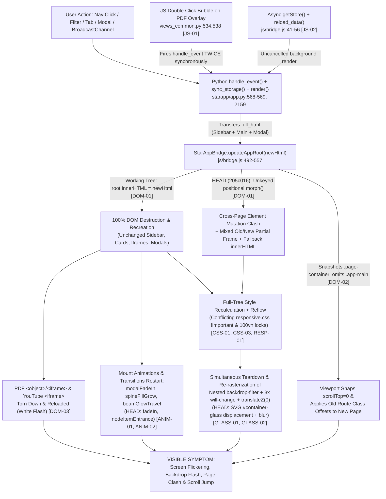

# STARAPP — COMPLETE UI FLICKERING, LIQUID GLASS & RENDERING ARCHITECTURE INVESTIGATION

> **Investigation Scope & Rules Compliance:** Zero application source files, stylesheets, scripts, or service worker assets were modified during this investigation. Every claim below is anchored strictly to observed source files in the workspace (`HEAD` commit `205c016 Demo 1 completed` and the current uncommitted working tree shown by `git diff HEAD`). Unverified runtime behaviors are explicitly labeled as unverified.

---

## 1. Application Rendering Architecture

StarApp runs as a browser-local Single-Page Application (SPA) driven by a Python controller inside WebAssembly (`Pyodide v0.26.2`) communicating synchronously and asynchronously with a Vanilla JS bridge (`js/bridge.js`) and five global stylesheets loaded in `<head>`.

### 1.1 Asset & Runtime Dependency Chain (`index.html`, `sw.js`, `scripts/pack_py.py`)

1. **Stylesheet Cascade Order (`index.html:9-13`):**
   - `css/design_tokens.css` (palette variables, radii, transition timing tokens)
   - `css/liquid_glass.css` (glass cards, buttons, controls, popovers, velocity charts)
   - `css/layout.css` (body canvas, `#app-root`, `.app-sidebar`, `.app-main`, `.app-topbar`, `.page-container`, `.modal-backdrop`)
   - `css/components.css` (KPI grids, tables, forms, rubric, roadmap stones, timelines, media cards)
   - `css/responsive.css` (breakpoints, review split-view overrides, sticky columns, mobile glass overrides, `prefers-reduced-motion`)
2. **Global SVG Filter Definition (`index.html:27-57`):**
   - Renders an invisible `<svg class="glass-svg-defs" aria-hidden="true">` containing `<filter id="container-glass">` (`feTurbulence` + `feGaussianBlur stdDeviation="2"` + `feDisplacementMap scale="70"` + `feGaussianBlur stdDeviation="4"` + `feComposite operator="over"`).
3. **Runtime & Script Initialization (`index.html:16-20, 87-182`):**
   - Loads `https://cdn.jsdelivr.net/pyodide/v0.26.2/full/pyodide.js`.
   - Loads `js/bridge.js?v=8` and `js/starapp_bundle.js?v=8` (bundled by `scripts/pack_py.py` from `starapp/*.py`; verified 100% in sync across all 13 Python modules).
   - On `DOMContentLoaded` (`index.html:171`), `initializeStarApp()` calls `loadPyodide()`, mounts all `starapp/*.py` files into Pyodide's virtual filesystem (`index.html:124-128`), asynchronously reads `"data"` and `"session"` from `StarAppBridge.getStore()` (`index.html:134-135`), and invokes `controller.initialize(stored_data, session_data)` (`index.html:159`).
   - On `window.load` (`index.html:174-182`), registers `sw.js`, which uses `Cache-First` for `cdn.jsdelivr.net` Pyodide assets (`sw.js:57-77`) and `Stale-While-Revalidate` (`sw.js:80-97`) for same-origin static files (`CACHE_NAME = "starapp-runtime-cache-v1"`).
4. **Python View & HTML Generators:**
   - `starapp/app.py` (`StarAppController`) is the central state machine, event dispatcher (`handle_event`), modal renderer (`render_active_modal`), and root HTML assembler (`render`).
   - `starapp/views_common.py`, `starapp/views_guardian.py`, and `starapp/views_cosmonaut.py` generate raw HTML strings with heavy inline `style="..."` and inline `onclick`/`onmouseover`/`onmouseout`/`onchange`/`oninput` handlers.
   - `starapp/dashboard_demo.py`, `starapp/roadmap.py`, and `starapp/seed_data.py` provide pure Python data structures (zero HTML/CSS generation).

### 1.2 Architectural Pattern

StarApp implements a **server-style full-page HTML string renderer executed client-side inside Pyodide**:
- There is **no** component-level state tracking, virtual DOM with keys, persistent shell mounting, or partial region replacement.
- Nearly every user interaction invokes `StarAppController.render()` (`starapp/app.py:1941-2183`), which rebuilds the **entire** UI tree inside `<div id="app-root">`—including the `<aside class="app-sidebar">`, `<div class="app-main">`, `<main class="...">`, any active flash banner, and `{modal_html}` (`starapp/app.py:2159-2168`).
- Only two actions bypass `self.render()`: `toggle_submission_method_fields` (`starapp/app.py:503-524`) and `recalc_rubric_total` (`starapp/app.py:552-566`), which mutate target element properties directly via Pyodide's `js.document`.

---

## 2. Navigation Rendering Lifecycle

Tracing what happens when a user clicks any sidebar link or interactive control (e.g., navigating from Dashboard to Roadmap, Learning Materials, or Project Reviews):

```
1. User clicks <a class="nav-link" onclick="window.StarAppBridge.dispatchAction('nav_guardian', 'g_reviews')">
   └─ Hovering first triggered .nav-link:hover (transition: all 150ms, transform: translateX(2px)) [css/layout.css:156,171-175]
2. JS Bridge receives event: window.StarAppBridge.dispatchAction(action, payloadJson) [js/bridge.js:483-489]
   └─ Synchronous call into Pyodide: window.starAppController.handle_event(action, payloadJson) [js/bridge.js:485]
3. Python Controller processes event: StarAppController.handle_event() [starapp/app.py:153-569]
   ├─ Updates self.current_view and clears self.active_modal = None [starapp/app.py:190-204]
   └─ Calls self.sync_storage() [starapp/app.py:568] -> writes "session" to sessionStorage (always), and writes "data" to localStorage + async IndexedDB + BroadcastChannel if store.dirty [starapp/app.py:113-128, js/bridge.js:128-158]
4. Python generates complete HTML: self.render() [starapp/app.py:569, 1941-2183]
   ├─ Regenerates sidebar_html (render_guardian_sidebar or render_cosmonaut_sidebar) [starapp/app.py:1978, 2060]
   ├─ Regenerates main_content_html for self.current_view [starapp/app.py:1980-2142]
   ├─ Regenerates modal_html = self.render_active_modal() [starapp/app.py:2144]
   └─ Concatenates into monolith `full_html` [starapp/app.py:2159-2168]
5. HTML transferred across Pyodide FFI to JS:
   └─ js.window.StarAppBridge.updateAppRoot(full_html) [starapp/app.py:2173]
6. DOM is updated inside updateAppRoot(newHtml) [js/bridge.js:492-557]:
   ├─ Captures window.scrollY and scrollable sub-container offsets (.page-container, .main-content, .table-responsive, .modal-body, .review-workspace-grid) [js/bridge.js:497-510]
   │    (Note: .app-main — the actual main scroll container per layout.css:249-256 — is NOT in this selector list!)
   ├─ Captures activeElement id and selection range [js/bridge.js:513-522]
   ├─ Working tree: root.innerHTML = newHtml [js/bridge.js:525] (destroys ALL existing DOM inside #app-root)
   ├─ HEAD (205c016): tempContainer.innerHTML = newHtml -> unkeyed index-based recursive morph(root, tempContainer) with innerHTML fallback [git diff HEAD js/bridge.js:523-610]
   └─ Restores old window.scrollY and captured className scroll offsets unconditionally [js/bridge.js:528-543]
7. CSS styles recalculated across entire newly mounted/mutated subtree
8. Browser runs layout & paint on fresh #app-root nodes (and tears down / re-initializes any <iframe>/<object> elements)
9. Liquid Glass compositor layers & backdrop-filter regions re-rasterized across all visible .liquid-glass-* nodes
10. Animations & transitions restart from frame 0 on freshly mounted nodes (modalFadeIn, spineFillGrow, beamGlowTravel, pulseHalo; and in HEAD also fadeIn on .page-container and nodeItemEntrance on .timeline-node-row)
```

### Key Architectural Findings in the Lifecycle

| Question | Observed Behavior | Evidence |
|---|---|---|
| Is the entire application root replaced? | **Yes (Working Tree)**; **Unkeyed index-morph across incompatible pages (`HEAD`)**. `<aside class="app-sidebar">`, `<div class="app-main">`, and `{modal_html}` are always regenerated and sent together as `full_html`. | `starapp/app.py:2159-2177`, `js/bridge.js:525` |
| Is DOM reconciliation used? | Removed in uncommitted working tree (`root.innerHTML = newHtml`). Was present in `HEAD` (`205c016`) as a hand-rolled unkeyed positional `morph(oldEl, newEl)` that walked `oldChildren[i]` vs `newChildren[i]` across completely different pages. | `git diff HEAD js/bridge.js` |
| Did `HEAD` reconciliation produce unnecessary mutations / coexisting fragments? | **Yes.** Because `morph()` matched children strictly by array index (`for (let i = 0; i < maxLen; i++)`) with no element keys or view IDs, navigating from e.g. `g_dashboard` (KPI grids, charts, tables) to `g_allotment` or `g_materials` kept `<div class="app-main"> -> <main class="page-container"> -> <div>` wrappers while mutating attributes, text nodes, inline styles, and replacing mismatched tags node-by-node in a live tree—temporarily leaving mixed old/new elements and triggering massive style/layout thrashing when child counts or tag names diverged. | `git diff HEAD -- js/bridge.js` (lines 523-602 of `HEAD`) |
| Are unchanged elements recreated? | **Yes.** The persistent `<aside class="app-sidebar">`, SVG icons, user card, filter headers, and even active `<object>`/`<iframe>` PDFs & YouTube embeds are rebuilt on every single `render()`, including intra-page clicks (filters, opening/closing modals, marking announcements read). | `starapp/app.py:1978, 2060, 2159-2168`; `starapp/views_common.py:534-558` |
| Are elements repeatedly mounted & unmounted? | **Yes.** Every `handle_event` (except lines 524 and 566) destroys and remounts `#app-root` children. In `g_materials` / `c_materials`, clicking *"Click to Read in Large Window"* or switching filters destroys and remounts every inline PDF `<object>`/`<iframe>` and YouTube `<iframe>` on the page behind/around the modal. | `starapp/app.py:227-238, 569, 2159`; `starapp/views_common.py:535-558` |
| Does navigation cause layout shifts / scroll jumps? | **Yes.** `updateAppRoot()` unconditionally snapshots `.page-container`, `.table-responsive`, etc., BEFORE replacement and reapplies `snap.top`/`snap.left` AFTER replacement via `root.querySelector("." + snap.className.split(" ")[0])` even when navigating to a completely different view! Additionally, `.app-main` (`css/layout.css:249-256`) is the actual scroll container (`height: 100vh; overflow-y: auto`), NOT `.page-container`, while `.main-content` queried in `js/bridge.js:499` does not exist anywhere in generated HTML. | `js/bridge.js:497-543`, `css/layout.css:249-256`, `starapp/app.py:2161-2165` |
| Can async renders overwrite newer renders? | **Yes (via `reload_data` / IndexedDB async read).** `initializeStarApp()` and `triggerCrossWindowLiveReload()` `await StarAppBridge.getStore("data")` asynchronously (IndexedDB promise) and then call `controller.initialize()` or `controller.reload_data()`, which invokes `self.render()` with no sequence guard or cancellation check against user navigations happening while IndexedDB I/O resolves. | `index.html:134-159`, `js/bridge.js:41-55`, `starapp/app.py:130-143` |

---

## 3. Liquid Glass Implementation Analysis

Every Liquid Glass primitive and compositor-sensitive property found across the codebase is mapped below.

### 3.1 Inventory of `backdrop-filter`, SVG Filters, Compositor Promotion & Stacking Controls

| Mechanism / Property | CSS Selector / HTML Element | Exact Value & File:Line | Compositing / Layer Effect |
|---|---|---|---|
| **SVG Displacement Filter Definition** | `#container-glass` inside `<svg class="glass-svg-defs">` | `feTurbulence (fractalNoise 0.05)` + `feGaussianBlur(2)` + `feDisplacementMap(scale=70)` + `feGaussianBlur(4)` + `feComposite(over)` (`index.html:27-57`) | Present in DOM permanently. In `HEAD` (`205c016`), referenced directly by `backdrop-filter: url("#container-glass") blur(...)` on `.liquid-glass-card`, `.liquid-glass-panel`, `.liquid-glass-modal`, and `.btn-liquid::before` (`git diff HEAD -- css/liquid_glass.css`). Detached from CSS in working tree, though `<svg class="glass-svg-defs">` remains. |
| **Root Glass Cards & Panels** | `.liquid-glass-card, .liquid-glass-panel, .liquid-glass-modal` | Working tree: `isolation: isolate; overflow: hidden; backdrop-filter: blur(12px); backface-visibility: hidden; transform: translateZ(0);` (`css/liquid_glass.css:20-34`). `HEAD`: `backdrop-filter: url("#container-glass") blur(18px) saturate(180%);` without `transform: translateZ(0)` (`git diff HEAD`). | Forces **every single card** on every page into an isolated GPU compositing layer with backdrop readback and 8-layer `box-shadow` (`css/liquid_glass.css:36-44`), AND creates a **hard stacking context trap** (`isolation: isolate` + `transform: translateZ(0)`). |
| **Modal Override Conflict** | `.liquid-glass-modal` | Desktop (`css/liquid_glass.css:49-59`): `backdrop-filter: none !important; background: #EAF4FF !important;`. Mobile `@media (max-width: 768px)` (`css/responsive.css:344-350`): `backdrop-filter: blur(12px) saturate(150%) !important;`. | Because `responsive.css` loads **after** `liquid_glass.css` (`index.html:10-13`) and both use `!important`, mobile viewports (`<=768px`) silently **re-enable** `backdrop-filter: blur(12px) saturate(150%) !important` on every modal (`#EAF4FF` opaque dialog + PDF/iframe inside!), colliding with `.modal-backdrop`'s own `blur(8px)`. |
| **Backdrop Blur Overlay** | `.modal-backdrop` | `position: fixed; inset: 0; backdrop-filter: blur(8px); z-index: 1000; animation: modalFadeIn 200ms ease-out;` (`css/layout.css:343-355`) | Applies a full-viewport (`100vw x 100vh`) live backdrop blur over the entire underlying page (including sticky `.app-topbar` and all underlying `.liquid-glass-card` layers) every time any modal is rendered. |
| **Sticky Topbar Glass** | `.app-topbar` | `backdrop-filter: blur(12px); transform: translateZ(0); position: sticky; top: 0; z-index: 90;` (`css/layout.css:258-273`; `HEAD` had `blur(14px)`) | Sticky composited backdrop-blur layer (CSS rule defined, though note `render_topbar()` is imported at `starapp/app.py:30` and currently not injected into `app.py:2159-2168`). |
| **Liquid Pill Button & Specular Layer** | `.btn-liquid`, `.btn-liquid::before` | `isolation: isolate` + `::before { backdrop-filter: blur(12px); transition: all 150ms; }` (`css/liquid_glass.css:118-167`; `HEAD` had `url("#container-glass") blur(12px)`) | Creates composited backdrop-blur layer per button with 9-layer inset/outer `box-shadow` transitioned via `transition: all`. |
| **3-Layer Metal Buttons (`will-change`)** | `.btn-metal-wrapper`, `.btn-metal-inner`, `.btn-metal` | All 3 nested elements set `will-change: transform;` + `transition: all 250ms cubic-bezier(0.1, 0.4, 0.2, 1);` (`css/liquid_glass.css:205-265`) | **Every single metal button** (often 10–30+ buttons per view on Badge Allotment, Reviews, Dashboard, Materials) allocates **3 simultaneous `will-change: transform` GPU texture layers**. |
| **Secondary Buttons** | `.btn-secondary` | `backdrop-filter: blur(8px); transition: all var(--transition-fast);` (`css/liquid_glass.css:284-303`) | Adds a separate `backdrop-filter` readback layer on every secondary button across sidebars, tables, modals, and toolbars. |
| **Nested Submission Form Glass** | `.liquid-submission-portal`, `.liquid-glass-control`, `.liquid-select-wrapper`, `.liquid-glass-file-input`, `.liquid-glass-file-input::file-selector-button`, `.liquid-date-wrapper` | `backdrop-filter: blur(10px..12px)` (in `HEAD`: `blur(18px..20px) saturate(180%)`) + `isolation: isolate` + `transform: translateZ(0)` (`css/liquid_glass.css:332-549`) | **Severe nested backdrop-filter stacking:** on `c_submission`, `c_extensions`, `g_materials`, `c_materials`, and `g_review_detail`: `body::before` -> `.liquid-submission-portal` (`blur(12px)`, `translateZ(0)`) -> `.liquid-select-wrapper` (`blur(12px)`, `translateZ(0)`) -> `<select class="liquid-glass-control liquid-glass-select">` (`blur(12px)`). And `.liquid-glass-file-input` (`blur(10px)`) directly wraps `::file-selector-button` (`blur(8px)`). |
| **Hover Popovers & Tooltips** | `.glass-tooltip-popover`, `.chart-data-tooltip`, `.velocity-hover-popover` | `backdrop-filter: blur(16px)` (`css/liquid_glass.css:696-697, 956-957`) / `blur(8px)` (`css/liquid_glass.css:865`), `z-index: 1000..999999` | Triggered on hover inside `.liquid-glass-card` ancestors (`isolation: isolate; transform: translateZ(0)`). |
| **Fixed Background Layer** | `body::before` (Working Tree) vs `body` (`HEAD`) | Working tree: `body::before { position: fixed; inset: 0; z-index: -1; transform: translateZ(0); }` (`css/layout.css:26-36`). `HEAD`: `body { background-attachment: fixed; }` (`git diff HEAD -- css/layout.css`). | In `HEAD`, `background-attachment: fixed` forced software/CPU full-viewport repaint on scroll and layout changes across all backdrop-filter elements. In working tree, `body::before` promotes the radial-gradient backdrop to a fixed GPU layer behind `.app-main` (`height: 100vh; overflow-y: auto`). |
| **Mobile Sticky Table Columns** | `.cadet-risk-table th/td:first-child, :last-child` | `@media (max-width: 900px)` `position: sticky !important; backdrop-filter: blur(8px) !important;` (`css/responsive.css:316-338`) | Forces sticky `backdrop-filter` compositor passes on every row cell (`tr` x 2 columns) during horizontal table scroll. |
| **Inline GPU Layer Wrapper around PDF** | `div` wrapping `#pdf-document-frame` | `isolation:isolate; transform:translateZ(0);` (`starapp/views_guardian.py:1752`) | Wraps heavy cross-process PDF `<iframe id="pdf-document-frame">` inside a promoted transform layer on `g_review_detail`. |

### 3.2 Expensive Liquid Glass Combinations Identified

1. **`HEAD` SVG Turbulence + Blur Backdrop Filter (`HEAD` `css/liquid_glass.css:30, 148` + `index.html:29-55`):** Applying `backdrop-filter: url("#container-glass") blur(18px) saturate(180%)` forced the browser to sample the background behind every card, run Perlin fractal noise displacement (`feTurbulence` + `feDisplacementMap scale="70"`), double Gaussian blur (`stdDeviation="2"` + `"4"`), AND CSS blur(18px) + saturate(180%) every time the DOM morphed or scrolled.
2. **Global Compositor Layer Explosion (Working Tree & `HEAD`):** Every card (`.liquid-glass-card`), button (`.btn-metal-wrapper` + `.btn-metal-inner` + `.btn-metal` = 3 `will-change: transform` layers each; `.btn-secondary` = `backdrop-filter: blur(8px)`), form input (`.liquid-glass-control` = `blur(12px)`), wrapper (`.liquid-select-wrapper` / `.liquid-date-wrapper`), and popover creates an independent composited backdrop/texture surface—all destroyed and re-allocated simultaneously on every `root.innerHTML = newHtml`.
3. **Nested `backdrop-filter` Readback Chains:** Especially in `c_submission` (`liquid-submission-portal` -> `liquid-select-wrapper` -> `liquid-glass-control`; `liquid-glass-file-input` -> `::file-selector-button`), `g_dashboard` (`liquid-glass-card` -> `glass-tooltip-popover` / `velocity-hover-popover`), and mobile modals (`modal-backdrop` blur(8px) -> `liquid-glass-modal` blur(12px) saturate(150%)).

---

## 4. CSS Conflict Analysis

### 4.1 Duplicate Selectors, Specificity Collisions, and Cascade Overrides

1. **Duplicate `@media (max-width: 768px)` & `!important` Modal Backdrop Contradiction (`css/liquid_glass.css` vs `css/responsive.css`):**
   - `css/liquid_glass.css:49-59` explicitly disables modal blur with `-webkit-backdrop-filter: none !important; backdrop-filter: none !important;` to prevent rendering artifacts on large dialogs.
   - `css/responsive.css` contains **three separate `@media (max-width: 768px)` blocks** (`lines 23-96`, `160-222`, `344-363`). The third block (`css/responsive.css:344-350`) declares:
     ```css
     .liquid-glass-card,
     .liquid-glass-panel,
     .liquid-glass-modal {
       -webkit-backdrop-filter: blur(12px) saturate(150%) !important;
       backdrop-filter: blur(12px) saturate(150%) !important;
     }
     ```
   - Because `responsive.css` loads last (`index.html:13`), equal `!important` specificity causes `responsive.css` to **override** `liquid_glass.css:57-58` below 768px—silently re-enabling blurred saturated compositing on modals and changing desktop `blur(12px)` cards to `blur(12px) saturate(150%)`.
   - Likewise, `.app-sidebar` (`css/responsive.css:28-33` vs `182-189`), `.modal-dialog` (`76-79` vs `161-165`), `.sidebar-nav`, `.nav-link`, and `.page-container` are styled twice at `@media (max-width: 768px)` with `!important` flags overriding the earlier declarations in the same file.

2. **Conflicting `overflow` & Stacking Context Traps (`css/liquid_glass.css` vs Inline Python Styles):**
   - `css/liquid_glass.css:20-33` sets `.liquid-glass-card { isolation: isolate; overflow: hidden; transform: translateZ(0); }`.
   - To keep tooltips/popovers visible, Python templates inject inline `overflow:visible` on KPI cards (`starapp/views_guardian.py:194, 211, 228, 247, 264`), inline `overflow:visible !important; z-index:50;` on `.velocity-glass-card` (`starapp/views_guardian.py:411`, duplicated in `css/liquid_glass.css:922-926`), and inline `overflow:visible;` on Cosmonaut performance card (`starapp/views_cosmonaut.py:421`)—plus `overflow:visible` on SVG roadmap `<svg>` (`starapp/views_cosmonaut.py:1145`).
   - **Critical Stacking Trap:** `isolation: isolate` + `transform: translateZ(0)` on `.liquid-glass-card` forces **each card into its own root stacking context**. Consequently, `.glass-tooltip-popover { z-index: 10000; }` (`css/liquid_glass.css:698`) inside KPI Card #1 (`views_guardian.py:200`) or Card #2 (`views_guardian.py:217`) cannot stack above sibling KPI Cards #2–#5 or rows below it, causing tooltips to clip behind adjacent glass cards (`z-index: 10000` only applies inside that card's trapped context). Only `.velocity-glass-card` (`z-index: 50`) partially elevated above sibling cards, leaving KPI cards 1–5 and Cosmonaut's `.liquid-glass-card` (`views_cosmonaut.py:421`, no `z-index`) broken against subsequent cards.
   - Similarly, `.glass-tooltip-popover` is rendered inside `<button type="button" class="metric-info-trigger">` (`views_guardian.py:25-51`, `views_cosmonaut.py:30-56`), which is invalid interactive-in-button HTML structure and binds popover positioning to the `17px x 17px` button box that also scales via `transform: scale(1.15)` on `:hover/:focus` (`css/liquid_glass.css:674`), shifting the entire popover visually!

3. **`div[style*="overflow-x:auto"]` Attribute Selector Side Effect (`css/responsive.css:105-112`):**
   - Applies `width: 100%; overflow-x: auto; -webkit-overflow-scrolling: touch; border-radius: var(--radius-sm);` to **every `div` in the DOM whose inline `style` attribute contains the substring `overflow-x:auto`**, including the Gamified Roadmap wrapper (`starapp/views_cosmonaut.py:1141`).
   - Additionally, `css/responsive.css:121, 127, 132, 173-175` use fragile substring attribute selectors (`div[style*="grid-template-columns:..."]`) to override inline Python grids, creating high coupling to exact whitespace/formatting inside Python f-strings.

4. **Roadmap & Media Card Inline Style vs CSS Transition Conflicts:**
   - `.liquid-glass-card` (`css/liquid_glass.css:46`) defines `transition: transform var(--transition-fast), border-color var(--transition-fast);` (explicitly commenting *"without box-shadow interpolation on mount to prevent shadow flash"*).
   - **Direct Override:** `starapp/views_cosmonaut.py:1115` injects inline `transition:transform 200ms ease, box-shadow 200ms ease;` + `onmouseover="this.style.transform='scale(1.03)'"` on every roadmap `.liquid-glass-card.milestone-container-node`, and `starapp/views_guardian.py:1564` injects inline `transition:transform 180ms ease, box-shadow 180ms ease;` on every review queue `.liquid-glass-card.interactive`—re-introducing `box-shadow` transition interpolation and fighting `.liquid-glass-card.interactive:hover` (`translateY(-2px)` vs `scale(1.03)`).
   - Meanwhile, `starapp/views_guardian.py:228, 247` inject inline `transition:transform 0.15s ease;` (dropping `border-color` transition on hover for KPI 3 & KPI 4).

5. **Viewport Height & Scroll Container Conflicts:**
   - `#app-root` is `min-height: 100vh` (`css/layout.css:41`), while `.app-main` is `height: 100vh; overflow-y: auto` (`css/layout.css:254-255`), whereas `.page-review-detail` (`css/responsive.css:225-231`) forces `height: 100vh !important; overflow: hidden !important;` alongside `.review-detail-workspace` inline `height: calc(100vh - 20px)` (`starapp/views_guardian.py:1833`) conflicting with `css/responsive.css:234` (`height: calc(100vh - 16px) !important`).
   - When switching between `g_review_detail` (`overflow: hidden` on `100vh`) and any standard scrolling page (`.app-main` `overflow-y: auto` scrollbar appears/disappears), the horizontal width available to grids shifts by scrollbar width (~15–17px on Windows browsers), causing grid reflow on navigation.

6. **Pervasive `transition: all` Rules Across Global Selectors:**
   - `css/liquid_glass.css`: `.btn-liquid::before` (`165`), `.btn-metal-wrapper` (`212`), `.btn-metal-inner` (`233`), `.btn-metal` (`263`), `.btn-secondary` (`300`), `.liquid-glass-control` (`385`), `.liquid-select-wrapper` (`418`), `.liquid-glass-file-input` (`489`), `.liquid-glass-file-input::file-selector-button` (`515`), `.liquid-date-wrapper` (`547`), `.liquid-glass-date::-webkit-calendar-picker-indicator` (`613`), `.metric-info-trigger` (`663`).
   - `css/layout.css`: `.nav-link` (`156`), `.notif-btn` (`306`).
   - `css/components.css`: `.form-control, .form-select, .form-textarea` (`204`), `.milestone-stone` (`344`).
   - Inline HTML in Python: `starapp/views_cosmonaut.py:404` and `starapp/views_guardian.py:849` inject `transition:all 0.2s ease;` directly onto dashboard chart bar fills (`<div>`), transitioning height, width, background, border-radius, and layout properties simultaneously if morphed or resized.

---

## 5. Animation and Transition Analysis

### 5.1 Complete Animation Trigger Matrix

| Trigger Event | Active CSS Animations / Transitions | Restart / Conflict Behavior | Source-Code References |
|---|---|---|---|
| **Initial Startup** | `#loading-progress-bar` `transition: width 300ms ease` (`35% -> 40% -> 70% -> 85% -> 95%`) + `.liquid-glass-card` mount | First paint shows loading glass card, then synchronous `root.innerHTML` wipe replaces it with Login or restored View (`HEAD` also played `@keyframes fadeIn`). | `index.html:65, 74, 92-159`, `starapp/app.py:111, 1941` |
| **Login** | `select_demo_account` / `login` replaces `#app-root` -> mounts sidebar + dashboard (`HEAD`: `.page-container` `fadeIn 200ms`) | Full DOM wipe; sidebar & cards paint fresh. Wait: if `select_demo_account` runs, `sync_storage()` writes `sessionStorage`, `render()` replaces DOM. | `starapp/app.py:160-177, 1941-2183` |
| **Page Navigation** | Clicking `.nav-link` starts `transition: all 150ms` + `translateX(2px)` on hover (`css/layout.css:156, 171-175`); click immediately triggers synchronous `root.innerHTML = newHtml` (Working Tree) or `morph()` (`HEAD`). | **Working tree:** Active `.nav-link` hover/press transition is mid-flight when `<aside class="app-sidebar">` is completely destroyed and recreated. **In `HEAD`:** `.page-container { animation: fadeIn 200ms ease-in-out }` (`opacity: 0 -> 1`, `translateY(6px -> 0)`) ran on navigation, OR failed to restart cleanly when `.page-container` was reused in-place by `morph()`—causing partially morphed elements to snap in (`HEAD` `git diff css/layout.css:322-331`). | `css/layout.css:156, 171-183`; `HEAD` `css/layout.css:322-331`; `starapp/app.py:190-204, 2159-2177` |
| **Sidebar Interactions** | `.app-sidebar` `transition: width 250ms` (`css/layout.css:60`); `.nav-link` & `svg` transitions (`156, 168`). | Sidebar is regenerated on every click (`starapp/app.py:1978, 2060`) even when only the main view or modal changes, resetting scroll position of `.sidebar-nav` (`.sidebar-nav` is NOT in `js/bridge.js:499` scroll snapshot selector!) and cutting off icon transitions. | `css/layout.css:60, 135-169`; `js/bridge.js:499`; `starapp/app.py:2160` |
| **Modal Opening, Interaction & Closing** | `.modal-backdrop` runs `@keyframes modalFadeIn 200ms ease-out` (`opacity: 0 -> 1`) (`css/layout.css:343-360`). Badge detail modal ALSO runs `@keyframes spineFillGrow 0.85s` (`css/components.css:719, 873-880`) and infinite `@keyframes beamGlowTravel 2.4s infinite` (`css/components.css:730, 882-897`). | **Critical Restart Bug:** Opening a modal (`view_material_preview`, `open_badge_detail_modal`, `view_marksheet`, etc.) calls `self.render()`, which **replaces the entire `#app-root`**—rebuilding the page, sidebar, and every inline `<object>`/`<iframe>` behind the modal! Conversely, **any render while a modal is open** (e.g., `reload_data` from `BroadcastChannel`, changing badge timeline, or any modal action that re-renders) recreates `.modal-backdrop` from scratch and **restarts `modalFadeIn` (`opacity: 0 -> 1`)**, creating an unmistakable black/blur flash over the screen! In `HEAD`, `.timeline-node-row` also started at `opacity: 0` with `animation-delay: 0.08..0.48s` (`views_cosmonaut.py:1245`, `HEAD` `components.css:748-750`), causing staggered pop-in flash. | `css/layout.css:343-360`; `css/components.css:711-750, 862-897`; `starapp/views_cosmonaut.py:1242-1257`; `starapp/app.py:207-244, 2144-2177` |
| **Tab / Filter Switching** | e.g., `filter_materials_type`, `filter_materials_badge`, `change_viewer_tab`, `filter_guardian_reviews`, `select_guardian_cosmo_filter` | Every tab/filter dropdown triggers full `self.render()` (`starapp/app.py:232-256, 532-534, 569`). On `g_review_detail` (`change_viewer_tab`) or `g_materials`/`c_materials`, this destroys and reloads `<iframe id="pdf-document-frame">` or all inline `<object>`/`<iframe>` viewers, causing white blank frames while PDF/YouTube reloads. On `<select class="liquid-glass-select">`, `updateAppRoot` immediately blurs/destroys the focused native `<select>` element (note: inline `<select>` elements in `views_common.py:680`, `views_guardian.py:1845` etc. — some have IDs, `views_common.py:680` has **no `id`**, so `activeId` focus restoration at `js/bridge.js:514` fails!). | `starapp/app.py:232-256, 532-534, 569`; `js/bridge.js:513-556`; `starapp/views_common.py:680` |
| **Dashboard Hover & Loading** | `.metric-info-trigger:hover > .glass-tooltip-popover` runs `@keyframes glassPopoverFadeIn 0.18s` (`css/liquid_glass.css:704-710`) while `.metric-info-trigger` itself scales `1.15` (`css/liquid_glass.css:674`); `.velocity-bar-col:hover` (`transition: transform 150ms`) reveals `.velocity-hover-popover` (`transition: opacity 0.15s, transform 0.15s, visibility 0.15s`). | Because `.glass-tooltip-popover` is a child of `<button class="metric-info-trigger">` whose transform changes on `:hover`, hovering near the edge or scaling `1.15` can shift geometry, while stacking contexts (`isolation: isolate; transform: translateZ(0)`) clip it behind adjacent cards. Also in `views_cosmonaut.py:407`, bar tooltips use `.glass-tooltip-popover` without `.metric-info-trigger`, meaning CSS rule `:hover > .glass-tooltip-popover` (`liquid_glass.css:752`) does not even match it (dead tooltip markup). | `css/liquid_glass.css:644-756, 929-999`; `starapp/views_guardian.py:24-52`; `starapp/views_cosmonaut.py:399-410` |
| **Roadmap Page** | Inline `onmouseover="this.style.transform='scale(1.03)'"` / `onmouseout` + inline `transition: transform 200ms ease, box-shadow 200ms ease` (`starapp/views_cosmonaut.py:1115-1117`). | Directly fights `.liquid-glass-card` CSS transition (`liquid_glass.css:46`) AND `.liquid-glass-card.interactive` rules; JS mouse handlers mutate `style.transform` directly on nodes that already carry `transform: translateZ(0)`. Note CSS class `.milestone-stone.active` (`@keyframes pulseHalo 2s infinite` animating `box-shadow`, `css/components.css:357-368`) is defined in CSS though `render_gamified_roadmap()` currently uses `.milestone-container-node` instead of `.milestone-stone`. | `starapp/views_cosmonaut.py:1111-1118`; `css/liquid_glass.css:33, 46`; `css/components.css:357-368` |
| **BroadcastChannel Sync Updates** | Remote tab calls `setStore("data", ...)` -> `triggerCrossWindowLiveReload()` -> `controller.reload_data()` -> `self.render()` (`js/bridge.js:41-64`, `starapp/app.py:130-143`). | Rebuilds the **entire** active DOM of the receiving window silently in the background (`root.innerHTML = newHtml`), interrupting any open dropdown, video playback, PDF scroll, in-progress form text (unless element has an `id`), and restarting `.modal-backdrop` (`modalFadeIn`) and `.timeline-track-*` animations! | `js/bridge.js:41-73, 146-155, 525`; `starapp/app.py:130-143` |

---

## 6. JavaScript Event Lifecycle Analysis

### 6.1 Startup & Listener Registration (`index.html`, `js/bridge.js`, `sw.js`)

- **No MutationObserver or ResizeObserver** exists anywhere in the codebase (verified across `js/bridge.js`, `index.html`, `sw.js`, and all `starapp/*.py` files).
- **No `setTimeout`, `setInterval`, or `requestAnimationFrame`** loops exist in `js/bridge.js` or `index.html` for rendering.
- **Event Delegation vs Inline Attributes:** StarApp does **not** attach persistent `addEventListener` handlers to `#app-root` children (only `DOMContentLoaded` and `window.load` in `index.html:171, 175`, and `window.addEventListener("storage", ...)` fallback in `js/bridge.js:68`). Instead, all click/change/submit/hover interactions are **inline HTML attributes** (`onclick`, `onchange`, `onsubmit`, `oninput`, `onmouseover`, `onmouseout`) generated inside Python strings. Because DOM nodes are recreated, listeners are garbage-collected and re-parsed cleanly (no cumulative `addEventListener` leak), **except** for:

### 6.2 Confirmed JavaScript Sync & Event Edge Cases

1. **Duplicate Render Storm in `HEAD` via Dual `BroadcastChannel` + `storage` Listeners (`HEAD` `js/bridge.js:41-73`):**
   - In `HEAD` (`205c016`), `js/bridge.js` registered **both** `syncChannel.onmessage` AND `window.addEventListener("storage", ...)` unconditionally (`git diff HEAD -- js/bridge.js`), with only a `150ms` debounce in `triggerCrossWindowLiveReload`. Since `setStore("data", value)` both writes `localStorage.setItem("starapp_data", value)` (which triggers `storage` in other tabs) AND posts `syncChannel.postMessage(...)`, any cross-tab update past 150ms—or any `IndexedDB` read latency variance—could trigger `reload_data()` twice (`render()` x 2).
   - In the current working tree (`js/bridge.js:59-73`), `window.addEventListener("storage")` was moved into the `else` branch (only active when `BroadcastChannel` is unsupported) and debounce raised to `300ms` (`js/bridge.js:44`).
2. **Stale Debounce & Unprotected `Date.now()` Timing (`js/bridge.js:41-56`):**
   - In `triggerCrossWindowLiveReload(sourceName)`, `lastSyncTimestamp = now` is set **before** `await window.StarAppBridge.getStore("data")` (`js/bridge.js:45-48`). If an async IndexedDB read takes >300ms or races with a local user action (`handle_event`), the async callback calls `window.starAppController.reload_data(latestDataJson)` (`js/bridge.js:51`) **without checking whether `store.dirty` or a local navigation occurred in the meantime**, overwriting the active page's DOM asynchronously.
3. **Scroll Snapshot Corruption Across Page Navigations (`js/bridge.js:497-543`):**
   - `updateAppRoot(newHtml)` checks **neither** whether the view changed (`g_dashboard` -> `g_materials`) **nor** whether `.app-main` scrolled:
     - `scrollableElements` (`js/bridge.js:499`) queries `[id], .page-container, .main-content, .table-responsive, .modal-body, .review-workspace-grid`.
     - `.app-main` (`css/layout.css:249-256`) is the actual `overflow-y: auto` viewport wrapper (`height: 100vh`)—it has **no `id`** and **is missing from the selector**, so `.app-main.scrollTop` is **always lost (snaps to `0`)** even on same-page actions like toggling filters or opening modals!
     - Meanwhile, `.table-responsive` or `.modal-body` snapshots are matched only by `snap.className.split(" ")[0]` (`js/bridge.js:537`), which applies Page A's horizontal/vertical scroll offset blindly onto Page B's first matching `.table-responsive` element!
4. **Click Bubbling & Double-Action Risks in Learning Materials (`starapp/views_common.py:534-542`):**
   - The `.media-pdf-box` container has `onclick="window.StarAppBridge.dispatchAction('view_material_preview', ...)"` (`534`), its child overlay `div` (`538`) ALSO has `onclick="..."` (without `event.stopPropagation()`!), and its grandchild `span` (`539`) has `onclick="event.stopPropagation(); window.StarAppBridge.dispatchAction('view_material_preview', ...)"`.
   - Clicking the overlay `div` (`538`) outside the pill `span` (`539`) bubbles directly up to `.media-pdf-box` (`534`), dispatching **`view_material_preview` -> `handle_event()` -> `sync_storage()` -> `render()` -> `root.innerHTML = newHtml` TWICE synchronously in a single click!**
   - Clicking `span` (`539`) calls `stopPropagation()` and dispatches once, but clicking anywhere else on the PDF card preview (`538`) fires **two full DOM replacements back-to-back** (restarting `modalFadeIn` and recreating every PDF `<object>`/`<iframe>` twice).
5. **Service Worker `Stale-While-Revalidate` Interaction (`sw.js:80-97`):**
   - `sw.js` returns `cachedResponse` immediately while fetching updated CSS/JS in the background without `CACHE_NAME` invalidation (`starapp-runtime-cache-v1` is hardcoded while `index.html` is at `?v=8`, and CSS files in `CORE_STATIC_ASSETS` have **no version query string**). Whenever CSS/JS updates during development, users run mixed/stale cached CSS (`css/liquid_glass.css`, `css/layout.css`, `css/components.css`) alongside newer HTML/Python until an extra reload occurs.

---

## 7. Python-JavaScript Bridge Analysis

Examining the Pyodide FFI boundary (`index.html:144-160`, `js/bridge.js:483-557`, `starapp/app.py:113-144, 153-570, 1941-2183`):

1. **Coarse-Grained String Serialization Across Wasm Boundary (`starapp/app.py:2159-2177`):**
   - Every UI state transition serializes the **entire workspace** (sidebar + page + modals + inline SVG paths + rubric tables + base64 PDFs/code payloads) into one Python `str` (`full_html`) and copies it from Pyodide Wasm linear memory into V8 JS heap via `js.window.StarAppBridge.updateAppRoot(full_html)`.
   - On views like `g_review_detail` (with Base64 PDF `iframe` or 100s of syntax table rows) or `g_materials` / `c_materials` (multiple inline `<object>`/`<iframe>` PDFs & YouTube embeds), this reconstructs and re-parses large HTML strings (plus embedded `data:application/pdf;base64,...` URIs) synchronously on every action.
2. **Synchronous `setStore` + Async IndexedDB Split (`starapp/app.py:113-128`, `js/bridge.js:128-158`):**
   - `sync_storage()` calls `js.window.StarAppBridge.setStore("session", session_data)` on **every** `handle_event()`, even when only closing a modal or changing a UI filter, and when `store.dirty` is true serializes the entire `store.to_json()` synchronously (`localStorage.setItem` + JSON stringification) right before `self.render()` on the main thread.
3. **Missing Partial Render Targets & Route Guard Discrepancy:**
   - `StarAppController.render()` computes `page_title` (`starapp/app.py:1973, 1981, ...`), yet **never renders a topbar** (`render_topbar` from `starapp/views_common.py:400` is imported at `starapp/app.py:30` and never called in `render()`) and never updates `document.title`—creating visual inconsistency with `css/layout.css:258-273` (`.app-topbar`).
   - `_GUARDIAN_VIEWS` (`starapp/app.py:77-80`) lists `"g_badge_allotment"` and `"g_cosmonauts"`, whereas `render()` (`starapp/app.py:2011`) and `render_guardian_sidebar()` (`starapp/views_guardian.py:63`) actually use `"g_allotment"`—meaning page reloads while on Badge Allotment fail the role-view whitelist (`starapp/app.py:101-106`) and snap back to `g_dashboard`.
4. **Unmounted Root Update During `morph()` (`HEAD`) vs Hard Wipe (Working Tree):**
   - Under `HEAD` (`205c016`), passing `full_html` through `morph(root, tempContainer)` walked `tempContainer.innerHTML = newHtml` + recursive live-DOM diffing in JS without keys, causing mismatched elements across pages to undergo intermediate partial mutation states before settling (and falling back to `root.innerHTML` on exceptions).
   - Under current working tree (`js/bridge.js:525`), switching directly to `root.innerHTML = newHtml` stopped DOM-corrupting unkeyed morphs, **but** guaranteed 100% DOM destruction, `.app-main` scroll reset to `top: 0`, embedded PDF/YouTube teardown+reload, and CSS animation/transition resets on every single interaction.

---

## 8. Browser Performance Evidence

> **Explicit Testing Limitation Statement:** Automated browser-level profiling and DevTools capture **could not be executed** in this workspace environment:
> - `playwright` installed: `False`
> - `selenium` installed: `False`
> - Local server (`serve.py` / `127.0.0.1:8000`): `CLOSED`
> - Strict investigation rules prohibit installing new libraries, running speculative edits, or guessing runtime telemetry.
> - **No synthetic performance numbers, frame timings, CLS scores, or DevTools paint counts are invented in this report.** Live browser DevTools traces (Chrome Performance / Rendering / Paint Flashing / Layers panel) remain **unverified at runtime** and are listed in Section 15 for empirical profiling.

What **is** 100% established statically from source code:
- Synchronous main-thread full-subtree replacement (`root.innerHTML = newHtml` or `HEAD`'s unkeyed `morph()`) occurs on every state/navigation event (`starapp/app.py:569, 2173`, `js/bridge.js:525`).
- Multiple full-subtree `backdrop-filter`, `will-change: transform`, `isolation: isolate`, `box-shadow` transition, and `@keyframes` declarations are present in the active CSS cascade (`css/liquid_glass.css`, `css/layout.css`, `css/components.css`, `css/responsive.css`).
- Double synchronous dispatch (`onclick` bubbling in `starapp/views_common.py:534, 538`) directly executes `handle_event()` -> `render()` -> `root.innerHTML = newHtml` twice per overlay click.

---

## 9. Confirmed Root Causes (Categories A–H)

Below are all **confirmed root causes** identified from direct source inspection, classified into categories **A–H**.

### Category A — DOM Rendering and Reconciliation

- **Issue ID:** `DOM-01`
- **Severity:** **Critical**
- **Status:** Confirmed root cause
- **Affected files:** `starapp/app.py`, `js/bridge.js`
- **Exact function / selector:** `StarAppController.render()`, `StarAppBridge.updateAppRoot(newHtml)`
- **Line references:** `starapp/app.py:569, 2159-2183`; `js/bridge.js:492-557` (and `HEAD` `js/bridge.js:523-610`)
- **Technical explanation:** Every navigation, filter change, tab click, and modal toggle rebuilds the entire application shell (`<aside class="app-sidebar">`, `<div class="app-main">`, `<main>`, and `{modal_html}`) and replaces `#app-root` (`root.innerHTML = newHtml` in working tree; unkeyed positional `morph(oldEl, newEl)` in `HEAD`). There is no persistent shell or partial target container.
- **Evidence:** `starapp/app.py:2159-2168` concatenates `{sidebar_html}` + `<div class="app-main">` + `{modal_html}` into `full_html`, and `js/bridge.js:525` executes `root.innerHTML = newHtml`. In `HEAD`, `git diff HEAD -- js/bridge.js` shows `morph()` looping `for (let i = 0; i < maxLen; i++)` over unkeyed `childNodes` between mismatched views.
- **Other components potentially affected:** Sidebar navigation state/scroll, all embedded `<object>`/`<iframe>` PDF & YouTube players, open `<select>` menus, active forms/inputs, modal dialogs.

---

- **Issue ID:** `DOM-02`
- **Severity:** **High**
- **Status:** Confirmed root cause
- **Affected files:** `js/bridge.js`, `css/layout.css`, `starapp/app.py`
- **Exact function / selector:** `StarAppBridge.updateAppRoot(newHtml)`, `.app-main`, `.page-container`
- **Line references:** `js/bridge.js:497-543`; `css/layout.css:249-256`; `starapp/app.py:2161-2165`
- **Technical explanation:** `updateAppRoot` omits `.app-main` (the actual `height: 100vh; overflow-y: auto` scroll container) from `scrollableElements` (`[id], .page-container, .main-content, .table-responsive, .modal-body, .review-workspace-grid`), while unconditionally reapplying any matched `.className.split(" ")[0]` scroll offsets even across completely different routes. Result: scrolling down on any page and opening a modal or clicking a filter snaps `.app-main` abruptly to `scrollTop = 0`, while table/modal scroll offsets can leak across routes onto the next page's first matching class selector.
- **Evidence:** `css/layout.css:249-256` defines `.app-main { height: 100vh; overflow-y: auto; }`, whereas `js/bridge.js:499` queries `.page-container, .main-content, ...` (`.main-content` does not exist in `app.py`; `.app-main` is omitted) and lines `531-543` restore `scrollTop`/`scrollLeft` without checking route identity.
- **Other components potentially affected:** Guardian Dashboard, Cosmonaut Dashboard, Badge Allotment, Learning Materials, Roadmap scroll viewport.

---

- **Issue ID:** `DOM-03`
- **Severity:** **High**
- **Status:** Confirmed root cause
- **Affected files:** `starapp/views_common.py`, `starapp/views_guardian.py`
- **Exact function / selector:** `render_learning_materials_view()`, `render_guardian_review_detail()`, `render_assessment_modal_content()`
- **Line references:** `starapp/views_common.py:534-558`; `starapp/views_guardian.py:1750-1755, 2004-2010`; `starapp/app.py:1423-1459`
- **Technical explanation:** Learning Materials renders live `<object type="application/pdf">`, fallback `<iframe>`, and YouTube `<iframe src="https://www.youtube.com/embed/...">` inside cards (`views_common.py:535-558`). Because `view_material_preview` and filter actions replace `#app-root` (`DOM-01`), every inline PDF plugin instance and YouTube `<iframe>` on the page is destroyed and reloaded whenever a modal opens/closes or a filter changes—causing multi-frame white flashes and PDF/video re-initialization clashes. The same happens on `g_review_detail` when switching tabs (`change_viewer_tab`, `app.py:532`).
- **Evidence:** `starapp/views_common.py:535-558` embeds `<object>` and `<iframe>` inside `render_learning_materials_view()`; `starapp/app.py:227-238, 569` calls full `self.render()` on preview/filter actions.
- **Other components potentially affected:** Learning Materials (`g_materials`, `c_materials`), Guardian Review Detail (`g_review_detail`), `assessment` modal.

---

### Category B — Liquid Glass Filters and GPU Rendering

- **Issue ID:** `GLASS-01`
- **Severity:** **Critical** (`HEAD`) / **Medium** (Residual DOM artifact in Working Tree)
- **Status:** Confirmed root cause (Primary GPU bottleneck in `HEAD`)
- **Affected files:** `index.html`, `css/liquid_glass.css`
- **Exact function / selector:** `#container-glass`, `.liquid-glass-card`, `.liquid-glass-panel`, `.liquid-glass-modal`, `.btn-liquid::before`
- **Line references:** `index.html:27-57`; `HEAD` `css/liquid_glass.css:30, 148` (`git diff HEAD -- css/liquid_glass.css`)
- **Technical explanation:** In `HEAD` (`205c016`), every glass card, panel, modal, and liquid button applied `backdrop-filter: url("#container-glass") blur(18px) saturate(180%)` (`blur(12px)` on `.btn-liquid::before`). `#container-glass` chains `feTurbulence` + `feGaussianBlur(2)` + `feDisplacementMap(scale=70)` + `feGaussianBlur(4)` + `feComposite` across every backdrop pixel of every card, causing severe per-frame compositing and partial-rasterization glitches during DOM morphing, scrolling, and hover transitions. Although removed from CSS selectors in the uncommitted working tree, `<svg class="glass-svg-defs">` remains in `index.html:27-57`.
- **Evidence:** `index.html:29-55` defines `<filter id="container-glass">`; `git diff HEAD -- css/liquid_glass.css` lines `104-108` and `136-138` verify `url("#container-glass")` was active on `HEAD`.
- **Other components potentially affected:** Every page in Guardian and Cosmonaut portals containing `.liquid-glass-card` or `.btn-liquid`.

---

- **Issue ID:** `GLASS-02`
- **Severity:** **High**
- **Status:** Confirmed root cause
- **Affected files:** `css/liquid_glass.css`, `css/layout.css`, `css/responsive.css`
- **Exact function / selector:** `.liquid-glass-card`, `.btn-metal-wrapper`, `.btn-metal-inner`, `.btn-metal`, `.btn-secondary`, `.liquid-submission-portal`, `.liquid-glass-control`, `.liquid-select-wrapper`, `.liquid-glass-file-input`, `.liquid-glass-file-input::file-selector-button`, `.liquid-date-wrapper`, `.modal-backdrop`, `.cadet-risk-table th/td`
- **Line references:** `css/liquid_glass.css:20-34, 143-155, 205-265, 284-303, 332-347, 369-386, 402-419, 476-523, 529-549, 696-697, 865, 956-957`; `css/layout.css:258-273, 343-355`; `css/responsive.css:316-350`
- **Technical explanation:** Nested `backdrop-filter` and excessive layer promotion (`transform: translateZ(0)`, `backface-visibility: hidden`, and 3× `will-change: transform` per `.btn-metal-wrapper`) create dozens of overlapping GPU compositing surfaces per screen (e.g., `body::before` fixed canvas -> `.liquid-submission-portal` `blur(12px)` -> `.liquid-select-wrapper` `blur(12px)` -> `.liquid-glass-control` `blur(12px)`; or `.modal-backdrop` `blur(8px)` over cards, plus `blur(12px) saturate(150%) !important` on `.liquid-glass-modal` under `<=768px`). When `DOM-01` destroys and rebuilds `#app-root`, all GPU compositor textures are torn down and re-rasterized simultaneously in a single frame, producing visible flashing/flickering of translucent card backgrounds.
- **Evidence:** Exact CSS declarations read in `css/liquid_glass.css`, `css/layout.css`, and `css/responsive.css` at the cited lines.
- **Other components potentially affected:** Submission portal (`c_submission`), Badge Allotment (`g_badge_allotment`/`g_allotment`), Guardian/Cosmonaut Dashboards, Roadmap, Modals on mobile (`<=768px`).

---

### Category C — CSS Conflicts and Stacking Contexts

- **Issue ID:** `CSS-01`
- **Severity:** **High**
- **Status:** Confirmed root cause
- **Affected files:** `css/liquid_glass.css`, `css/responsive.css`
- **Exact function / selector:** `.liquid-glass-modal` vs `@media (max-width: 768px) { .liquid-glass-card, .liquid-glass-panel, .liquid-glass-modal }`
- **Line references:** `css/liquid_glass.css:49-59`; `css/responsive.css:344-350`; `index.html:10-13`
- **Technical explanation:** `liquid_glass.css:57-58` disables backdrop blur on `.liquid-glass-modal` using `!important` specifically to eliminate blur artifacts inside modals. However, `responsive.css` is loaded last and its third `@media (max-width: 768px)` block (`344-350`) forces `-webkit-backdrop-filter: blur(12px) saturate(150%) !important; backdrop-filter: blur(12px) saturate(150%) !important;` on `.liquid-glass-modal` with equal `!important` priority, overriding the fix on mobile/narrow viewports and re-introducing nested blur (`modal-backdrop` + `liquid-glass-modal`).
- **Evidence:** Direct comparison of `css/liquid_glass.css:57-58` and `css/responsive.css:345-350` in load order `index.html:10-13`.
- **Other components potentially affected:** All modals on `<=768px` viewports (PDF theater reader, Marksheet, Assessment, Badge Detail, Notifications).

---

- **Issue ID:** `CSS-02`
- **Severity:** **High**
- **Status:** Confirmed root cause
- **Affected files:** `css/liquid_glass.css`, `starapp/views_guardian.py`, `starapp/views_cosmonaut.py`
- **Exact function / selector:** `.liquid-glass-card`, `.glass-tooltip-popover`, `.metric-info-trigger`, `.velocity-glass-card`, `render_metric_info_popover()`, `render_cosmo_metric_info_popover()`, `render_guardian_dashboard()`, `render_cosmonaut_dashboard()`
- **Line references:** `css/liquid_glass.css:20-34, 644-756, 922-966`; `starapp/views_guardian.py:17-53, 194, 211, 228, 247, 264, 411`; `starapp/views_cosmonaut.py:22-58, 399-421`
- **Technical explanation:** Every `.liquid-glass-card` enforces `isolation: isolate; transform: translateZ(0);` (`css/liquid_glass.css:25, 33`). Both properties establish an isolated stacking context for each card. Even though templates add inline `overflow:visible` and `.glass-tooltip-popover` specifies `z-index: 10000` (`css/liquid_glass.css:698`), popovers inside KPI cards 1–5 (`views_guardian.py:194-264`) and Cosmonaut's chart (`views_cosmonaut.py:421`) are trapped inside their parent card's stacking context (`z-index: auto`) and render **underneath** subsequent sibling cards in DOM order. Furthermore, `.glass-tooltip-popover` is nested inside `<button class="metric-info-trigger">` (`views_guardian.py:25-51`) which applies `transform: scale(1.15)` on hover (`css/liquid_glass.css:674`), shifting the popover's coordinate box while hovering; and `.has-glass-tooltip.velocity-bar-col` (`views_cosmonaut.py:399-410`) uses `.glass-tooltip-popover` without `.metric-info-trigger`, so the visibility selector (`.metric-info-trigger:hover > .glass-tooltip-popover`, `liquid_glass.css:752`) never triggers.
- **Evidence:** Direct inspection of CSS stacking properties (`css/liquid_glass.css:25, 33, 674, 698, 752, 922-926`) and HTML templates (`starapp/views_guardian.py:24-52, 194-279, 411`; `starapp/views_cosmonaut.py:29-57, 399-421`).
- **Other components potentially affected:** Guardian Dashboard KPI row, Weekly Velocity chart, Cosmonaut Dashboard Milestone chart.

---

- **Issue ID:** `CSS-03`
- **Severity:** **Medium**
- **Status:** Confirmed root cause
- **Affected files:** `css/layout.css`, `css/responsive.css`, `starapp/views_guardian.py`, `starapp/app.py`
- **Exact function / selector:** `.app-main`, `.page-review-detail`, `.review-detail-workspace`
- **Line references:** `css/layout.css:249-256`; `css/responsive.css:225-285`; `starapp/views_guardian.py:1833`; `starapp/app.py:2157`
- **Technical explanation:** All normal views scroll inside `.app-main` (`height: 100vh; overflow-y: auto`), whereas `g_review_detail` applies `.page-review-detail { height: 100vh !important; overflow: hidden !important; }` (`css/responsive.css:225-231`) plus conflicting heights between inline `height:calc(100vh - 20px)` (`views_guardian.py:1833`) and CSS `height: calc(100vh - 16px) !important` (`responsive.css:234`). Navigating into or out of `g_review_detail` toggles `.app-main` scrollbar visibility/width and snaps layout geometry.
- **Evidence:** Observed declarations in `css/layout.css:254-255`, `css/responsive.css:225-240`, `starapp/views_guardian.py:1833`, `starapp/app.py:2157`.
- **Other components potentially affected:** `g_reviews` <-> `g_review_detail` navigation transition.

---

### Category D — Animation and Transition Conflicts

- **Issue ID:** `ANIM-01`
- **Severity:** **Critical**
- **Status:** Confirmed root cause
- **Affected files:** `css/layout.css`, `css/components.css`, `starapp/views_cosmonaut.py`, `starapp/app.py`
- **Exact function / selector:** `.modal-backdrop`, `@keyframes modalFadeIn`, `.timeline-track-fill`, `.timeline-track-beam`, (`HEAD`: `.page-container`, `@keyframes fadeIn`, `.timeline-node-row`, `@keyframes nodeItemEntrance`)
- **Line references:** `css/layout.css:343-360` (and `HEAD` `css/layout.css:322-331`); `css/components.css:711-750, 862-897` (and `HEAD` `css/components.css:745-750`); `starapp/views_cosmonaut.py:1242-1303`; `starapp/app.py:2144-2177`
- **Technical explanation:** Because `DOM-01` destroys and remounts `#app-root` on every `render()`, mount animations restart from `0%` every time `render()` executes:
  1. `.modal-backdrop` restarts `@keyframes modalFadeIn` (`opacity: 0 -> 1`) on every action while a modal is open or during cross-window `reload_data()`, flashing the dark blurred backdrop behind the dialog.
  2. `.timeline-track-fill` (`0.85s`) and `.timeline-track-beam` (`2.4s infinite`) restart from `0%` on every modal re-render.
  3. In `HEAD` (`205c016`), `.page-container` applied `animation: fadeIn 200ms ease-in-out` (`opacity: 0; transform: translateY(6px)`) on every page mount, and `.timeline-node-row` started at `opacity: 0` with staggered `animation-delay: 0.08..0.48s` (`nodeItemEntrance`), guaranteeing an `opacity: 0` flash whenever nodes rebuilt.
- **Evidence:** `css/layout.css:354-360`; `git diff HEAD -- css/layout.css css/components.css`; `starapp/views_cosmonaut.py:1242-1299`.
- **Other components potentially affected:** Every modal overlay, Badge Detail Lifecycle Timeline, and (`HEAD`) every page navigation target.

---

- **Issue ID:** `ANIM-02`
- **Severity:** **Medium**
- **Status:** Confirmed root cause
- **Affected files:** `css/liquid_glass.css`, `css/layout.css`, `css/components.css`, `starapp/views_cosmonaut.py`, `starapp/views_guardian.py`
- **Exact function / selector:** `.nav-link`, `.notif-btn`, `.btn-liquid::before`, `.btn-metal-wrapper`, `.btn-metal-inner`, `.btn-metal`, `.btn-secondary`, `.liquid-glass-control`, `.liquid-select-wrapper`, `.liquid-glass-file-input`, `.liquid-date-wrapper`, `.metric-info-trigger`, `.form-control`, `.milestone-container-node` (inline), review queue cards (inline), bar fills (inline)
- **Line references:** `css/liquid_glass.css:46, 165, 212, 233, 263, 300, 385, 418, 489, 515, 547, 613, 663`; `css/layout.css:156, 306`; `css/components.css:204, 344`; `starapp/views_cosmonaut.py:404, 1115-1117`; `starapp/views_guardian.py:228, 247, 849, 1564`
- **Technical explanation:** Widespread `transition: all ...` causes browsers to interpolate layout, background, shadow, and border properties simultaneously on state changes (or during `HEAD` positional `morph()` attribute mutations). In addition, Python inline `style="transition:transform 200ms ease, box-shadow 200ms ease;"` + `onmouseover`/`onmouseout` (`views_cosmonaut.py:1115-1117`) and `views_guardian.py:1564` explicitly re-enable `box-shadow` transition animations on `.liquid-glass-card`, overriding `liquid_glass.css:46` (`transition: transform var(--transition-fast), border-color var(--transition-fast);` which was narrowed specifically to prevent box-shadow flash).
- **Evidence:** CSS rules and inline Python attributes verified at the cited lines.
- **Other components potentially affected:** Sidebar navigation links, Roadmap milestone cards, Guardian Review Queue cards, Metal/Liquid buttons, KPI cards, Dashboard bar charts.

---

### Category E — JavaScript Event and Callback Duplication

- **Issue ID:** `JS-01`
- **Severity:** **High**
- **Status:** Confirmed root cause
- **Affected files:** `starapp/views_common.py`, `starapp/app.py`
- **Exact function / selector:** `render_learning_materials_view()`, `StarAppController.handle_event("view_material_preview", ...)`
- **Line references:** `starapp/views_common.py:534-543`; `starapp/app.py:227-230, 569`
- **Technical explanation:** In Learning Materials PDF cards, `.media-pdf-box` (`534`) AND its child overlay `div` (`538`) both define `onclick="window.StarAppBridge.dispatchAction('view_material_preview', ...)"`, while only the inner pill `span` (`539`) calls `event.stopPropagation()`. Clicking the overlay area outside the pill fires `dispatchAction('view_material_preview', ...)` **twice synchronously** (bubble from line 538 -> line 534), triggering two consecutive `handle_event()` -> `sync_storage()` -> `render()` -> `root.innerHTML` replacements in a single user click.
- **Evidence:** Verbatim lines `starapp/views_common.py:534-542`. Note also that `<object>`/`<iframe>` inside `.media-pdf-box` (`535-536`) have `pointer-events:none`, so all clicks inside the box hit either `538` or `539`.
- **Other components potentially affected:** `g_materials`, `c_materials`, and `material_preview` modal (PDF `<object>`/`<iframe>` torn down and rebuilt twice in one click).

---

- **Issue ID:** `JS-02`
- **Severity:** **High** (`HEAD`) / **Low–Medium** (Async race still present in Working Tree)
- **Status:** Confirmed root cause (`HEAD` duplicate sync) / Potential contributor (Async overwrite in Working Tree)
- **Affected files:** `js/bridge.js`, `starapp/app.py`
- **Exact function / selector:** `triggerCrossWindowLiveReload()`, `syncChannel.onmessage`, `window.addEventListener("storage")`
- **Line references:** `js/bridge.js:41-73, 146-155`; `starapp/app.py:130-143` (and `HEAD` `js/bridge.js:41-73`)
- **Technical explanation:** In `HEAD` (`205c016`), both `BroadcastChannel.onmessage` AND `window.addEventListener("storage")` were bound unconditionally, allowing both listeners to trigger `triggerCrossWindowLiveReload()` for a single `setStore("data", ...)` write when IndexedDB/scheduling delayed beyond the 150ms debounce. In the working tree, the `storage` listener was moved to the `else` branch (`js/bridge.js:65-73`) and debounce increased to 300ms (`js/bridge.js:44`). However, because `triggerCrossWindowLiveReload` still performs an unguarded `await getStore("data")` before calling `controller.reload_data()`, slow IndexedDB resolution can still execute `self.render()` asynchronously and overwrite newer local UI state/renders.
- **Evidence:** `js/bridge.js:41-73` and `git diff HEAD -- js/bridge.js`.
- **Other components potentially affected:** Cross-window Cosmonaut <-> Guardian live updates (`reload_data`).

---

### Category F — Python-to-JavaScript Rendering Pipeline

- **Issue ID:** `PYJS-01`
- **Severity:** **High**
- **Status:** Confirmed root cause
- **Affected files:** `starapp/app.py`, `js/bridge.js`
- **Exact function / selector:** `StarAppController.handle_event()`, `StarAppController.sync_storage()`, `StarAppController.render()`
- **Line references:** `starapp/app.py:113-128, 153-570, 1941-2183`; `js/bridge.js:128-158, 513-556`
- **Technical explanation:** Every `handle_event()` (aside from lines 524 and 566) calls `self.sync_storage()` and `self.render()` synchronously inside the input event handler—serializing session/data state, generating the full HTML document string in Python/Pyodide, passing it across the Wasm-to-JS FFI, and replacing `#app-root`. Even tiny local UI updates (toggling a modal, filtering a list, marking one announcement read, changing viewer tab, or typing into an instant filter) execute the full pipeline. Meanwhile, `updateAppRoot`'s focus restoration (`js/bridge.js:514`) only preserves focus if `activeElement.id` is set—elements without an `id` (such as `views_common.py:680`'s filter `<select>`) permanently lose focus on change.
- **Evidence:** `starapp/app.py:568-569` unconditional `self.sync_storage(); self.render()`, `js/bridge.js:513-556`, `starapp/views_common.py:680`.
- **Other components potentially affected:** All views, modals, filter controls, and forms across both portals.

---

### Category G — Browser Asset Loading and Initialization

- **Issue ID:** `ASSET-01`
- **Severity:** **Medium**
- **Status:** Potential contributor
- **Affected files:** `index.html`, `sw.js`
- **Exact function / selector:** `initializeStarApp()`, `self.addEventListener("fetch", ...)`
- **Line references:** `index.html:9-20, 87-182`; `sw.js:9-23, 80-97`
- **Technical explanation:** `sw.js` caches unversioned `./css/*.css` files and `./js/*?v=8` under a static `CACHE_NAME = "starapp-runtime-cache-v1"` using `Stale-While-Revalidate`. If assets change without bumping `CACHE_NAME` or CSS query strings, the page paints initially with stale cached CSS/JS from Service Worker CacheStorage while fetching fresh files in the background, leading to visual style discrepancies across refreshes. At startup, `initializeStarApp()` also paints `#app-root`'s loading glass card (`index.html:62-81`), waits asynchronously for Pyodide Wasm + IndexedDB, then abruptly swaps to `render_login_view()` or the restored route.
- **Evidence:** `sw.js:9-23, 84-96` and `index.html:9-20, 62-160`.
- **Other components potentially affected:** Application startup flash, first load vs subsequent cached loads after CSS edits.

---

### Category H — Responsive Layout and Viewport Behavior

- **Issue ID:** `RESP-01`
- **Severity:** **Medium**
- **Status:** Confirmed root cause (`<=768px` glass override & breakpoint duplication) / Potential contributor (`overflow-x:auto` & attribute selector rules)
- **Affected files:** `css/responsive.css`, `css/layout.css`
- **Exact function / selector:** `@media (max-width: 768px)`, `div[style*="overflow-x:auto"]`, `@media (max-width: 900px) .cadet-risk-table th/td`
- **Line references:** `css/responsive.css:23-96, 105-112, 120-222, 316-363`
- **Technical explanation:**
  1. Three separate `@media (max-width: 768px)` blocks declare conflicting/duplicated rules for `.app-sidebar` (`position: relative !important` switching the sidebar from side column to stacked top block inside `#app-root { flex-direction: column }`) and `.liquid-glass-modal` (`CSS-01`), increasing style recalculation work near responsive widths.
  2. `div[style*="overflow-x:auto"]` (`107`) injects `width: 100%; overflow-x: auto; border-radius` onto unrelated layout wrappers such as the Gamified Roadmap container (`views_cosmonaut.py:1141`).
  3. Below `900px`, `.cadet-risk-table` turns first/last `th` and `td` cells into `position: sticky !important` with `backdrop-filter: blur(8px) !important` (`responsive.css:316-338`), multiplying backdrop blur layers across every table row.
- **Evidence:** Verified verbatim across `css/responsive.css:23-363`.
- **Other components potentially affected:** Tablet/mobile viewports (`<=992px`, `<=900px`, `<=768px`), Cadet Risk table, Gamified Roadmap, Modals on mobile.

---

## 10. Potential Contributing Factors

In addition to the confirmed causes above, the following behaviors are **potential contributors** (not verified with live Chromium DevTools paint traces in this environment):

1. **`CONT-01` (Category B — GPU Layer Promotion of `body::before` Fixed Canvas vs `.app-main` Scroll):** `css/layout.css:26-36` promotes `body::before` to a fixed full-viewport composited layer (`position: fixed; z-index: -1; transform: translateZ(0)`), while `.app-main` (`height: 100vh; overflow-y: auto`) scrolls independently above it and contains dozens of `transform: translateZ(0)` cards sampling `backdrop-filter: blur(12px)`. Depending on GPU driver / Chromium compositor tile invalidation during `innerHTML` replacement, backdrop sampling over `z-index: -1` fixed layers may momentarily show unblended `frost-mist` frames before backdrop passes settle *(Unverified in DevTools)*.
2. **`CONT-02` (Category A/B — Synchronous `localStorage.setItem` Serialization Before Render):** `starapp/app.py:125-128` + `js/bridge.js:137` serialize the full `store.to_json()` string synchronously (potentially large when uploaded Base64 PDFs are stored in `LearningMaterial` or `ProjectSubmission`) on the UI thread immediately before calling `self.render()`. Long main-thread JS/Wasm task blocks delay paint commit between action click and final DOM swap *(Unverified runtime timing)*.
3. **`CONT-03` (Category G — Cross-Origin YouTube `<iframe>` & Browser PDF Plugin Lifecycle):** Even apart from `DOM-03` teardown, browser-native PDF `<object>`/`<iframe>` viewers and `youtube.com/embed` frames run in out-of-process/OOPIF renderers; when parent `.modal-backdrop` opens over them or `DOM-01` remounts sibling containers, Chromium composites external surfaces asynchronously, often producing a 1–2 frame white/black flicker on reveal *(Unverified in DevTools)*.
4. **`CONT-04` (Category F — `_GUARDIAN_VIEWS` Whitelist Mismatch in `app.py:78`):** `_GUARDIAN_VIEWS` lists `"g_badge_allotment"` instead of `"g_allotment"` (`views_guardian.py:63`, `app.py:2011`). While not causing intra-session page-switch flicker, refreshing the browser while on Badge Allotment triggers a fallback redirect render to `g_dashboard` (`starapp/app.py:101-106`).
5. **`CONT-05` (Category G — Redundant `<svg class="glass-svg-defs">` Filter Tree in `index.html:27-57`):** Still parsed in DOM at root, though unreferenced in working-tree CSS (`url("#container-glass")` removed in working tree). Can contribute minor overhead only if referenced dynamically or in `HEAD`.

---

## 11. Root Cause Relationship Diagram

StarApp's flickering is **not** caused by a single isolated CSS property—Liquid Glass amplifies and exposes an architectural rendering storm whose **Primary Root Cause** is **Full-Root Synchronous HTML Regeneration (`DOM-01` / `PYJS-01`)**.



### Primary Root Cause vs. Secondary Symptoms

1. **Primary Root Cause (`DOM-01` + `PYJS-01`):** Replacing the entire `#app-root` (whether via `root.innerHTML = newHtml` in the working tree or unkeyed cross-page positional `morph()` in `HEAD`) on every click, filter, modal open/close, and cross-window sync, combined with unconditional/broken scroll restoration (`DOM-02`).
2. **Primary Visual Amplifier (`GLASS-01` in `HEAD` + `GLASS-02` + `ANIM-01`):** Because every card, button wrapper, form control, modal backdrop, and tooltip uses GPU-promoted `backdrop-filter` / `will-change` / `isolation: isolate; transform: translateZ(0)` and mount animations (`modalFadeIn`, `HEAD` `fadeIn`, `nodeItemEntrance`), full-root replacement forces the entire composited surface stack to vanish, recalculate, re-animate opacity, and re-blur across dozens of nested layers on every click.
3. **Secondary Symptoms:**
   - *"Entire display appears to clash or reconstruct incorrectly"* -> `HEAD`'s unkeyed positional `morph()` mutating Page A's nodes into Page B's structure (`DOM-01`) + scroll snapping/leaking (`DOM-02`) + `100vh` scrollbar width shift (`CSS-03`) + `opacity: 0` mount animations (`ANIM-01`).
   - *"Liquid Glass effects visually unstable / tooltips overlap"* -> `isolation: isolate; transform: translateZ(0)` trapping `.glass-tooltip-popover` inside sibling cards (`CSS-02`) + `responsive.css:347` overriding `liquid_glass.css:57` on mobile modals (`CSS-01`) + nested blur chains (`GLASS-02`).
   - *"Clicking materials flashes twice / reloads PDFs"* -> Inline PDF `<object>`/`<iframe>` teardown on modal open (`DOM-03`) + double-bubbling `view_material_preview` click (`JS-01`).

---

## 12. Affected Files and Exact Line References

| File | Baseline (`HEAD` `205c016`) vs Working Tree Status | Exact Line References & Issues |
|---|---|---|
| `index.html` | Unchanged vs `HEAD` | `9-13` (CSS load order), `16-20` (Pyodide/JS load), `27-57` (`#container-glass` SVG filter [`GLASS-01`]), `62-81` (loading card), `134-159` (async `getStore` -> `initialize`), `171-182` (DOMContentLoaded & SW registration [`ASSET-01`]) |
| `js/bridge.js` | **Modified in working tree** (`git diff HEAD`: removed dual `storage` listener, changed debounce `150ms -> 300ms`, replaced recursive `morph()` with `root.innerHTML = newHtml`) | `41-73` (`triggerCrossWindowLiveReload`, `syncChannel.onmessage`, `storage` listener [`JS-02`]), `128-158` (`setStore` sync `localStorage` + async IndexedDB + `BroadcastChannel`), `483-489` (`dispatchAction`), `492-557` (`updateAppRoot` scroll snapshots missing `.app-main` + `root.innerHTML` + `activeId`-only focus [`DOM-01`, `DOM-02`, `PYJS-01`]) |
| `sw.js` | Unchanged vs `HEAD` | `9-23` (static `CACHE_NAME`, unversioned CSS URLs), `53-97` (`Stale-While-Revalidate` local asset caching [`ASSET-01`]) |
| `css/design_tokens.css` | Unchanged vs `HEAD` | `6-96` (color palette variables & `--transition-fast/normal/smooth`) |
| `css/liquid_glass.css` | **Modified in working tree** (`git diff HEAD`: removed `url("#container-glass")` & `saturate(180%)` from cards/buttons/controls, dropped `blur(18-20px)` to `blur(12px)`, added `backface-visibility: hidden` + `transform: translateZ(0)`, disabled modal backdrop blur, removed `box-shadow` transition on `.liquid-glass-card`) | `20-47` (`.liquid-glass-card/panel/modal` [`GLASS-01`, `GLASS-02`, `CSS-02`]), `49-59` (`.liquid-glass-modal` `backdrop-filter: none !important` [`CSS-01`]), `118-167` (`.btn-liquid::before` [`GLASS-01`, `ANIM-02`]), `205-265` (3x `will-change: transform` + `transition: all` on `.btn-metal-*` [`GLASS-02`, `ANIM-02`]), `284-303` (`.btn-secondary` blur + `transition: all`), `332-549` (nested form glass controls + `transition: all` [`GLASS-02`, `ANIM-02`]), `644-756` (`.metric-info-trigger` + `.glass-tooltip-popover` [`CSS-02`]), `922-966` (`.velocity-glass-card` `z-index: 50` + `.velocity-hover-popover` `blur(16px)` [`CSS-02`]) |
| `css/layout.css` | **Modified in working tree** (`git diff HEAD`: moved fixed gradients from `body { background-attachment: fixed }` to `body::before { position: fixed; transform: translateZ(0) }`, reduced `.app-topbar` blur `14px -> 12px` + `translateZ(0)`, removed `.page-container` `fadeIn`, added `.modal-dialog.modal-xl`) | `12-36` (`body` / `body::before` [`CONT-01`]), `49-61` (`.app-sidebar`), `146-183` (`.nav-link` `transition: all` [`ANIM-02`]), `249-256` (`.app-main` `100vh` scroll [`DOM-02`, `CSS-03`]), `258-273` (`.app-topbar`), `332-337` (`.page-container`; `HEAD` `322-331` had `fadeIn` [`ANIM-01`]), `343-372` (`.modal-backdrop` `blur(8px)` + `modalFadeIn` [`GLASS-02`, `ANIM-01`]) |
| `css/components.css` | **Modified in working tree** (`git diff HEAD`: removed `opacity: 0; animation: nodeItemEntrance` from `.timeline-node-row`) | `192-205` (form `transition: all`), `335-368` (`.milestone-stone` `transition: all`, `@keyframes pulseHalo`), `594-650` (`.resource-media-card` blur override + `.media-video-box`/`.media-pdf-box`), `711-750` (`.timeline-track-fill/beam` + `.timeline-node-row` [`ANIM-01`]; `HEAD` `745-750` had `nodeItemEntrance` `opacity: 0`), `862-912` (keyframes) |
| `css/responsive.css` | Unchanged vs `HEAD` | `23-96`, `160-222`, `344-350` (3x duplicated `@media (max-width: 768px)`; line `347` overrides `.liquid-glass-modal` `backdrop-filter: none !important` [`CSS-01`, `RESP-01`]), `105-112` (`div[style*="overflow-x:auto"]`), `225-285` (`.page-review-detail` `100vh` lock [`CSS-03`]), `316-338` (sticky table columns `blur(8px)`) |
| `starapp/app.py` | **Modified in working tree** (`publish_badge` persistence, `modal-xl` PDF reader) | `77-80` (`_GUARDIAN_VIEWS` mismatch [`CONT-04`]), `113-143` (`sync_storage`, `reload_data` [`PYJS-01`, `JS-02`]), `153-570` (`handle_event` -> unconditional `sync_storage` + `render` except `524`/`566` [`DOM-01`, `PYJS-01`]), `1398-1459` (modal PDF `<object>`/`<iframe>`), `1941-2183` (`render()` constructing full `sidebar_html` + `app-main` + `modal_html` [`DOM-01`]) |
| `starapp/views_common.py` | **Modified in working tree** (material preview dispatch payload & Theater View button label) | `400-424` (`render_topbar` unused in `app.py`), `534-558` (inline PDF `<object>`/`<iframe>` + YouTube `<iframe>` + un-stopped bubbling double `onclick` [`DOM-03`, `JS-01`]), `680` (`<select>` without `id` loses focus on `render()` [`PYJS-01`]) |
| `starapp/views_cosmonaut.py` | **Modified in working tree** (roadmap badge status labels & modal click) | `22-58` (popover inside `<button>` [`CSS-02`]), `399-421` (`.has-glass-tooltip.velocity-bar-col` + `transition:all` + `overflow:visible` card without `z-index` [`CSS-02`]), `1112-1145` (inline `transition: ... box-shadow`, `onmouseover`/`onmouseout` on `.liquid-glass-card` [`ANIM-02`]), `1242-1303` (timeline animation delays [`ANIM-01`]) |
| `starapp/views_guardian.py` | Unchanged vs `HEAD` | `17-53` (popover inside `<button>` [`CSS-02`]), `194, 211, 228, 247, 264` (KPI inline `overflow:visible` trapped in `translateZ(0)` + KPI 3/4 inline `transition` [`CSS-02`, `ANIM-02`]), `411` (`z-index: 50` workaround), `849` (`transition:all`), `1564` (inline `box-shadow` transition [`ANIM-02`]), `1752-1754` (inline `isolation:isolate; transform:translateZ(0)` around `#pdf-document-frame`), `1833` (`height:calc(100vh - 20px)` conflicting with `responsive.css:234` [`CSS-03`]) |
| `js/starapp_bundle.js` | **Modified in working tree** (matches `starapp/*.py`) | Verified 100% in sync with all 13 `starapp/*.py` files via `scripts/pack_py.py` model |

---

## 13. Functional Regression Risks

Any future remediation effort touches tightly coupled inline HTML/CSS/Python contracts. High-risk regression points include:

1. **Multi-Window Real-Time Sync (`BroadcastChannel` & `reload_data`):** Changing `updateAppRoot` to partial/view-scoped patching must still handle `reload_data()` updating *every* visible section (sidebar badge counters like `pending_reviews` and `unread_anns`, main content, AND an open modal if underlying data changed in another tab).
2. **Focus & Cursor Preservation During Input:** Any DOM diffing or partial render touching `#guardian-rubric-form`, `#evaluation-rubric-form`, `#add-skill-form-box`, or search/filter inputs must avoid detaching active elements or breaking inline `id`-less `<select>` focus (`views_common.py:680`).
3. **Inline DOM Mutations Expecting Specific IDs & Selectors:**
   - `starapp/app.py:503-524` (`toggle_submission_method_fields`) directly reads/mutates `#sub-github-field`, `#sub-file-field`, `#sub-file-label`, `#sub-file-input`.
   - `starapp/app.py:552-566` (`recalc_rubric_total`) directly reads `#rubric-bu/ar/tk/pr/qa` and mutates `#rubric-total-display`.
   - `starapp/views_cosmonaut.py:936-985` toggles `#add-skill-form-box` and `#add-cert-form-box` directly in inline JS; `app.py:2152` closes flash banners via `this.parentElement.remove()`.
   - `js/bridge.js:303-315` mutates `#deliverable-viewport-container` and `#toggle-viewer-expand-btn`.
4. **Guardian Review Split Workspace (`g_review_detail`):** Changing `.app-main`, `.page-review-detail`, or `.review-detail-workspace` height/overflow without testing `>992px` and `<=992px` can break the 66%/33% zero-page-scroll PDF+Rubric layout (`css/responsive.css:225-285`).
5. **Popover Clipping vs Liquid Glass Clipping:** Removing `overflow: visible` on KPI / Velocity cards clips `.glass-tooltip-popover` and `.velocity-hover-popover`; removing `isolation: isolate` / `transform: translateZ(0)` without testing `.liquid-glass-card` border-radius clipping can expose child corners outside `border-radius: var(--radius-lg)`.
6. **Service Worker Stale Bundle Trap (`sw.js`):** Modifying `css/*.css`, `js/bridge.js`, or `starapp/*.py` (requiring `scripts/pack_py.py` regeneration of `js/starapp_bundle.js`) without updating `CACHE_NAME` or cache-busting query strings causes browsers with an active Service Worker to serve old files on next launch.
7. **Bundle Sync Requirement:** `index.html` loads Python sources from `js/starapp_bundle.js` (NOT directly from `starapp/*.py`). Editing `starapp/*.py` without re-running `scripts/pack_py.py` leaves the browser running stale code.

---

## 14. Recommended Debugging Order

To diagnose and verify root causes methodically (before writing fixes):

1. **Step 1 — Establish Real Browser Profiling Baseline:** Serve the current workspace via `python serve.py` and capture Chrome DevTools traces (**Performance** + **Rendering -> Paint Flashing & Layer Borders** + **Elements -> Mutations**) across:
   - Dashboard -> Roadmap -> Materials -> Reviews navigation
   - Learning Materials *"Click to Read in Large Window"* (observe double dispatch from `JS-01` + PDF reload from `DOM-03`)
   - Modal interactions + `BroadcastChannel` two-window test (`Guardian` action reflected in `Cosmonaut`)
   - Responsive resize across `1200px`, `900px`, and `<=768px`
2. **Step 2 — Isolate Full-Root Replacement (`DOM-01`, `DOM-02`, `PYJS-01`):** Separate persistent `<aside class="app-sidebar">`, `.app-main` content slot, and `#modal-root` slot lifecycle in tracing to verify how much paint flash disappears purely by preserving sidebar, inline media boxes, and `.app-main` scroll state across non-route actions.
3. **Step 3 — Audit Event Double-Triggers & Focus/Scroll Continuity (`JS-01`, `JS-02`):** Verify `view_material_preview` single vs double click dispatch, `BroadcastChannel` background `reload_data` vs foreground modal/tab animations (`ANIM-01`), and `.app-main` scroll persistence.
4. **Step 4 — Profile Liquid Glass Layer Count & Stacking (`GLASS-01`, `GLASS-02`, `CSS-01`, `CSS-02`):** Use Chrome DevTools **Layers** panel to count promoted layers per route (`3x will-change` buttons + nested form glass + mobile modal override `responsive.css:347`) and confirm stacking context clipping of KPI popovers (`CSS-02`).
5. **Step 5 — Audit Transitions, Viewport Shifts & SW Caching (`ANIM-01`, `ANIM-02`, `CSS-03`, `ASSET-01`):** Verify animation restarts on partial updates, scrollbar layout shift entering/leaving `g_review_detail`, and `sw.js` cache invalidation behavior.

---

## 15. Areas Requiring Further Investigation

Because browser automation (`playwright`/`selenium`) and live Chrome DevTools instrumentation were unavailable during this static code audit, the following areas require **live browser verification**:

1. **Chrome DevTools Performance & Layer Profiler Metrics (Unverified):**
   - Exact main-thread duration (ms) of `handle_event()` + `store.to_json()` + Pyodide `render()` + `innerHTML` parse per page.
   - Exact promoted GPU layer count and memory footprint per view (`c_submission`, `g_dashboard`, `c_roadmap`, `g_reviews`).
   - Paint-flashing rects during scroll over `body::before` fixed canvas and during navigation transitions.
2. **Out-of-Process Frame Flicker on PDFs & YouTube (`DOM-03`, `CONT-03`):** Empirical check of how much visible white/black flash originates from `<object>`/`<iframe>` reconstruction versus `.modal-backdrop` compositing (`blur(8px)` + `modalFadeIn`) in Chrome/Edge on Windows.
3. **Scroll Restoration Side Effects on Sub-Views:** Verifying exact `scrollTop` behavior across `.app-main` vs `.modal-body` vs `.review-workspace-grid` when switching between routes that share `.table-responsive` (`js/bridge.js:499, 537`).
4. **Mobile Viewport (`<=768px` & `<=900px`) Compositing Behavior (`CSS-01`, `RESP-01`):** Verifying GPU blur cost and visual artifacts when `.liquid-glass-modal` re-acquires `backdrop-filter: blur(12px) saturate(150%) !important` under `responsive.css:347` and `.cadet-risk-table` renders sticky blurred columns (`responsive.css:316-338`).
5. **`HEAD` (`205c016`) vs Working Tree Comparative Trace:** Recording DevTools traces on `git show HEAD` vs working tree to measure exact frame-level impact of removing `url("#container-glass")`, `fadeIn`, `nodeItemEntrance`, dual `storage` listener, and replacing `morph()` with `root.innerHTML`.

