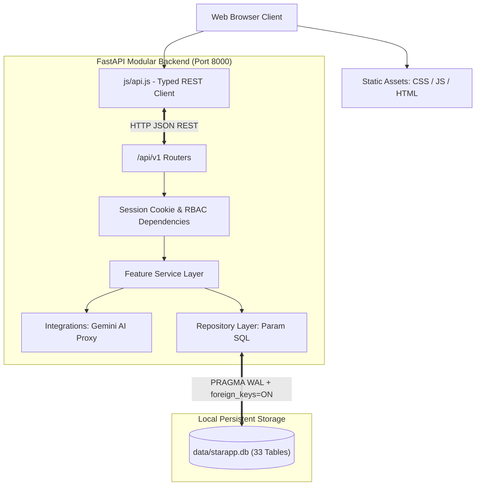

# STARAPP FULL-STACK ARCHITECTURE SPECIFICATION

> **Document Version:** 2.0.0-PROD  
> **Target Environment:** Local Full-Stack Application  
> **Backend:** Python 3.12 / 3.13 + FastAPI  
> **Database:** Authoritative Persistent SQLite3 (`data/starapp.db`)  
> **Frontend:** Native HTML5, Liquid-Glass CSS, Vanilla JS API Client (`js/api.js`)

---

## 1. System Topology

---

## 2. Layered Responsibilities

### 2.1 Frontend Presentation Layer
- **No Heavy Frameworks:** Preserves original responsive HTML/CSS/JS design tokens without React, Angular, or Vue overhead.
- **Client Communication:** Driven by `js/api.js`, providing unified fetch wrappers with session credentials (`credentials: "same-origin"`).
- **Security:** Zero plaintext API keys or credentials shipped to the browser.

### 2.2 API Layer (`backend/app/api/v1/` or `backend/app/features/*/router.py`)
- Thin controllers handling request validation via Pydantic models.
- Standardized HTTP status codes (200 OK, 201 Created, 400 Bad Request, 401 Unauthorized, 403 Forbidden, 404 Not Found, 409 Conflict).
- Centralized exception mapping via `StarAppException`.

### 2.3 Feature Service Layer (`backend/app/features/*/service.py`)
- Encapsulates all business rules, eligibility algorithms, and state machines.
- Coordinates database queries across multiple repositories within safe transaction boundaries.

### 2.4 Repository Layer (`backend/app/features/*/repository.py`)
- Pure parameterized SQL queries (`sqlite3.Cursor.execute(query, params)`).
- SQL injection immunity through explicit parameter binding (`?`).
- Object-to-dictionary mapping via `sqlite3.Row`.

### 2.5 Database Layer (`backend/app/database/`)
- Single authoritative persistent SQLite3 database on disk (`data/starapp.db`).
- Configured with `PRAGMA foreign_keys = ON;`, `PRAGMA journal_mode = WAL;`, and `PRAGMA busy_timeout = 5000;`.
