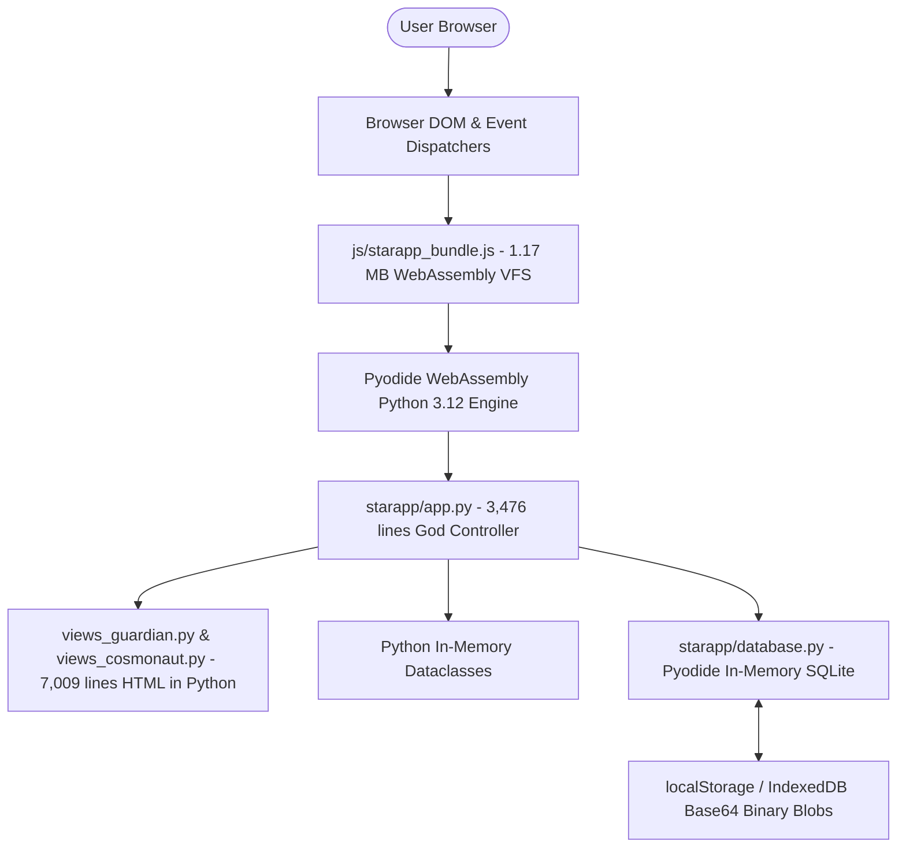

# CURRENT ARCHITECTURE AUDIT

> **Scope:** Pre-migration architecture of StarApp (`c:\Users\USER\Desktop\starapp_demo`)  
> **Date:** 2026-11-20  
> **Status:** Phase 0 Baseline Discovery Complete

---

## 1. Runtime Architecture

The original application runs entirely inside the client browser as an **in-browser Python monolith using Pyodide WebAssembly (Python 3.12)**.

### Key Execution Mechanics
1. **Bootstrapping:** `index.html` loads Pyodide from CDN, initializes the WebAssembly worker, and loads `js/starapp_bundle.js` into Pyodide's virtual in-memory filesystem.
2. **Dispatch Bridge:** DOM onclick handlers execute `dispatchAction(action, payload)`. This calls `pyodide.runPython("starapp.app.dispatch_action(...)")`.
3. **HTML Construction:** Python methods in `views_guardian.py` and `views_cosmonaut.py` construct massive multi-line f-strings with double-escaped braces (`{{` and `}}`).
4. **DOM Replacement:** The returned HTML string is directly assigned to `document.getElementById('app').innerHTML`.

---

## 2. Controller & Monolithic Coupling

The primary controller is `starapp/app.py` (3,476 lines), containing a single `StarApp` class with **114 dispatch actions**.

### Responsibilities Handled by `StarApp`:
- Navigation and view routing (Guardian, Cosmonaut, Reviewer, Modals).
- Authentication, role switching, and session management.
- Badge authoring, taxonomy cascading dropdowns, and Gemini prompt parsing.
- Higher-band reviewer eligibility checks ($Reviewer_{Band} > Badge_{Band}$).
- Reviewer dispatch, approval, rejection, and inline edits.
- Allotment assignment, deadlines, and milestone transitions.
- Project submissions, GitHub URL validation, and zip uploads.
- 50-mark rubric assessments and arithmetic validation.
- SQLite database initialization, PRAGMA checks, and schema migrations.
- Base64 state pickling, export, import, and IndexedDB sync.

---

## 3. Storage & State Synchronization

The system maintains state across 3 competing stores:
1. **In-Memory Python Objects:** Dataclasses defined in `starapp/models.py`.
2. **In-VFS SQLite3:** Database managed by `starapp/database.py` with 32 tables.
3. **Browser LocalStorage / IndexedDB:** Snapshot backups serialized as base64-encoded binary SQLite dumps.

---

## 4. Why Small Changes Took 25–40 Minutes

1. **Double Escaping in HTML-in-Python:** Modifying styling or JavaScript required editing Python strings where `{` and `}` had to be double-escaped. One mistake crashed the runtime with silent syntax errors.
2. **Virtual FS Packaging:** Any edit in Python required running `python scripts/pack_py.py` to regenerate `js/starapp_bundle.js`. Without this, stale code was served.
3. **Context Satiation:** Monolithic files of 3,500–4,800 lines consumed massive token windows, slowing AI agents down.
4. **Tri-State Drift:** Updating a single field required editing models, database DDL, controller state dumps, and unpickling handlers.
