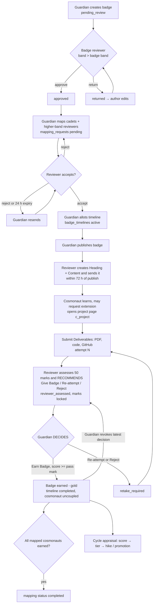
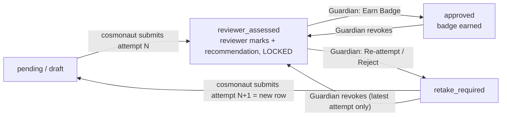
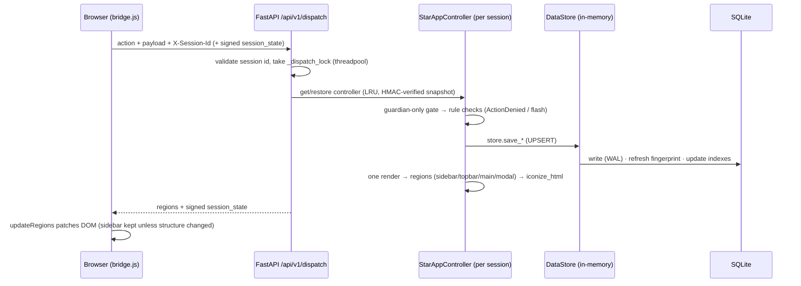

# Flowcharts & State Machines

All flows below describe the **real implemented behaviour** as of 2026-11-28 (verified against `starapp/app.py`, `storage.py`, `database.py`, `cycles.py`).
Action names in `monospace` are controller actions you can grep.

## 1. End-to-end badge lifecycle (text flowchart)

```text
┌─ GUARDIAN ───────────────────────────────────────────────────────────────────────────────┐
│ 1. CREATE BADGE   g_create_badge  (pick band, power/capability/skill; Gemini can draft     │
│    outcomes / topics / project prompt)            actions: create_badge, save_generated_badge│
│    badge.workflow_status = "pending_review", is_published = 0, is_allocated = 0            │
└───────────────┬──────────────────────────────────────────────────────────────────────────┘
                ▼   send_badge_review_request  → badge_reviewer_assignments(status=pending)
┌─ BADGE REVIEWER (band > badge band) or GUARDIAN ─────────────────────────────────────────┐
│ 2. REVIEW  g_badge_approval / c_requests (card) → c_badge_review (edit real badge, approve) │
│    authorize_badge_decision: status must be pending_review · assigned reviewer or guardian │
│    · Reviewer_Band > Badge_Band · never the author                                         │
│        ├── approve_submitted_badge ──► workflow_status = "approved"                        │
│        └── return_submitted_badge ───► "returned" (author edits + resubmits → pending_review)│
└───────────────┬──────────────────────────────────────────────────────────────────────────┘
                ▼ only "approved" badges can be mapped
┌─ GUARDIAN ───────────────────────────────────────────────────────────────────────────────┐
│ 3. MAP    g_mapping  : choose band → badge → cadets (that band) → reviewers (higher band)  │
│    + review window/anchor on the calendar        save_band_mapping → band_mappings          │
│    send_mapping_requests ──► mapping_requests(status=pending, expires_at = +24 h)           │
│    + notification to reviewers; Guardian and reviewer both see a live countdown             │
└───────────────┬──────────────────────────────────────────────────────────────────────────┘
                ▼
┌─ PROJECT REVIEWER ───────────────────────────────────────────────────────────────────────┐
│ 4. ACCEPT / DECLINE invitation   c_requests                                                 │
│        accept_mapping_request → mapping_requests.status = "accepted" (guardian notified)    │
│        reject_mapping_request → "rejected"                                                  │
│    (only the addressed reviewer or a guardian may act) · NO answer within 24 h ⇒ the request │
│    auto-becomes "rejected" + expired (both notified); late accept refused; the Guardian can  │
│    resend_mapping_request (fresh 24 h window)                                               │
└───────────────┬──────────────────────────────────────────────────────────────────────────┘
                ▼
┌─ GUARDIAN ───────────────────────────────────────────────────────────────────────────────┐
│ 5. ALLOT  g_allotment: cards (3 per row) → Timeline & Mapping (READ-ONLY view) and          │
│    Edit Badge (cosmonauts grouped per reviewer + the six timeline dates, glass calendar):   │
│    save_badge_form → _save_badge_allotment_edit; the Timeline view reflects every change    │
│    g_badge_allotment / save_allotment_timeline,                                              │
│    execute_cosmonaut_mapping  → badge_timelines per (cadet,badge): learning window, project│
│    window, submission_deadline, review_date, expected_award_date; status = "active";        │
│    badge.is_allocated = 1; assigned_cosmonaut_ids / assigned_reviewer_id set                │
│ 6. PUBLISH  publish_badge / publish_and_unlock_badge → is_published = 1 → cadets now see it │
│    (unpublish_badge / revoke_badge reverse it). Learning materials: g_materials             │
└───────────────┬──────────────────────────────────────────────────────────────────────────┘
                ▼
┌─ GUARDIAN → PROJECT REVIEWER (the mapped one) ───────────────────────────────────────────┐
│ 7. 72-HOUR PROJECT WINDOW  publish_badge stamps badge.published_at; each mapped reviewer    │
│    has 72 h to create + send the project (live countdown on the Badge Review card).         │
│    The cosmonaut has NO "Request Project" button any more ("Project Allocated" stays        │
│    disabled until the reviewer sends; the server action request_project is legacy only)     │
│ 8. CREATE + SEND PROJECT  c_badge_reviews → "Create Project" modal (pre-filled sample):     │
│    Heading + Content + checklist of the mapped cosmonauts → send_reviewer_project           │
│    → NEW row proj_<badge>_<reviewer>_<ms>_<id> status "released"; each recipient notified   │
│    heading required (≤200 chars), content required (≤20,000), only the mapped reviewer or   │
│    a guardian, only to cosmonauts mapped to that reviewer                                   │
└───────────────┬──────────────────────────────────────────────────────────────────────────┘
                ▼
┌─ COSMONAUT ──────────────────────────────────────────────────────────────────────────────┐
│ 9. LEARN  c_submission (Badges, landing page) / c_roadmap / c_badge_detail / c_materials     │
│    (milestone state: completed|active|locked); every card has Reviewer + Timeline buttons;   │
│    optional: submit_extension_request (once pending at a time) → guardian approves/rejects   │
│    "Project Allocated" unlocks → open_allocated_project_page → view c_project (its own PAGE; │
│    server guard _allocated_project_denied: badge allotted to me AND my project was sent)     │
│ 10. SUBMIT  glass "Submit Deliverables" dialog (render_cosmonaut_submission_modal):          │
│    submit_project_deliverable  — checks: a project was SENT to me · prerequisites approved   │
│    · badge allotted to me · not already earned · not awaiting the Guardian's decision ·      │
│    deliverables present (PDF report + code file + https GitHub URL; demo mode may fill       │
│    placeholders) · size ≤ ~9 MB. New row in project_submissions, attempt_number = previous+1 │
│    (edit in place only while the latest is pending); the mapped reviewer is notified and the │
│    reviewer's "Assessment" button (rv-assess) on Badge Review UNLOCKS                        │
└───────────────┬──────────────────────────────────────────────────────────────────────────┘
                ▼
┌─ PROJECT REVIEWER (the mapped one) — RECOMMENDS ONLY ────────────────────────────────────┐
│ 11. ASSESS  c_badge_reviews → Assessment button (disabled/locked `rv-assess is-locked`       │
│     until this cosmonaut submitted) → open_reviewer_assessment_page → c_assessment_detail    │
│     (deliverables + 50-mark rubric)   submit_reviewer_assessment                             │
│     5 criteria × 10 = 50 marks + recommendation Give Badge / Re-attempt / Reject             │
│     → marksheet asm_rev_<sub>_<attempt>, decision recommend_approve | recommend_resubmit |   │
│       recommend_reject (never "approve"); Give Badge refused below the badge pass mark       │
│     submission.status = timeline.status = "reviewer_assessed"; marks reach the cosmonaut's   │
│     marksheet AND the Guardian at once (notifications); marks are LOCKED for this attempt —  │
│     a second submit is refused, a new assessment exists only for a new attempt               │
└───────────────┬──────────────────────────────────────────────────────────────────────────┘
                ▼
┌─ GUARDIAN — DECIDES ─────────────────────────────────────────────────────────────────────┐
│ 12. FINAL DECISION  g_reviews (Assessment Dashboard: cards with an assessed reviewer are     │
│     highlighted "N awaiting your decision" / "Decide now") → g_review_detail                 │
│     submit_guardian_final_assessment — pre-filled from the reviewer's marks + recommendation │
│        ├── Earn Badge (score ≥ badge.passing_percentage, default 70, else refused) ──► PASS  │
│        │     submission "approved", timeline "completed", actual_award_date set,             │
│        │     marksheet asm_g_… decision "approve", uncouple_cadet_badge_mapping,             │
│        │     activity "badge_awarded", notification "Badge Earned"                           │
│        ├── Re-attempt ──► marksheet decision "resubmission_requested"                       │
│        └── Reject     ──► marksheet decision "rejected"                                     │
│              (both: submission + timeline "retake_required" → cosmonaut submits attempt N+1  │
│               → back to step 10; attempt N's marksheets stay on record: attempts append-only)│
│     The saved decision is LOCKED (panel read-only: "Decision saved: …" + Revoke button); a   │
│     second decision without revoking is refused ("already received a final decision")        │
│ 12b. REVOKE  open_revoke_decision_confirm → revoke_guardian_decision (Guardian-only; only    │
│     the LATEST attempt): deletes the Guardian marksheet (store.delete_assessment), submission│
│     → "reviewer_assessed" (reviewer marks untouched), timeline award date cleared, mapping   │
│     re-coupled (recouple_cadet_badge_mapping), cosmonaut + reviewer notified, activity       │
│     "guardian_decision_revoked" → the Guardian can decide again                              │
└───────────────┬──────────────────────────────────────────────────────────────────────────┘
                ▼
┌─ COSMONAUT / MAPPING ────────────────────────────────────────────────────────────────────┐
│ 13. BADGE EARNED  gold badge on the Badges card + badge page (`.gold-*`, `.mbe-card`),      │
│     c_results (ONE marksheet: latest evaluation, marks only), c_roadmap (milestone           │
│     completed, next unlocks), c_profile, leaderboard rank; counts toward the cycle appraisal│
│ 14. MAPPING END RULE  each earned cosmonaut is uncoupled from the mapping (added to          │
│     completed_cosmonauts, timeline "completed"); band_mappings.status becomes "completed"    │
│     only when ALL mapped cosmonauts have earned. On the reviewer's Badge Review schedule     │
│     the badge then moves from Upcoming Reviews to Completed Reviews ("All badges earned");   │
│     a revoke re-opens it                                                                     │
└──────────────────────────────────────────────────────────────────────────────────────────┘
```

## 2. Mermaid version



## 3. State machines

**Badge (`badges.workflow_status`)**: `pending_review → approved | returned`; `returned → pending_review` (resubmit). Flags: `is_published`, `is_allocated`. Only `approved` badges can be mapped/published.

**Mapping request (`mapping_requests.status`)**: `pending → accepted | rejected`; a guardian may delete a request. `rejected` carries `expired=true` when the 24 h window ran out (shown as "Expired"; only `resend_mapping_request` reopens it → `pending`, new `expires_at`); an explicit accept/decline stores `responded_at` and clears `expired`.

**Project REQUEST** (same table, `reviewer_project_prompts`): `requested` -> `fulfilled` (when the reviewer sends a project to that cosmonaut). Requests never count as projects (`get_reviewer_project_prompts(include_requests=False)` hides them).

**Reviewer project prompt (`reviewer_project_prompts.status`)**: saved by `send_reviewer_project` / `save_reviewer_project_prompt`; the status comes from the payload (default `"released"`; committed data holds `sent` and `released`). Cadets are resolved from the mapping (timelines / band_mappings / badge assignment) when not passed, and filtered to the cadets mapped to *this* reviewer.

**Badge timeline (`badge_timelines.status`)**: `active → reviewer_assessed → completed | retake_required`; `retake_required → reviewer_assessed` after the next attempt; **revoke**: `completed | retake_required → reviewer_assessed` (award date cleared).

**Submission (`project_submissions.status`)**: `draft|pending → reviewer_assessed → approved | retake_required` (code also recognises `resubmission_requested` as final).
New attempts are *new rows*. Rows with `approved` block further attempts. **Revoke** (Guardian only, latest attempt only): `approved | retake_required → reviewer_assessed`.



**Marksheet (`assessment_marksheets.decision`)**: reviewer → `recommend_approve | recommend_resubmit | recommend_reject` (legacy `reviewer_assessed` / `approve` / `request_revision` rows still exist and are read); guardian → `approve` | `resubmission_requested` | `rejected` (`approved` is also read as earned). A reviewer row is written once per attempt (`asm_rev_<sub>_<attempt>`); a Guardian row (`asm_g_<sub>_<attempt>`) is deleted only by a revoke.

**Band mapping (`band_mappings.data_json.status`)**: `active → completed` when every cosmonaut in the mapping is in `completed_cosmonauts` (each earned cosmonaut is added by `store.uncouple_cadet_badge_mapping`; a revoke removes them again and returns `completed → active`).

**Deadline extension**: `pending → approved | rejected` (guardian only).

**Cycle (`performance_cycles.status`)**: `active` / `evaluating` / `closed`. `activate_cycle` makes exactly one cycle active and closes any other `active`/`evaluating` cycle (sets `closed_at`), and enrolls every active user in it. `finalize_and_close_cycle` finalizes appraisals, closes the cycle and notifies people. Closed cycles are read-only (only `_CYCLE_READONLY_SAFE_ACTIONS` run).
**Appraisal (`cycle_performance_appraisals.status`)**: calculated → `finalized`.

## 4. Request/dispatch sequence



## 5. Performance-cycle flow

```text
create_six_month_cycle (clone cohort/enrollments)  →  activate_cycle (one active)
   → during the cycle: badges / reviews / grading accumulate under cycle_id
   → calculate_cycle_appraisals: per person → cosmo_score, reviewer_score, composite, tier, recommended hike %, promotion
   → update_cycle_appraisal (guardian remarks / approved hike %, bonus)
   → finalize_and_close_cycle: appraisal status finalized, cycle closed (read-only), notifications sent
```
