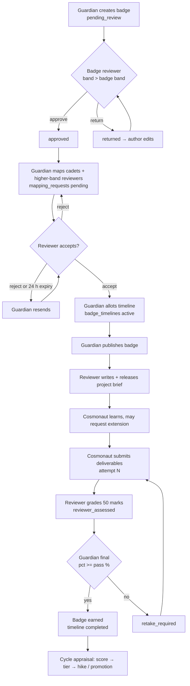
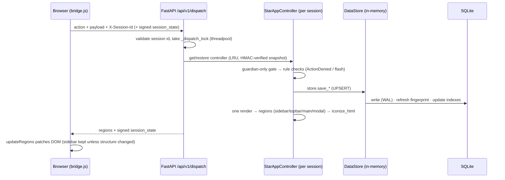

# Flowcharts & State Machines

All flows below describe the **real implemented behaviour** (verified against `starapp/app.py`, `database.py`, `cycles.py`).
Action names in `monospace` are controller actions you can grep.

## 1. End-to-end badge lifecycle (text flowchart)

```text
┌─ GUARDIAN ───────────────────────────────────────────────────────────────────────────────┐
│ 1. CREATE BADGE   g_create_badge  (pick band, power/capability/skill; Gemini can draft     │
│    outcomes / topics / project prompt)            actions: create_badge, save_generated_badge│
│    badge.workflow_status = "pending_review", is_published = 0, is_allocated = 0            │
└───────────────┬──────────────────────────────────────────────────────────────────────────┘
                ▼   send_badge_review_request  → badge_reviewer_assignments(status=pending)
┌─ BADGE REVIEWER (band > badge band) or GUARDIAN ─────────────────────────────────────────┐
│ 2. REVIEW  g_badge_approval / c_requests                                                   │
│    authorize_badge_decision: status must be pending_review · assigned reviewer or guardian │
│    · Reviewer_Band > Badge_Band · never the author                                         │
│        ├── approve_submitted_badge ──► workflow_status = "approved"                        │
│        └── return_submitted_badge ───► "returned" (author edits + resubmits → pending_review)│
└───────────────┬──────────────────────────────────────────────────────────────────────────┘
                ▼ only "approved" badges can be mapped
┌─ GUARDIAN ───────────────────────────────────────────────────────────────────────────────┐
│ 3. MAP    g_mapping  : choose band → badge → cadets (that band) → reviewers (higher band)  │
│    + review window/anchor on the calendar        save_band_mapping → band_mappings          │
│    send_mapping_requests ──► mapping_requests(status=pending, expires_at = +24 h)           │
│    + notification to reviewers; Guardian and reviewer both see a live countdown             │
└───────────────┬──────────────────────────────────────────────────────────────────────────┘
                ▼
┌─ PROJECT REVIEWER ───────────────────────────────────────────────────────────────────────┐
│ 4. ACCEPT / DECLINE invitation   c_requests                                                 │
│        accept_mapping_request → mapping_requests.status = "accepted" (guardian notified)    │
│        reject_mapping_request → "rejected"                                                  │
│    (only the addressed reviewer or a guardian may act) · NO answer within 24 h ⇒ the request │
│    auto-becomes "rejected" + expired (both notified); late accept refused; the Guardian can  │
│    resend_mapping_request (fresh 24 h window)                                               │
└───────────────┬──────────────────────────────────────────────────────────────────────────┘
                ▼
┌─ GUARDIAN ───────────────────────────────────────────────────────────────────────────────┐
│ 5. ALLOT  g_allotment: cards (3 per row) → Timeline & Mapping (READ-ONLY view) and          │
│    Edit Badge (cosmonauts grouped per reviewer + the six timeline dates, glass calendar):   │
│    save_badge_form → _save_badge_allotment_edit; the Timeline view reflects every change    │
│    g_badge_allotment / save_allotment_timeline,                                              │
│    execute_cosmonaut_mapping  → badge_timelines per (cadet,badge): learning window, project│
│    window, submission_deadline, review_date, expected_award_date; status = "active";        │
│    badge.is_allocated = 1; assigned_cosmonaut_ids / assigned_reviewer_id set                │
│ 6. PUBLISH  publish_badge / publish_and_unlock_badge → is_published = 1 → cadets now see it │
│    (unpublish_badge / revoke_badge reverse it). Learning materials: g_materials             │
└───────────────┬──────────────────────────────────────────────────────────────────────────┘
                ▼
┌─ PROJECT REVIEWER ───────────────────────────────────────────────────────────────────────┐
│ 7. PROJECT BRIEF  c_badge_reviews : write title/description/deliverables/requirements      │
│    send_reviewer_project → reviewer_project_prompts (status from payload, default           │
│    "released"; data also holds "sent"). Only the mapped reviewer or a guardian may release, │
│    and only to cadets mapped to that reviewer; cadets are notified                          │
└───────────────┬──────────────────────────────────────────────────────────────────────────┘
                ▼
┌─ COSMONAUT ──────────────────────────────────────────────────────────────────────────────┐
│ 8. LEARN  c_roadmap / c_badge_detail / c_materials (milestone state: completed|active|locked)│
│    optional: submit_extension_request (once pending at a time) → guardian approves/rejects  │
│ 9. SUBMIT c_submission  submit_project_deliverable                                          │
│    checks: prerequisites approved · badge allotted to me · not already earned · not awaiting│
│    final decision · deliverables present (PDF report + code file + https GitHub URL; demo    │
│    mode may fill placeholders) · size ≤ ~9 MB                                               │
│    new row in project_submissions, attempt_number = previous+1 (edit if latest is pending)  │
└───────────────┬──────────────────────────────────────────────────────────────────────────┘
                ▼
┌─ PROJECT REVIEWER (the mapped one) ──────────────────────────────────────────────────────┐
│ 10. FIRST ASSESSMENT  c_assessment_detail  submit_reviewer_assessment                      │
│     5 criteria × 10 = 50 marks → marksheet asm_rev_<sub>_<attempt> (decision               │
│     "reviewer_assessed"); submission.status = timeline.status = "reviewer_assessed";        │
│     cadet + guardian notified                                                               │
└───────────────┬──────────────────────────────────────────────────────────────────────────┘
                ▼
┌─ GUARDIAN ───────────────────────────────────────────────────────────────────────────────┐
│ 11. FINAL ASSESSMENT  g_reviews / g_review_detail  submit_guardian_final_assessment        │
│     defaults to the reviewer's marks (guardian can adjust)                                  │
│     pct = total/50 × 100                                                                    │
│        ├── pct ≥ badge.passing_percentage (default 70) ──► PASS                             │
│        │      submission "approved", timeline "completed", actual_award_date = today,       │
│        │      marksheet asm_g_… decision "approve", uncouple_cadet_badge_mapping,           │
│        │      activity "badge_awarded", notification "Badge Earned"                         │
│        └── below ──► submission "retake_required", timeline "retake_required",              │
│               marksheet decision "resubmission_requested" → cadet submits attempt N+1 (→ 9) │
│     A finalised attempt is immutable (no re-grading).                                       │
└───────────────┬──────────────────────────────────────────────────────────────────────────┘
                ▼
┌─ COSMONAUT ──────────────────────────────────────────────────────────────────────────────┐
│ 12. BADGE EARNED  c_results (marksheet), c_roadmap (milestone completed, next unlocks),    │
│     c_profile, leaderboard rank; counts toward the cycle appraisal                          │
└──────────────────────────────────────────────────────────────────────────────────────────┘
```

## 2. Mermaid version



## 3. State machines

**Badge (`badges.workflow_status`)**: `pending_review → approved | returned`; `returned → pending_review` (resubmit). Flags: `is_published`, `is_allocated`. Only `approved` badges can be mapped/published.

**Mapping request (`mapping_requests.status`)**: `pending → accepted | rejected`; a guardian may delete a request. `rejected` carries `expired=true` when the 24 h window ran out (shown as "Expired"; only `resend_mapping_request` reopens it → `pending`, new `expires_at`); an explicit accept/decline stores `responded_at` and clears `expired`.

**Reviewer project prompt (`reviewer_project_prompts.status`)**: saved by `send_reviewer_project` / `save_reviewer_project_prompt`; the status comes from the payload (default `"released"`; committed data holds `sent` and `released`). Cadets are resolved from the mapping (timelines / band_mappings / badge assignment) when not passed, and filtered to the cadets mapped to *this* reviewer.

**Badge timeline (`badge_timelines.status`)**: `active → reviewer_assessed → completed | retake_required`; `retake_required → reviewer_assessed` after the next attempt.

**Submission (`project_submissions.status`)**: `draft|pending → reviewer_assessed → approved | retake_required` (code also recognises `resubmission_requested` as final).
New attempts are *new rows*. Rows with `approved` block further attempts.

**Marksheet (`assessment_marksheets.decision`)**: reviewer → `reviewer_assessed`; guardian → `approve` | `resubmission_requested` (legacy data also has `request_revision`).

**Deadline extension**: `pending → approved | rejected` (guardian only).

**Cycle (`performance_cycles.status`)**: `active` / `evaluating` / `closed`. `activate_cycle` makes exactly one cycle active and closes any other `active`/`evaluating` cycle (sets `closed_at`), and enrolls every active user in it. `finalize_and_close_cycle` finalizes appraisals, closes the cycle and notifies people. Closed cycles are read-only (only `_CYCLE_READONLY_SAFE_ACTIONS` run).
**Appraisal (`cycle_performance_appraisals.status`)**: calculated → `finalized`.

## 4. Request/dispatch sequence



## 5. Performance-cycle flow

```text
create_six_month_cycle (clone cohort/enrollments)  →  activate_cycle (one active)
   → during the cycle: badges / reviews / grading accumulate under cycle_id
   → calculate_cycle_appraisals: per person → cosmo_score, reviewer_score, composite, tier, recommended hike %, promotion
   → update_cycle_appraisal (guardian remarks / approved hike %, bonus)
   → finalize_and_close_cycle: appraisal status finalized, cycle closed (read-only), notifications sent
```
